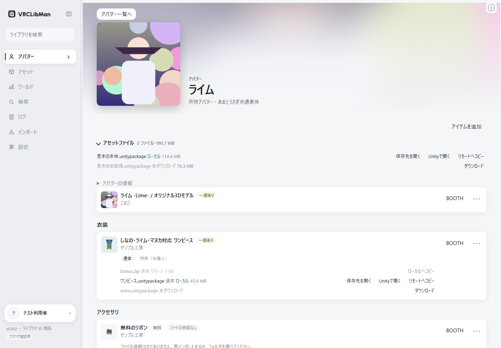
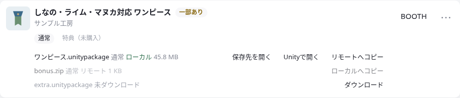
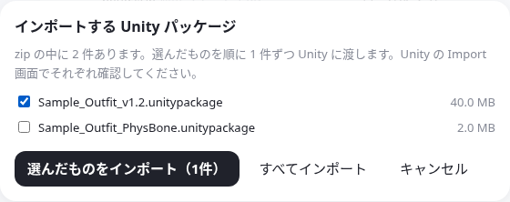

# VRCLibMan で、買ったアセットを使いやすく

「このアバターに着せられる服、何を持っていたっけ？」「ダウンロードした zip はどこに置いた？」。VRCLibMan は、BOOTH の商品情報と手元のファイルを結び付けて、改変に使いたいものを探すためのデスクトップアプリです。

内蔵ブラウザで BOOTH を使うと、商品の閲覧、入手後の登録、ファイルの取得・整理をアプリの中でつなげられます。最初にこれまでの購入情報を読み込んでおけば、新しく入手した商品も同じライブラリへまとめられます。

**[ダウンロード](https://github.com/KeisXR/VRCLibMan/releases) · [画面付きの使い方](../how-to-use.md) · [対応環境・通信・利用上の注意](../README.md)**

## 改変したいアバターから、持っているものを探す

BOOTH の購入履歴をたどったり、フォルダ名を思い出したりする前に、アバターを選びます。対応する衣装・髪・アクセサリなどをカテゴリ別に見られます。

対応表に共通素体が登録されていれば、その素体向けの商品も一緒に表示します。たとえばライムの詳細から、同じ素体として登録されているプラム向けの衣装も探せます。髪は頭部の対応が必要なので、そのアバターへの対応が登録されたものを表示します。

特定アバターに結び付かない商品は「汎用」から、調整して着せたい衣装は「ほかの衣装」から探せます。「ほかの衣装」は調整用の候補を探す欄で、着用できることを保証するものではありません。

## いつもの BOOTH 閲覧を、その後の管理につなげる

推奨する使い方は、アプリの内蔵ブラウザで BOOTH にログインする方法です。Windows / macOS / Linux では一覧の横にページタブを開けるので、ライブラリを見ながら商品ページも確認できます。必要なページを別ウィンドウへ移したり、ブックマークしておいたりもできます。Linux 版は実機未検証のテスト版です。

最初は「ライブラリ全取得」で、購入ライブラリ・ギフト・無料ダウンロードの商品情報をまとめて読み込みます。以後は、内蔵ブラウザの対応する購入完了ページや、自分でクリックしたダウンロードの保存完了から商品を登録できます。初回は「取得した商品の分類」で分類先を選びます。後回しにした商品も、あとから続けられます。

この自動登録は内蔵ブラウザで使う機能です。普段のブラウザから送る拡張機能も、アプリ内でのログインや閲覧を使いたくない人向けの代替手段として用意しています。

## ファイルを探し直す手間を減らす

登録した商品には、ファイルの「ローカル」「リモート」「未ダウンロード」などの状態が出ます。必要なものが手元にあるかを見て、保存先を開いたり、未取得の購入済みファイルを選んで1件ずつダウンロードしたりできます。

「ダウンロードを自動整理」をオンにすると、自分で取得した対象ファイルを、指定したライブラリフォルダへ商品 ID 別にまとめられます。商品カードからのダウンロードには、内蔵ブラウザのログイン、ライブラリフォルダ、自動整理の設定が必要です。

すでにダウンロード済みのファイルは、保存フォルダを調べて商品と結び付けられます。自動で決められないものは「確認」で選び直せます。NAS や共有フォルダを使っている場合は、リモートライブラリとのコピーもできます。

## 見つけたパッケージを Unity で開く

手元の zip や `.unitypackage` は「Unityで開く」から、設定した Unity の Import 画面へ渡せます。zip の中に複数のパッケージがあるときは、必要なものを選べます。商品を探してから、OS のフォルダで同じファイルを探し直す手間が減ります。

実際のインポートは Unity 側で内容を確認して進めます。VRCLibMan がプロジェクトへ自動でアセットを転送することはありません。Mac / Linux の Unity 連携は実機未確認です。

## アバター以外のアセットやワールドもまとめる

「アセット」では、衣装・髪・ギミックなどをジャンル別に探せます。「ワールド」では、ワールド向けの商品を別に管理できます。右パネルには商品のプレビューとファイル一覧を出せるので、一覧を離れずに画像や zip の中身を確認できます。

分類には BOOTH のカテゴリ・タグと、設定した分類モデルを使います。Ollama や対応する Mac の Apple オンデバイスモデルなら端末内で処理でき、手元でモデルを動かせない場合はクラウド API も選べます。誤分類は手動で修正・固定できます。

## 使い始める流れ

1. アプリと分類用モデルを準備し、セットアップで「アプリの内蔵ブラウザ」を選びます。
2. BOOTH にログインして「ライブラリ全取得」を実行し、「インポート」で分類します。
3. ファイルを置くライブラリフォルダを選び、ダウンロード済みのファイルを結び付けます。
4. 必要なら自動整理をオンにして、アバターやジャンルから使いたい商品を探します。

商品情報の読み込みとファイル本体のダウンロードは別の操作です。商品の購入、一括・無人の自動ダウンロード、年齢確認の自動通過は行いません。BOOTH の非公式アプリのため、利用前に [アカウントと利用規約についての注意](../README.md#利用規約とアカウントへの注意)を確認してください。

具体的な設定と操作は [使い方ガイド](../how-to-use.md)へ進んでください。

> 画像は現行 UI の見本データです。実際の商品画像・購入履歴・ログイン状態は含みません。
