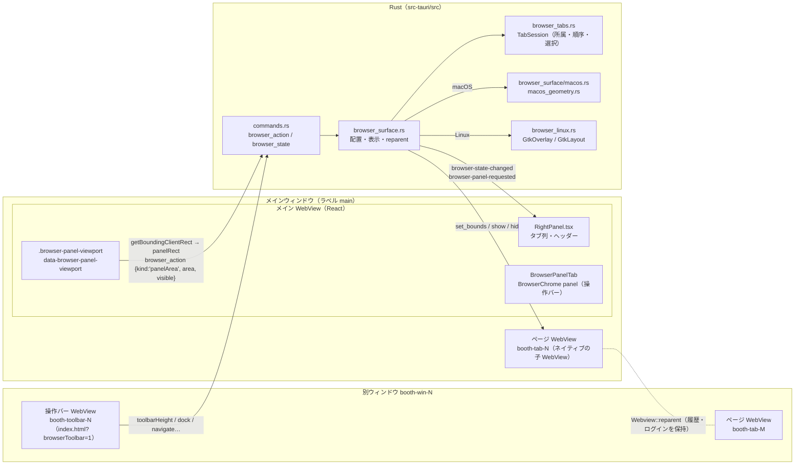

# 右パネル（右側サイドバー）の実装とデザイン

アプリの右端にある「右パネル」の仕組みをまとめた開発者向けの資料です。右パネルにはプレビュー、ファイル、内蔵ブラウザのページを同じタブ列で並べます。

- 対象: main `df68a64`（v0.2.4 と #135 の後）
- 書き方: この資料に出てくる名前、値、挙動は、コード、テスト、`AGENTS.md`、`docs/development.md`、`docs/verification.md`、PR の本文で確認したものです。確認できなかったことには **要確認** と付けています。
- 実機での確認状況は、リポジトリの記録に書かれている範囲だけを書いています。記録がないものを「確認済み」にはしていません。

一番難しいのは、内蔵ブラウザのページが HTML ではないことです。ページは OS のネイティブ WebView で、HTML の上に重ねて表示します。このため次のことが必要になります。

- 位置と大きさを、毎回 DOM で測って Rust に渡す
- メニューやダイアログが重なるときは、ネイティブ側を隠す
- OS ごとに座標系の違いを吸収する

過去の不具合（[§11](#11-過去の不具合と修正)）は、ほぼすべてこの3点から起きています。

---

## 目次

1. [目的と全体の挙動](#1-目的と全体の挙動)
2. [構成（DOM の領域とネイティブ WebView）](#2-構成dom-の領域とネイティブ-webview)
3. [タブの模型と保存](#3-タブの模型と保存)
4. [タブの種類](#4-タブの種類)
5. [開く・閉じる・並べ替え・ドラッグ・分離・復帰](#5-開く閉じる並べ替えドラッグ分離復帰)
6. [幅の変更・全面表示・浮かぶパネル・画面倍率](#6-幅の変更全面表示浮かぶパネル画面倍率)
7. [OS ごとの違い](#7-os-ごとの違い)
8. [IPC のコマンドとイベント](#8-ipc-のコマンドとイベント)
9. [設定と DB のキー](#9-設定と-db-のキー)
10. [デザイン](#10-デザイン)
11. [過去の不具合と修正](#11-過去の不具合と修正)
12. [テストと実行方法](#12-テストと実行方法)
13. [未確認のこと](#13-未確認のこと)
14. [拡張するとき](#14-拡張するとき)
15. [ファイルの一覧](#15-ファイルの一覧)

---

## 1. 目的と全体の挙動

右パネルは、一覧を見ながら補助の情報を横に出すための多用途の列です。#87 で、ChatGPT アプリ（旧 Codex）の右ペインを参考に追加しました。それまで GenreBrowser の中で左右に分けていた PreviewPane は、このとき「プレビュー」タブへ移しました。

| 項目 | 挙動 | 実装 |
| --- | --- | --- |
| 位置 | アプリ全体のグリッドの右端の列 | `src/useAppLayout.tsx`、`src/components/RightPanel.tsx` の `RightPanelColumn` |
| 開閉 | Ctrl+Shift+B（Mac は ⌘⇧B も可）、ヘッダーの ×。閉じている間は、ページ右上のタブ数のボタンでも開く | `isRightPanelShortcut`（`src/rightPanel.ts`）、`RightPanelLauncher` |
| 幅 | 左端の区切りをドラッグする。矢印キーなら16px ずつ。Home かダブルクリックで既定幅 | `ResizeSeparator grows="left"` |
| 浮かぶパネル | 窓幅が 1000px 未満なら、列にせずアプリの窓の中に浮かぶ小窓として表示。広い窓でもヘッダーの「ウィンドウとして浮かせる」で同じ表示にできる。動かせて大きさも変えられ、下の一覧は操作できる | `useAppLayout` の `narrow`、`panel.floating`、`FloatingPanel`、`src/floatingPanel.ts` |
| 全面表示 | 一覧を隠し、パネルが中央の列を使う。その場限りで保存しない | `maximized`。このとき `.main` に `hidden` を付ける |
| タブ | プレビュー、ファイル、各 Web ページ。ページは内蔵ブラウザが有効なときだけ | `RIGHT_PANEL_KINDS`、`mergePanelWebTabs` |
| 保存 | 開閉、幅、固定タブの並びと選択。ページの URL とタイトルは保存しない | [§9](#9-設定と-db-のキー) |

アセットとワールドの「プレビュー」ボタンは、右パネルを開いてプレビュータブを選びます。プレビュータブがすでに表示中なら、押すとパネルを閉じます（#87 の本文）。

---

## 2. 構成（DOM の領域とネイティブ WebView）

### 2.1 全体図



### 2.2 部品と役割

- **メイン WebView（`main`）**
  - React の画面全体です。右パネルの枠、タブ列、ブラウザの操作バー（`BrowserChrome panel`）は、すべてこの HTML の中にあります。
- **ページ WebView（`booth-tab-N`）**
  - 外部のページを表示するネイティブの子 WebView です。`Window::add_child`（Tauri の `unstable`）で、メインウィンドウか別ウィンドウにぶら下げます。
  - HTML の重なり順には入りません。必ず HTML より上に描かれます。
  - アプリの capability は与えません（`capabilities/default.json` は `windows: ["main"]` だけ）。
- **操作バー WebView（`booth-toolbar-N`）**
  - 別ウィンドウにだけあります。capability は `capabilities/browser-toolbar.json` です。
  - 窓のドラッグ、最小化、最大化、閉じるの権限だけを持ちます。
- **確認用 WebView（`booth-probe`）**
  - ログイン状態の確認に使います。タブではないので、右パネルには出しません。強制ダークの対象外です。

右パネルの中のページ（docked）には操作バー WebView がありません。操作バーはメイン WebView の HTML で、その下の `.browser-panel-viewport` の矩形にネイティブのページを重ねます。

### 2.3 状態を持つ場所

| 層 | 持つもの | 場所 |
| --- | --- | --- |
| `TabSession` | 全タブ（`BrowserTab`）。表示先（`SessionHost`：`panel` か `window-N`）ごとの `order`、`active_id`、`slot`。フォーカス中の表示先 | `src-tauri/src/browser_tabs.rs` |
| `Surface` | `TabSession`。実際に開いている表示先（`LiveHost`：`window_label`、`toolbar_label`、`generation`、`area`、`visible`、`toolbar_height`）の一覧 | `src-tauri/src/browser_surface.rs` の `static SURFACE` |
| `PREFER_WINDOW` | このセッションでページを別窓へ出したか（メモリのみ） | `browser_surface.rs` |
| React | 右パネルの開閉、幅、全面表示、タブ列（固定タブと Web タブの混在の順） | `useRightPanelState`（`RightPanel.tsx`） |

`BrowserState`（`browser_state` の戻り値）の `hosts[]` には、タブを持つ表示先だけが入ります。各要素は `id`、`kind`、`tabIds`、`activeId` です。`host` は大まかな表示先で、パネルにページがあれば `"panel"`、別窓にだけあれば `"window"` です。`panelSupported` は `panel_supported()` の値です。

### 2.4 矩形の同期（DOM → Rust）

`useDockedArea`（`src/components/BrowserPanel.tsx`）が、`.browser-panel-viewport` を測って送ります。

1. 測り直しの合図は次のとおりです。どれも `requestAnimationFrame` で1フレームにまとめます。
   - `ResizeObserver`（表示域そのもの）
   - `window` の `resize`
   - `MutationObserver`：`document.body` の subtree で、`childList` と、属性 `class` / `open` / `hidden` / `role` / `aria-modal` / `aria-expanded`
   - 500ms ごとの安全用 `setInterval`。大きさが変わらない移動（横の列が折りたたまれた場合など）を拾います
2. `panelRect`（`src/browserPanel.ts`）で、`getBoundingClientRect()` を DOM の内側に収まる整数 CSS px に直します。
   - 左と上は `Math.ceil`、右と下は `Math.floor` です。端数で HTML の操作バーへはみ出さないためです（#112）。
3. `browserPanelVisible` で表示するかを決めます。次のどれかに当たれば `visible: false` です。
   - 幅か高さが `BROWSER_PANEL_MIN_EDGE`（2px）未満
   - 浮かぶパネルを動かしている間、または大きさを変えている間（`document.body` に `right-panel-moving`）
   - 右パネル幅のドラッグ中、またはネイティブの `dragstart` から `dragend` / `drop` まで
   - `document.body.classList` に `tab-dragging` がある（タブのドラッグ中）
   - `BROWSER_PANEL_COVER_SELECTORS` に当たる要素が矩形に重なっている（`coveringRects`）
4. 直前と同じ報告なら送りません（`sameReport`）。違うときだけ `api.browserAction({ kind: "panelArea", area, visible })` を送ります。
5. アンマウント時、つまりタブを切り替えたときやパネルを閉じたときは、片付けで `panelArea` に `area: null, visible: false` を送ります。

`BROWSER_PANEL_COVER_SELECTORS` は次のとおりです。

```
[role="menu"], [role="dialog"], [role="alertdialog"], [aria-modal="true"], dialog[open],
.account-popover, .product-actions-panel, .avatar-add-panel, .preview-overlay, .setup-screen
```

`coveringRects` は、表示域そのものを含む層を数えません。浮かぶパネル（`.right-panel-float`）はこの一覧に入っておらず、中のページを隠しません。

浮かぶパネルは大きさを変えずに動くので、`ResizeObserver` では気づけません。`FloatingPanel` は位置が変わるたびに `window` へ `right-panel-moved` を送り、`useDockedArea` はこれを測り直しの合図にします。

Rust 側の流れは次のとおりです。

- **受け付け（`commands.rs`）**
  - `browser_action` の `PanelArea` は、`main_window_only` で、メインウィンドウからの呼び出しだけを受け付けます。
  - `panel_rect` → `SurfaceArea::from_panel` で値を検査します。有限値でなければ拒否し、範囲は 0〜`MAX_PANEL_EDGE`（16384）に収めます。
- **記録（`browser_surface::panel_area`）**
  - `panel` の `LiveHost` に記録します。`area` が `None` のときは前の矩形を残し、`visible` だけを false にします。
- **配置（`layout` → `layout_panel` → `place_tabs`）**
  - `panel_content` が、`visible` で幅と高さが 2 以上のときだけ矩形を返します。返らなければ、その表示先のページをすべて `hide()` します。
  - 矩形がある場合は、全ページに `set_view_bounds` してから、選択中のページだけを `show()` し、ほかは `hide()` します。
- **再適用**
  - メインウィンドウの `Resized` / `ScaleFactorChanged` では、`handle_window_event` が `layout` を呼び、最後の矩形を置き直します。ページは閉じません。
  - 子 WebView の自動リサイズはパネルの矩形に追従しないからです（#105）。

単位は CSS px のまま、論理座標として渡します。画面倍率は掛けません（`SurfaceArea::rect` のコメント「CSS pixels are already logical points」）。

### 2.5 別ウィンドウの配置

`layout_window` は、窓の `inner_size` を論理座標にして、`split(toolbar_height)` で上下に分けます。

- 上は操作バー WebView です。
- 下はページです。

`toolbar_height` は、操作バー（`BrowserChrome`、`!embedded`）が `ResizeObserver` で実際の高さを測り、`toolbarHeight` で送ります。Rust は 1〜420 に収めます（`measured_toolbar_height`）。初期値は `DEFAULT_TOOLBAR_HEIGHT` = 112 です。

112 は、タイトルバーを兼ねるタブ列 36、ナビゲーション 44、ツール行 32 の合計と一致します。`test/browser-panel-layout.test.mjs` が `chrome.height === 112` を確認しています。

---

## 3. タブの模型と保存

### 3.1 型（`src/rightPanel.ts`）

```ts
RIGHT_PANEL_KINDS = ["preview", "files"]
RIGHT_PANEL_KIND_INFO = {
  preview: { label: "プレビュー", singleton: true, available: true },
  files:   { label: "ファイル",   singleton: true, available: true },
}
interface RightPanelTab { id: string; kind: RightPanelKind | "web"; tabId?: string; title?: string }
```

- `id` はセッションの中だけで使う React の key です（`newTabId`）。保存しません。
- 固定の種類は `preview` と `files` だけです。どちらも1つまでです（singleton）。
- `web` はページのタブです。保存する種類ではなく、Rust の `hosts` の `panel` から作ります。
  - id は `web-${tabId}` です（`mergePanelWebTabs`、`focusWebTab`）。
  - `tabId` は Rust の `booth-tab-N` です。
  - タイトルが空なら「ページ」と表示します。
- 定数は次のとおりです。

| 定数 | 値 | 意味 |
| --- | --- | --- |
| `RIGHT_PANEL_MAX_TABS` | 12 | 固定タブを含めて追加できる上限 |
| `RIGHT_PANEL_LIST_MIN` | 360 | パネル幅を決めるとき、一覧に残す最小幅 |
| `RIGHT_PANEL_SEPARATOR` | 6 | 区切りの幅 |
| `RIGHT_PANEL_SHORTCUT_LABEL` | `"Ctrl+Shift+B"` | 閉じるボタンの title に出す文字（Mac でも同じ文字） |

- Rust 側にも同じ許可リストがあります（`src-tauri/src/model.rs`）。
  - `RIGHT_PANEL_KINDS = ["preview","files"]`
  - `RIGHT_PANEL_SINGLETONS = ["preview","files"]`
  - `RIGHT_PANEL_MAX_TABS = 12`
  - `DEFAULT_RIGHT_PANEL_TABS = {"tabs":["preview"],"active":0}`

### 3.2 操作（純粋関数）

| 関数 | 内容 |
| --- | --- |
| `parseRightPanelTabs` | 保存した JSON を読みます。未知の種類、singleton の重複、自由な文字列は捨てます。上限は12です。重複した側が選択中だったときは、残った方を選びます。壊れていれば既定（プレビューだけ）にします |
| `serializeRightPanelTabs` | 固定タブの種類の並びと `active` の位置だけを書きます。Web タブを選んでいるときは、その左にある最後の固定タブの位置を書きます |
| `pageTabsAllowed` | `builtinBrowser === true` のときだけページのタブを出します |
| `visibleTabs` / `activeTab` | このビルドで使える種類（`available`）とゲートで絞ります。隠したタブも設定には残ります |
| `openTab` / `canAddTab` | singleton がすでにあれば、そのタブを選びます。上限なら追加しません |
| `closeTab` | 閉じたタブの右隣、なければ左隣を選びます |
| `moveTab` / `placeTab` | 並べ替えです。`placeTab` の index は、取り除く前の位置で数えた「すき間」の番号です |
| `mergePanelWebTabs` | Rust の `panel` のページ一覧と合わせます。ユーザーの並びを保ち、出て行ったページは除き、来たページは末尾に足します。選択中が消えたら同じ位置か左隣を選びます |
| `focusWebTab` | 指定のページを選びます。タブがなければ末尾に足します |
| `webTabIds` | タブ列に並んでいる順のページ id。Rust の `reorderTabs` に使います |
| `rightPanelMaxWidth` / `fitRightPanelWidth` | [§6.1](#61-幅) を参照 |

### 3.3 保存されるもの・されないもの

- **保存するもの**
  - `right_panel_tabs`：固定タブの並びと選択だけです（例：`{"tabs":["preview","files"],"active":1}`）。
  - 開閉は `preview_pane`、幅は `preview_pane_width` に保存します。#87 で、もとのプレビュー欄の値をそのまま引き継ぎました。移行の処理はありません。
- **保存しないもの**
  - ページの URL とタイトル
  - 固定タブとページの混ざった並び（起動後、ページは末尾に足されます）
  - 全面表示
  - ファイルタブで最後に開いた場所（モジュール変数 `remembered` だけに持ちます）
  - ページの表示倍率
  - `PREFER_WINDOW`
- **古い設定の扱い**
  - #87〜#90 の時期にあった種類 `browser` は、#95 以降は読むときに捨てます（Rust の `normalize_right_panel_tabs` と TS の `parseRightPanelTabs`）。
- **書き込みの頻度**
  - `useRightPanelState` は、直列化した文字列が変わったときだけ `updateSettings({ rightPanelTabs })` を呼びます。
  - 幅は、ドラッグを確定したときに `previewPaneWidth` を書きます（`publishWidth`）。

### 3.4 ページの並びは Rust が正本

右パネルのタブ列でページを並べ替えると、`syncWebOrder` が `reorderTabs { hostId: "panel", tabIds }` を送ります。`TabSession::reorder` は、件数と中身が一致しない並びを拒否します（「タブの並びが一致しません」）。

固定タブとページの相対的な位置は、React の中だけで持ちます。

---

## 4. タブの種類

描画する部品は `src/components/rightPanelRegistry.tsx` の `RIGHT_PANEL_RENDERERS` です。

```ts
{ preview: PreviewTab, files: FilesTab }
```

ページのタブは registry を通りません。`PanelBody` が直接 `BrowserPanelTab unified` を出します。

### 4.1 プレビュー（`preview`）

- `PreviewTab` は `useLargePreview` で、選択中の商品を受け取ります。選択が変わると `#right-panel-body` の先頭までスクロールします。
- 本体は `src/components/PreviewPane.tsx` です。段階は `idle` → `adult` → `settling` → `loading` → `ready` → `fallback` です。
  - まず `cacheProductPreview(boothId, false, true)` を呼びます。
  - `PREVIEW_SETTLE_MS`（600ms）止まってから、`cacheProductPreview(boothId, true, true)` で大きな画像を取ります。選択を続けて動かしても、そのたびには取りません。
- R-18 の商品は、「表示する」を押すまで大きな画像を取りません（#87 で変更なし）。
- 事実欄（ショップ、ジャンル、ファイル）と BOOTH ボタンがあります。BOOTH ボタンは商品ページのリンク先設定に従います（#82）。
- 商品を選んでいないときは、空の文言を出します。文言は `panel.preview` があるかで変わります。
- 幅の定数は `src/previewPane.ts` の `PREVIEW_PANE_WIDTH = { min: 240, default: 300, absoluteMax: 1600 }` です。

### 4.2 ファイル（`files`）

読み取り専用の簡易エクスプローラーです（#89、#91、#94）。

- **UI（`src/components/FilesTab.tsx`、補助は `src/fileBrowser.ts`）**
  - 上部はパス欄（「移動」か Enter）と、「上の階層へ」「ライブラリ」「リモート」（つながるときだけ）「再読み込み」です。
  - 最初の場所は path `""` です。Rust がライブラリフォルダに解決します。
  - `.zip` で終わるパスを入力すると、その zip の目次を開きます（`isZipPath`）。
  - 欄の下に「ライブラリの中/外・読み取りのみ」を出します。商品 ID のフォルダには商品名を `（商品名）` の形で添えます（#94）。R-18 にはバッジを出します。
  - ファイルには「保存先を開く」を出します。`.unitypackage` には `UnityOpenButton` を出しますが、ライブラリかリモートのルートの中にあるときだけです。
    - `UNITY_OPEN_AVAILABLE = true`。#89 では false で、#91 で有効にしました。
  - 件数が上限に達したときは、打ち切ったことを表示します。
- **Rust（`src-tauri/src/file_browser.rs`、`commands.rs`）**
  - コマンドは `list_directory` / `list_zip_entries` で、async と `spawn_blocking` で動きます。
  - 書き込み、削除、移動、展開はしません。
  - パスは絶対パスだけを受け付けます。`..` は拒否します。
  - 待ちは5秒が上限です（`library_files::wait_for`）。
  - 件数の上限は、フォルダ 2000、zip 5000 です（`truncated`）。
  - UTF-8 の印がない zip の名前は Shift_JIS として読みます（`encoding_rs`）。
  - リンクは表示するだけで、たどりません。
- 詳しい約束は `AGENTS.md` の「ファイル」タブの段落にあります。

### 4.3 Web ページ（`web`）

- `BrowserPanelTab`（`src/components/BrowserPanel.tsx`）がタブを出します。
- `useBrowserHost` が `browserState` を読みます。読み直すのは、`browser-state-changed` を受けたときと、2秒ごとの定期確認です（別ウィンドウは OS からも閉じられるため）。
- 表示の分岐は次のとおりです（`BrowserPanelTab`）。

| 条件 | 表示 |
| --- | --- |
| `!panelSupported` | 「別ウィンドウ」で開く案内 |
| そのページの `host` が `window` | 「パネルに戻す」の案内 |
| ドックされていない | 「ブラウザを開く」 |
| ドック中 | `BrowserChrome panel hostId="panel" showPageTabs={!unified}` と `.browser-panel-viewport` |

- 右パネルの操作バー（`BrowserChrome` の panel 表示）は次のとおりです。
  - ページのタブ列は出しません（`unified` のため）。ページのタブは右パネルのタブ列そのものです（#95）。
  - 戻る、進む、再読み込み/停止、アドレス欄、ブックマークの☆、別ウィンドウで開く（`undock`）、および右端の「⋯」メニュー（`.browser-more`）があります。
  - メニューは `document.body` にポータルして、ツールバーや本文カードの overflow に切られない位置に固定表示します。
  - 「⋯」メニュー（`.browser-more-popover`、`role="menu"`）には、ズーム（`−` / 倍率 / `+` と 100% リセット）、購入ライブラリを開く、ブックマーク追加・編集、BOOTH のライブラリをインポート、別ウィンドウで開くをまとめています。
  - 「インポート」は booth.pm の `/library` のときだけ出します。
  - 「別ウィンドウで開く」（`undock`）があります。
  - ツール行は、ブックマークバー（Ctrl か中クリックで新しいタブ、右クリックで編集）と、ズーム（− / 倍率 / ＋）です。
  - ブックマークの編集欄は、名前が100文字まで、URL が4096文字までです。保存は最大200件です（`MAX_BOOKMARKS`）。
- 新しいタブの上限は全体で20です（`browser_tabs::MAX_TABS`）。右パネルと別窓の合計です。

---

## 5. 開く・閉じる・並べ替え・ドラッグ・分離・復帰

### 5.1 パネルの開閉

- 開閉するのは `useRightPanelState` の `open` です。保存先は `preview_pane` です。
- **パネルを閉じてもページは壊しません。** パネルを閉じると `BrowserPanelTab` がアンマウントされ、`panelArea` に `null/false` が届きます。Rust はページを `hide()` するだけです。
- ページを破棄するのは、ページタブの × だけです（#95、#105）。

### 5.2 ページを開く

- **右パネルから**
  - ＋メニュー（`AddTabMenu`）の「ブラウザ」か、案内の「ブラウザを開く」から、`openPage` → `newTab { hostId: "panel" }` を送ります。パネルに置けないときは hostId を付けません。
- **ほかの画面から**
  - インポート画面（`BuiltinBrowserImport`）の「ブラウザを開く」などは `open_booth_browser` を呼びます。
  - ここから `browser::open_browser` → `browser_surface::open` と進みます。
- **最初のセッションをどこで始めるか**
  - `start_in_panel(supported, prefer_window, main_visible)` で決めます。
  - `panel_supported()` が true で、このセッションでまだ別窓を選んでおらず、メインウィンドウが見えていれば、パネルで始めます。
- **パネルで開いたあと**
  - Rust は `browser-panel-requested`（payload は tabId）をメインウィンドウへ送ります。
  - `RightPanel.tsx` はこれを受けて、パネルを開き、そのタブを選びます（`focusWebTab`）。
- **ページ内のポップアップ**
  - 新しいタブにします（`on_new_window` → `new_tab_on`）。開くのは開いた元と同じ表示先です。
  - BOOTH と pixiv のログイン系の URL は、同じタブで移動します（`login_popup_in_same_tab`）。

### 5.3 タブの × で閉じる

- `closeTabById` → `closeTab { tabId }` を送ると、Rust は WebView を `close()` して `TabSession::remove` します。
- 表示先が空になったら `retire_if_empty` を呼びます。別窓なら、その窓を `destroy()` します。
- React 側では、隣のタブを選んで `selectTab` を送ります。

### 5.4 並べ替え（ドラッグとキーボード）

`PanelHeader`（`RightPanel.tsx`）と `src/tabStrip.ts` で行います。

- **押したとき（`pointerdown`）**
  - 押したタブを `drag.current` に覚えます。**ここではポインターを捕捉しません。**
- **動かしたとき（`pointermove`）**
  - `TAB_DRAG_THRESHOLD_PX`（6px）を超えたら、ドラッグとして扱います。
  - ここで初めて `.right-panel-tabs` に `setPointerCapture` し、`body.tab-dragging` を付けます。
- **閾値の前にタブ列から出たとき（`pointerleave`）**
  - ボタンが押されたままならドラッグとして捕捉します。離されていれば破棄します。
- **挿入位置**
  - `insertionIndex` が、各タブの中央を基準に決めます。2px の挿入線（`.right-panel-tab-insert`）を出します。
- **離したとき（`pointerup`）**
  - `dragOutcome` が次のどれかを返します。
    - `click`：閾値未満
    - `reorder`：窓の中で離した
    - `detach`：窓の外で離した Web タブ
    - `cancel`
  - `reorder` は `panel.arrange` → `placeTab` で並べ、Web タブなら `reorderTabs` を送ります。
- **Escape**
  - ドラッグ中なら取り消して、元の並びに戻します。
  - まだドラッグになっていない押下では Escape を横取りせず、アプリのほかの処理に渡します。
- **`pointercancel` / 捕捉を失ったとき**
  - 破棄します。
- **キーボード**
  - タブの上で ←/→ を押すと選択を移します。Alt+←/→ で並べ替えます。

### 5.5 ページを別窓へ出す（分離）

- **ページ1件を出す**
  - Web タブを**アプリの窓の外で**離したときだけ分離します（`pointerInsideWindow` が false）。
  - 右パネルの外に出ただけでは分離しません。ネイティブの `dragend` だけでも分離しません（`dragEndOnly` → `cancel`）。
  - `detachPage(tabId, screenX, screenY)` → `detachTab { tabId, x, y }` を送ります。
  - Rust の `detach_tab` は次の順に処理します。
    1. `detach_position`：値を検査し、±100000 に収め、y から 28 を引きます。負の座標はほかのモニターとして受け付けます。
    2. `add_window` → `build_browser_window(slot, Some((x, y)))`
    3. `register_live`
    4. `move_tab(tab_id, host_id, 0)`
    5. `reparent_tab`
    6. `install_browser_menu`
    7. `watch_browser_window`
    8. `retire_if_empty(from)`
    9. `PREFER_WINDOW = true`
    10. `layout` → `raise`
- **全ページを出す**
  - 操作バーの「別ウィンドウで開く」は `undock` です。右パネルのページを全部、新しい窓1つへ移します。
- **失敗したとき**
  - 所属、順序、選択を `MoveToken` で元に戻します（`restore` / `restore_moves`）。
  - 作りかけの窓は `discard_host` で捨てます。
  - 一部だけ reparent した後に失敗した場合は、移した分を元の窓へ reparent し直します（`reparent_ids`）。

### 5.6 右パネルへ戻す（復帰）

- **別窓のページを全部戻す**
  - 別窓の「パネルに戻す」は `dock { area: null, hostId }` です。その窓のページを全部右パネルへ移し、窓を閉じます。
  - 矩形を付けないのは、次にパネルが測って報告するからです（`commands.rs` のコメント）。
- **ページ1件を戻す**
  - `dockTab { tabId, index? }` です。
- **順序の約束（`dock`）**
  - セッション上でタブをパネルへ移します。
  - そのあと `live` から窓を外し、空になった表示先を消します。
  - 最後に `source.destroy()` します。
  - こうしないと、遅れて届いた `Destroyed` が、移したタブまで消してしまいます。
  - さらに `watch_browser_window` の `Destroyed` は、`generation` が一致するときだけ処理します（`destroy_matches`）。
- **データの扱い**
  - 移動は同じ WebView の `Webview::reparent` です。履歴、ログイン、ページ内の状態はそのまま残ります。
  - 保存してある表示倍率は、移したあとに `set_zoom` で掛け直します（#105）。

### 5.7 窓が閉じたとき

- **別窓を OS から閉じたとき**
  - その窓のタブだけを閉じます（`take_host` → `close_webviews`）。
- **メインウィンドウの `Destroyed`**
  - `panel` のタブだけを手放します。
- **ライブラリ全取得との関係**
  - ライブラリ全取得が使っているタブが消えたら、全取得を中止します（`request_library_walk_cancel`）。
- **操作できないとき**
  - 全取得中とダウンロード中は、タブの作成、選択、移動、閉じる操作をすべて止めます（`mutable()` → `BROWSER_BUSY_MESSAGE`）。

---

## 6. 幅の変更・全面表示・浮かぶパネル・画面倍率

### 6.1 幅

- **グリッド（`useAppLayout.tsx`）**
  - 列は左から、レール、6px、［ジャンル、6px］、`minmax(0,1fr)` です。
  - パネルをドックしていて全面表示でなければ、その右に 6px の区切りとパネル幅が続きます。
  - CSS 変数 `--right-panel-width` などにも値を書きます。
- **上限（`rightPanelMaxWidth(windowWidth, leftColumns)`）**
  - `min(1600, floor(窓幅/2), floor(窓幅 − 左の列 − 6 − 360))` です。下限は 240 で、これを下回りません。
  - `leftColumns` は、レール + 6、ジャンル列があればさらにジャンル + 6 です。
- **画面に出す幅（`fitRightPanelWidth`）**
  - `min(上限, 保存幅)` です。保存幅そのものは書き換えません。窓を広げれば元の幅に戻ります。
- **保存幅の範囲**
  - 240〜1600 です（`clamp_preview_pane_width`、TS の `clampStoredPreviewPaneWidth`）。
- **区切り（`ResizeSeparator`）**
  - `role="separator"` で、aria の値を持ちます。ポインターを捕捉してドラッグします。
  - 矢印キーで 16px（`UI_RESIZE_STEP_PX`）ずつ動かして確定します。Home かダブルクリックで既定の 300 に戻ります。
- **ドラッグ中**
  - ネイティブのページは隠れます（[§2.4](#24-矩形の同期dom--rust)）。WebView がポインターを奪わないようにするためです。

### 6.2 全面表示

- ヘッダーの「全面表示」「全面表示をやめる」で切り替えます。浮かぶパネルでは出しません。浮かせると全面表示は解除します。
- `.main` を `hidden` にし（`App.tsx`）、パネルが中央の `1fr` 列を使います。
- `.right-panel.maximized` は本文のカードの左にも余白を付け、本文の子要素を `max-width: 960px` で中央に寄せます。
  - プレビュー画像は `max-height: min(720px, 64vh)` です。
  - ページのタブ（`.right-panel-body-web > .browser-panel`）には 960px の制限を掛けません（#97）。

### 6.3 浮かぶパネル（狭い窓）

- 窓幅が 1000px 未満（`src/uiLayout.ts` の `UI_PANEL_OVERLAY_PX`）なら `narrow` です。このとき `panelDocked = open && !narrow` は false になり、パネルは浮かびます。
- 広い窓でも、ヘッダーの「ウィンドウとして浮かせる」で浮かせられます（`panel.floating`）。`useAppLayout` は浮かせたパネルを列に数えないので、一覧とジャンル列が幅を取り戻します。浮かせている間、広い窓ではヘッダーに「右側に戻す」を出します。狭い窓では列に戻せないので出しません。この選択は全面表示と同じくその場限りで、保存しません。狭い窓を経由して広げても浮いたままです。
- 列の幅は `computeAppLayout`（`src/uiLayout.ts`）がまとめて決めます。パネルの幅を先に決め、一覧が 480px を切るならジャンル列をやめてチップ帯にし、パネルの幅をもう一度決めます（[デザインガイドの狭い窓](design/README.md#狭い窓)）。860px 以下でサイドバーがアイコンだけになるのはパネルが浮いているときだけなので、列のパネルと同時には起きません。
- 左サイドバーの開閉は、右パネルが開いていても幅を動かします（`data-rail-motion="slide"`）。ドッキングしたページ（ネイティブビュー）は `useDockedArea` の rAF / ResizeObserver で矩形に追従します。パネルの矩形が変わらなければ `sameReport` で送信は起きません。
  - 開閉でパネル自体の left / width が変わるとき（`fitRightPanelWidth` の上限で幅が変わる、最大化）。ジャンル列の出入りだけではパネルは動かないので隠しませんは、`railMotionHoldsPanel` が真になり、`.app-shell` に `data-rail-hold` が付きます。その 220ms は `browserPanelVisible` が false を返し、ドラッグ中と同じくページを隠して HTML の地を見せます。
  - 実機（WebView2 / WKWebView）で追従中にちらつく場合は、右パネルが開いている開閉を常に hold にするのが代替案です。詳しくは[デザインガイドの動き](design/README.md#動き)。
- `FloatingPanel`（`RightPanel.tsx`）は `document.body` へのポータルで、`.right-panel-float`（`position: fixed`、z-index 20）の中に `.right-panel.floating` を置きます。
  - 背景幕はなく、`aria-modal` も付けません。どのタブでも一覧を操作でき、一覧で選んだ商品はそのままプレビューに出ます。Escape や外側のクリックでは閉じません。閉じるのは × と Ctrl+Shift+B です。
  - 一覧のポップオーバー（z-index 10〜12）より上、モーダルの重ね表示（z-index 30 以上）より下です。モーダルが重なると、中のページは `BROWSER_PANEL_COVER_SELECTORS` で隠れます。
- 位置と大きさは `src/floatingPanel.ts` の純粋関数で決めます。
  - 最初は右上（窓の端から 16px）に、幅 420px・高さ 720px を上限として出します。
  - 動かす：タブ列の空いたところか、左端のつまみ（`.right-panel-float-grip`、「右パネルを移動」）をドラッグします。タブ、＋、×などのボタンの上では動かしません。
  - 大きさ：左右の辺、下の辺、左下と右下の角（`.right-panel-float-edge`、幅 6px・角 14px）をドラッグします。引いた辺の反対側は動きません。最小は 260×220px です。
  - パネルは常に窓の内側に収め、端から 8px あけます（`clampFloatRect`）。ネイティブのページが窓の外へ出ないようにするためです。窓を縮めると収まるように詰め、広げると置いた位置に戻ります。
  - つまみは矢印キーで 16px 動かし、Shift+矢印キーで大きさを変えます。Home かダブルクリック（つまみかタブ列の空き）で右上に戻します。
  - 置いた位置はアプリを開いている間だけモジュール変数に持ち、保存しません。
- 浮かぶパネルの中にもページを置けます。動かしている間と大きさを変えている間は `right-panel-moving` でページを隠し、直前のスナップショットを見せます。置き終わると `right-panel-moved` で測り直して表示します。ページのカードは下に 8px あけ、ネイティブのページがリサイズの辺を覆わないようにします。

### 6.4 画面倍率（DPI）

- DOM の矩形は CSS px で、Tauri の論理座標と同じ単位です。どの OS でも倍率は掛けません。
- Windows は端数の DIP をそのまま渡します（`child_bounds`）。
- macOS は `snap_logical_points` で、各辺を四捨五入してから渡します。wry が子 WebView の幅と高さを整数ポイントに切り捨てるためです。
- Linux は GTK の margin と size_request に `as i32` で渡します（`place_panel_view`）。
- メインウィンドウの `ScaleFactorChanged` では、最後の矩形を置き直します。
- 倍率の扱いを CI で確かめているのは次の2つです。
  - Linux の `GDK_SCALE=1` と `2`（`linux_browser_panel_native`）
  - Chromium のテストでの CSS 幅の違い

### 6.5 ページの表示倍率（ズーム）

- 倍率はタブごとに持ちます。範囲は 25%〜500% で、初期値は 100% です。
- 段階は `next_zoom` の `LEVELS` です。
  - 0.25, 0.33, 0.5, 0.67, 0.75, 0.8, 0.9, 1.0, 1.1, 1.25, 1.5, 1.75, 2.0, 2.5, 3.0, 4.0, 5.0
- ページの WebView にだけ掛けます。操作バーは拡大しません。
- ネイティブ側で変わった倍率も読み戻します（`refresh_history` → `native_zoom`）。
- ナビゲーションと別窓への移動では倍率を残します。終了したら保存しません（#100）。

---

## 7. OS ごとの違い

`panel_supported()` は `cfg!(any(windows, target_os = "macos", target_os = "linux"))` で、現在は3つの OS すべてで true です。広げた順は、Windows（#90）、macOS（#105）、Linux（#128）です。

| | Windows | macOS | Linux |
| --- | --- | --- | --- |
| ページ WebView | WebView2 | WKWebView | WebKitGTK |
| パネルへの配置 | `set_bounds`（端数の DIP のまま） | `macos::set_panel_bounds`。`contentLayoutRect` を基準に `setFrame` し、`setClipsToBounds: true` | `browser_linux::set_view_bounds`。メイン WebView を `GtkOverlay` の主子にし、ページを overlay の子として margin と size_request で置く |
| 別窓への配置 | `set_bounds` | `set_bounds`（overlay タイトルバー込みの矩形） | `GtkLayout` に `put` / `move_` し、パネル用の margin と align を戻す |
| 丸め | なし | `snap_logical_points`（四捨五入） | `as i32`（切り捨て） |
| 別窓のタイトルバー | `decorations(false)`。タブ列がタイトルバーを兼ね、HTML のウィンドウ操作ボタンを出す | `TitleBarStyle::Overlay` と `hidden_title(true)`。標準ボタン用に `.browser-titlebar.macos { padding-left: 84px }` | `decorations(false)`（Windows と同じ） |
| 別窓のメニュー | `hide_menu`（ショートカットは残る） | アプリ、編集、ブラウザのメニューを表示 | `hide_menu`。非表示ではアクセラレータが効かないため、子 WebView のキー入力をネイティブで受けて `dispatch_shortcut` へ渡す |
| 枠のリサイズ | `set_resizable(true)` | 標準 | 子 WebView に自前の枠リサイズ処理（端から 5px）。`install_view_handlers` で1つのビューに1回だけ |
| データの保存先 | `data_directory(session_dir)` | `data_store_identifier(BOOTH_DATA_STORE_ID)` | `data_directory`。ログアウト用に `remember_profile` で WebsiteDataManager を持つ |
| そのほか | 同期 IPC の中で窓を作らない（WebView2 は再入できない）。async コマンドと `dispatch_ui` を使う | WebContent プロセスが終了したら、確認用以外の WebView を再読み込み（`on_web_content_process_terminate`） | メイン WebView の親が `gtk::Box` でなければエラー |

### 7.1 macOS の座標（#105 → #112 → #132）

- `NSWindow.contentLayoutRect` を、`convertRect:fromView:nil` でページの superview の座標に直します。その上端を DOM の原点として扱います（`macos_geometry::panel_frame`）。
- superview が `isFlipped` でなければ、y は `layout.y + layout.height − area.y − area.height` です。
- タイトルバーの高さを決め打ちせず、画面倍率も掛けません。リサイズや再ドックのたびに読み直します。
- 先に wry の `set_bounds` を呼ぶと、一瞬ブックマークバーの上にページが出ます。そのため `setFrame` だけを使います（`macos.rs` のコメント）。
- フルスクリーンでタイトルバーがないときは、ずらす量は 0 です（`fullscreen_without_a_titlebar_needs_no_inset`）。
- 別窓の overlay タイトルバーでは、この処理を通りません（`fill_host` のとき）。

### 7.2 OS ごとの確認状況（リポジトリの記録のとおり）

| 対象 | 記録 |
| --- | --- |
| Windows（WebView2）の右パネル埋め込み、クリック、ドラッグ、分離 | 各 PR（#95、#99、#100、#105、#118）で「実機未確認」と書かれています。実機での確認の記録は見つかりませんでした（**要確認**） |
| macOS の配置 | Mac CI（`native macOS browser panel`）で、実際の AppKit / WKWebView にマウス入力を送り、旧配置ではブックマークが押せないことと、新配置では押せることを確かめています（#132）。「Tauri 製品版全体や利用者の Mac の実行確認とは区別する」と書かれています |
| macOS の Retina、スリープ復帰、別窓との往復での履歴・ログイン・倍率 | 未確認（`docs/verification.md` の 2026-11-01） |
| Linux | 仮想 X11 とソフトウェア描画で、実 Tauri / GTK / WebKit のテストを `GDK_SCALE=1/2` で CI 実行しています。GNOME / KDE の実機、Wayland、GPU 描画、aarch64 の実機、署名済み AppImage、BOOTH の実ログインは未確認です（#128） |
| 強制ダーク | WebView2 での見た目は実機未確認、macOS / Linux は未検証です |

---

## 8. IPC のコマンドとイベント

配置・非表示通知の再送、アンマウント後の通知、Windowsの通信経路の復旧は [画面の通信と読み込みの復旧](communication-recovery.md) を参照。

### 8.1 コマンド

すべて `src-tauri/src/commands.rs` にあります。フロントからの呼び出しは `src/api.ts` です。ブラウザ見本では `src/preview/browser.ts` が代わりに応えます。

| コマンド | 呼べる WebView | 内容 |
| --- | --- | --- |
| `browser_state` | `main` と `booth-toolbar*`（`trusted_browser_controls`） | `BrowserState` を返す |
| `browser_action { action }` | 同上 | 下の表。戻り値は操作後の `BrowserState` |
| `save_browser_bookmark` / `delete_browser_bookmark` | 同上 | ブックマーク（`settings.browser_bookmarks`） |
| `open_booth_browser` / `close_booth_browser` | — | セッションを開く、すべて閉じる（`browser.rs`）。async で、`dispatch_ui` でメインスレッドへ渡す |
| `booth_browser_log` | — | 診断ログ（`booth-browser.log`） |
| `list_directory` / `list_zip_entries` | — | ファイルタブ |

`BrowserAction` の種類（Rust は `#[serde(tag = "kind", rename_all = "camelCase", deny_unknown_fields)]`、TS は `src/types.ts`）は次のとおりです。

| kind | 引数 | 処理 | 備考 |
| --- | --- | --- | --- |
| `newTab` | `url?`, `hostId?` | `new_tab_on` / `new_tab` | 操作バーからなら、その窓に開く |
| `navigate` | `url`, `tabId?`, `hostId?` | `navigate_tab` | `checked_url` で、アプリ内部の URL と認証情報付きの URL を拒否 |
| `selectTab` / `closeTab` | `tabId` | `select` / `close_tab` | |
| `back` / `forward` / `reload` / `stop` | `tabId?`, `hostId?` | `history_tab` など | |
| `zoom` | `action: "in"\|"out"\|"reset"`, `tabId?`, `hostId?` | `zoom_tab` | |
| `toolbarHeight` | `height`, `hostId?` | `toolbar_height` | 別窓の操作バーが送る |
| `dock` | `area: Rect\|null`, `hostId?` | `dock` | 別窓の「パネルに戻す」 |
| `undock` | — | `undock` | 右パネルの「別ウィンドウで開く」 |
| `panelArea` | `area: Rect\|null`, `visible` | `panel_area` | **`main` からだけ**（`main_window_only`） |
| `reorderTabs` | `hostId`, `tabIds` | `reorder` | |
| `detachTab` | `tabId`, `x`, `y`（画面座標） | `detach_tab` | |
| `dockTab` | `tabId`, `index?` | `dock_tab` | |

`Rect` は `{ left, top, width, height }`（CSS px、`deny_unknown_fields`）です。

`caller_host` は、操作バー WebView からの呼び出しなら、その窓の表示先を補います。`main` からの呼び出しでは補いません。パネルを操作するときは、メインウィンドウが `hostId: "panel"` を明示します。

### 8.2 イベント（Rust → フロント）

| イベント | 送り先 | 内容 | 受け取る場所 |
| --- | --- | --- | --- |
| `browser-state-changed` | 全体 | 状態が変わった | `listenBrowserChanged`（`useBrowserHost`、`RightPanel.tsx`） |
| `browser-panel-requested` | `main` だけ（`emit_to`） | payload の tabId を右パネルで出してほしい | `listenBrowserPanelRequested` → パネルを開いてタブを選ぶ |
| `browser-focus-address` | その操作バー | Ctrl+L / Ctrl+T の後でアドレス欄にフォーカス | `listenBrowserControlEvents` |
| `browser-operation-error` | 全体 | ショートカットや履歴操作の失敗の文言 | 同上 |
| `booth-browser-used` | 全体 | booth.pm の読み込みを終えた、または窓を閉じた | `api.ts`（アカウント表示などの更新） |

### 8.3 キーボードショートカット

- **右パネルの開閉**
  - Ctrl+Shift+B / ⌘⇧B（`RightPanel.tsx` の keydown）。Alt と同時なら反応しません。
- **右パネルの操作バー（埋め込み）**
  - フォーカスが操作バーの中にあるときだけ、Ctrl の ＋/=/−/0、L、T、W、R を処理します（`BrowserChrome`）。
  - ネイティブのページにフォーカスがあるときのキーは、ページ WebView が受け取ります。
  - Linux は `install_shortcuts` がネイティブで拾い、`dispatch_shortcut` へ渡します。
  - Windows / macOS のパネルで、ページにフォーカスがあるときにショートカットが効くかは **要確認** です。メニューのアクセラレータは別窓にしか登録していません。
- **別窓**
  - ネイティブのメニューのアクセラレータを使います（`install_browser_menu`）。React 側では二重に処理しません。
  - 新しいタブ CmdOrCtrl+T、閉じる CmdOrCtrl+W、アドレス CmdOrCtrl+L、再読み込み CmdOrCtrl+R です。
  - 戻る/進むは Mac が Cmd+[ / Cmd+]、それ以外は Alt+←/→ です。
  - 拡大は CmdOrCtrl+Shift+Equal と CmdOrCtrl+Equal、縮小は CmdOrCtrl+Minus、実際のサイズは CmdOrCtrl+0 です。
  - メニューのイベントは、その窓にフォーカスがあるときだけ処理します。

---

## 9. 設定と DB のキー

settings はキーと値の表です。どのキーも `INSERT OR IGNORE` で足したもので、スキーマ版は変えていません（`src-tauri/src/db.rs`）。

| キー | 既定 | 型と範囲 | TS の名前 | 意味 |
| --- | --- | --- | --- | --- |
| `preview_pane` | `"0"` | `"1"` / `"0"` | `previewPane` | 右パネルが開いているか |
| `preview_pane_width` | `"300"` | 240〜1600（`clamp_preview_pane_width`） | `previewPaneWidth` | 右パネルの保存幅 |
| `right_panel_tabs` | `{"tabs":["preview"],"active":0}` | `normalize_right_panel_tabs` で整える | `rightPanelTabs` | 固定タブの並びと選択。URL は入れない |
| `builtin_browser` | `"0"` | `"1"` / `"0"` | `builtinBrowser` | 内蔵ブラウザ。これが on のときだけページのタブを出す |
| `browser_force_dark` | `"0"` | `"1"` / `"0"` | `browserForceDark` | 強制ダーク。保存すると `sync_force_dark` で開いているページへすぐ反映 |
| `browser_bookmarks` | 行なし（読むときに「BOOTH」と「購入ライブラリ」を補う） | JSON の配列。最大200件 | — | ブックマークバー |

- `normalize_right_panel_tabs` は、TS の `parseRightPanelTabs` と同じ規則です（未知の種類と singleton の重複を捨て、上限12、選択位置を引き継ぐ）。読むときも書くときも通します。
- `right_panel_tabs` の型コメントは、`src/types.ts` の `Settings.rightPanelTabs` にあります。

---

## 10. デザイン

色、余白、角丸の全体の方針は [デザインガイド](design/README.md) にあります。この節では右パネルに関わる値だけを `src/styles.css` から抜き出しています。`src/styles.css` を変えたら `docs/design/tokens.css` も合わせてください（`AGENTS.md`）。

### 10.1 使うトークン

| 変数 | ライト | ダーク | 右パネルでの用途 |
| --- | --- | --- | --- |
| `--bg` | `#f5f6f8` | `#121214` | パネルの地 |
| `--surface` | `#fff` | `#1c1c1f` | 選択中のタブ、操作バー、ページの表示域 |
| `--surface-secondary` | `#f7f7f9` | `#26262b` | 押された・開いたアイコン |
| `--sunken` | `#f7f7f9` | `#26262b` | アドレス欄 |
| `--text` / `--text-secondary` | `#20222b` / `#858995` | `#f3f3f5` / `#9b9ba6` | 選択中 / 通常のタブ |
| `--line` | `#e9eaf0` | `#2e2e34` | 本文のカードの枠、選択中のタブの輪郭、ツール行の下の線、移動ボタンのまとまりとアドレス欄の枠 |
| `--hover` | `#f4f5f8` | `#2a2a30` | ホバー |
| `--button` | `#20222b` | `#f5f5f7` | 並べ替えの挿入線 |
| `--shadow` | `0 4px 16px rgba(0,0,0,.06)` | `0 4px 16px rgba(0,0,0,.28)` | 選択中のタブ、浮かぶパネル |
| `--radius-sm` / `--radius-pill` / `--radius` | 10px / 9999px / 18px | 同じ | タブ / × とアイコン / 浮かぶパネル |
| `--motion` | 160ms | 同じ | 背景、色、透明度の変化 |
| `--space-1`〜`--space-6` | 4 / 8 / 12 / 16 / 24 / 40 | 同じ | 余白 |

ダークは `@media (prefers-color-scheme: dark)` で切り替えます。OS の設定に従い、アプリにダークの切り替えはありません。

### 10.2 寸法

**枠とタブ列**

ChatGPT アプリのサイドパネルにならい、タブ列はアプリの地（`--bg`）に置き、その下の本文を白いカードにします。左の区切り線は引きません。

- `.right-panel`：枠線なし、地は `--bg`。
- `.right-panel-head`：`padding: var(--space-2) var(--space-2) var(--space-2) 0`、`gap: 4px`。タブの種類を切り替えても高さは変わりません。浮かぶパネルでは左を `--space-1` にして先頭に 24px 幅のつまみを置き、空いたところは `cursor: grab` です。全面表示では左にも `--space-2`。
- ヘッダー右端の並びは、列のときは「ウィンドウとして浮かせる」・全面表示・×、浮かせているときは「右側に戻す」（広い窓だけ）・× です。
- `.right-panel-tabs`：横スクロールで、スクロールバーは出しません（`scrollbar-width: none`）。`gap: 4px`。`flex: 0 1 auto` なので ＋ はタブの直後に並び、全面表示と × は `.right-panel-actions` の `margin-left: auto` で右端に寄せます。
- `.right-panel-tab`
  - 角丸は `--radius-sm`、文字は `--text-secondary` です。ホバーで `--hover` と `--text` になります。
  - 選択中は `--surface`、`font-weight: 650`、`--line` の 1px の輪郭と弱い影、`flex-shrink: 0` です。狭くてもラベルが潰れません。
  - どのタブも幅の上限は 240px で、タブ欄がそれより狭いときはタブ欄の幅です（`max-width: min(240px, 100%)`）。ページのタイトルが長くてもラベルが省略記号で切れ、× はタブ欄の内側に残って押せ、ほかのタブも潰れません。上限が無いと、縮まない選択中のタブが × ごとスクロールバーの無いタブ欄の外へはみ出し、ほかのタブは幅0になっていました。
  - タブのボタンは `padding: 6px 4px 6px 10px` で、種類のアイコン（`.right-panel-tab-icon`：プレビューは画像、ファイルはフォルダ、ページは地球儀）と、省略記号付きの1行のラベル（`.right-panel-tab-label`）を並べます。アイコンは `aria-hidden` で、タブの名前はラベルだけです。
  - **右パネルとブラウザのタブには、朱の線のアクセントを使いません**（[デザインガイド](design/README.md) の「タブ」）。
- タブの ×（`.right-panel-tab-close`）：22×22px、`--radius-pill`。ホバー中、選択中、`:focus-visible` のときだけ `opacity: 1` で、それ以外は 0 です。
- ヘッダーのアイコン（`.right-panel-icon`）：32×32px。`aria-pressed` / `aria-expanded` が true のときは `--surface-secondary` です。SVG は `stroke-width: 1.4`。
- 並べ替えの挿入線：幅 2px、上下の margin 6px、`--button`。
- ＋メニュー（`.right-panel-popover`）：`.account-popover` を流用し、`min-width: 168px`、ボタンの下 4px に出します。`role="menu"`。すでに表示中の singleton には「表示中」を添えます。

**本文**

- `.right-panel-body`：`padding: var(--space-2) var(--space-3) var(--space-4)`、`overflow-y: auto`、`overscroll-behavior: contain`。
- 本文は白いカードにします。`--surface`、`1px solid var(--line)`、角丸 `--radius-control`、`margin: 0 var(--space-2) var(--space-2) 0`。浮かぶパネルでは左右と下に `--space-2` をあけます。
  - カードの中のプレビュー（`.panel.preview-pane`）は、カードを二重にしないよう地と影を外します。
- ページのタブ（`.right-panel-body-web`）では padding を 0 にし、`overflow: hidden` にして、操作バーとページを縦に詰めます。カードは窓の下端まで伸ばし、下の枠と下の角丸を付けません。ネイティブのページは長方形で、HTML の角丸では切り抜けないからです。
  - 表示域はカードの左右 1px の枠の内側になります。`test:tab-click` と `test:browser-layout` の「幅の差 2px 以内」はこの枠を含めた許容です。
- 空の状態：「タブがありません。＋から追加できます。」

**閉じているときの入口（`RightPanelLauncher`）**

- パネルが閉じているときだけ、`.topbar` の右上（`position: absolute; top: 6px; right: var(--space-3)`）に 32×32px のボタンを出します。`.topbar` は sticky なので、一覧をスクロールしても同じ位置に残ります。
- 中身は `1.5px` の枠・角丸 5px の四角に、パネルが表示するタブの数（`launcherCountLabel`：`visibleTabs` の件数、100 以上は「99+」）を `tabular-nums` で書きます。ページのタブは内蔵ブラウザが有効なときだけ数えます。
- 押すと `panel.toggle` で開きます。狭い窓と、浮かせることを選んでいるときは浮かぶパネルで開きます。aria-label は「右パネルを開く（タブ N 件）」、title にショートカットを出します。
- ボタンと重ならないよう、`.topbar` のバナーと進捗（`.banner`、`.progress`）の右の余白を広げ、狭い窓のジャンルのチップ帯（`.chip-bar-track`）にも右の余白を足します。
- 全面表示では `.main` ごと隠れますが、そのときパネルは開いているので入口は要りません。

**浮かぶパネル**

- `.right-panel-float`：`position: fixed`、z-index 20。位置と大きさはインラインの `left / top / width / height` です。
- `.right-panel.floating`：`1px solid var(--line)`、`--radius`、`--shadow`、`overflow: hidden`。動かしている間（`.moving`）だけ影を `0 8px 28px rgba(0,0,0,.16)` に強めます。
- つまみ（`.right-panel-float-grip`）：24×32px、6 点のグリフ、色は `--faint`（ホバーで `--text-secondary`）。
- 辺（`.right-panel-float-edge`）：左右は幅 6px（上 12px・下 14px をあける）、下は高さ 6px、左下と右下の角は 14px 四方。見た目はなく、カーソルだけ変えます。

**区切り（`.resize-separator`）**

- 幅 6px、`margin: 0 -3px`。`::after` の線を、ホバー中かフォーカス中だけ出します。

**操作バー（`BrowserChrome`）**

| 部品 | 寸法 |
| --- | --- |
| 別窓のタブ列 | 36px（右パネルで出す場合は 40px） |
| ナビゲーション | 44px。戻る・進む・再読み込みは `.browser-nav-group`（高さ 32px、`--line` の枠のグループ、中のボタンは 28px、進むと再読み込みの間に 1px の仕切り）にまとめる。ほかのアイコンは 32px の円。アドレス欄は高さ 32px・`--radius-control` の角丸・`--sunken` |
| ツール行（ブックマークとズーム） | 32px。下に `--line` の線。ズームの倍率ボタンは `min-width: 48px` で、`tabular-nums` |
| ウィンドウ操作ボタン | 幅 46px。閉じるのホバーは `#c42b1c` |

- 右パネルの中では `.browser-chrome.panel` の margin、padding、枠、影、角丸をすべて外します。上の区切りは本文のカードの枠が兼ねます。
  - 通常のカード `.panel` と同じクラス名なので、打ち消しが必要です（#100、#113、#118）。
- `.browser-panel-viewport`
  - `flex: 1`、`--surface`、`padding: var(--space-4)`、`overflow: hidden` です。
  - メニューやダイアログが重なってネイティブ WebView を一時的に隠している間も、直前に取得したページの静止画（`.browser-panel-snapshot`、`browser_panel_snapshot` コマンド。macOS は `WKWebView` の `takeSnapshotWithConfiguration:`、見本画面は SVG）を同じ矩形に敷き、メニューの背後にページが見え続けるようにします。メモリ上だけで扱い、DB や設定には保存しません。静止画がまだないときだけ案内文を出します。
- 幅への対応は container query です（`.browser-chrome { container-type: inline-size }`）。
  - 520px 以下：「インポート」と、ホームのアイコン（`.browser-home`）を隠す
  - 360px 以下：アドレス欄の「開く」ボタンを隠す

### 10.3 フォーカスとキーボード

- すべての `:focus-visible` は、2px の `var(--text)` の輪郭で、offset は 2px です。
- タブ列は `role="tablist"`（aria-label「右パネルのタブ」）、各タブは `role="tab"` と `aria-selected` です。←/→ で選択、Alt+←/→ で並べ替えます。
- 各タブの × は、「〇〇のタブを閉じる」という aria-label です。
- 区切りは `role="separator"` と aria の値を持ち、矢印と Home で操作します。
- ＋メニューは Escape で閉じます。
- 浮かぶパネルはモードレスで、開いてもフォーカスを動かしません。つまみ（「右パネルを移動」）は矢印キーで移動、Shift+矢印キーで大きさ、Home で右上に戻します。
- ネイティブのページの中は、HTML のフォーカス順の外です。ページから HTML へ Tab で戻れるかは **要確認** です。

### 10.4 動きを減らす

- `@media (prefers-reduced-motion: reduce)` で、すべての animation と transition を止めます。
- タブの読み込み中の回転（`.browser-tab-loading`、800ms）にも、個別に止める指定があります。

### 10.5 強制ダーク（内蔵ブラウザのページ）

- 実装は `src-tauri/src/browser_dark.rs` です（#114）。
- 対象は表示用のページ WebView だけです（`is_page_webview`：`booth-tab-` に数字が続くもの）。確認用、操作バー、メイン画面には入れません。
- CSS は次のとおりです。`html` に掛けたものを画像系で打ち消します。BOOTH の商品カード・タグのバナー・ユーザーアイコンは `` ではなく、インラインの `style="background-image:url(...)"` で画像を描くので、インラインの style で背景画像を指定した要素（`html` と `body` を除く）も打ち消しの対象にします。打ち消した要素の中はすでに元の色なので、その中の画像系にはフィルタを掛けません（3回目の反転を防ぐ）。

```css
html{background-color:#fff!important;filter:invert(1)!important;}
img,video,canvas,embed,object,input[type='image'],svg image,
:not(html):not(body)[style*='background-image' i][style*='url(' i],
:not(html):not(body)[style*='background:' i][style*='url(' i]{filter:invert(1)!important;}
:is(上と同じ一覧) :is(上と同じ一覧){filter:none!important;}
```

- スタイルシートのクラスで指定した背景画像は検出しません。拾うにはページの要素を走査して属性を書き込む必要があり、ページの DOM を変えないという方針と合わないためです。疑似要素（`::before` など）の背景画像も反転したままです。
- `hue-rotate(180deg)` は使いません。0 か 255 で切れた色が元に戻らないからです。
- 付け方は `adoptedStyleSheets` で、使えなければ `style#vrclibman-force-dark` にします。付ける時機は次の2つです。
  - 文書開始の `initialization_script_for_all_frames`
  - 読み込み完了時の `eval`
- 設定を変えたら `sync_force_dark` が、開いているページへすぐ反映します。再起動は要りません。
- WebView2 の `WebContentsForceDark` を使わない理由は次のとおりです。
  - 起動時に固定される
  - 確認用を含む全体に効く
  - 切り替えに再起動が要る
- アプリ本体のダーク（OS の設定）とは別のものです。

---

## 11. 過去の不具合と修正

時系列です。日時は PR のマージ時刻を Asia/Tokyo に直したものです。

| PR | マージ（JST） | 内容 |
| --- | --- | --- |
| #87 | 11/01 09:57 | 右パネルを追加。プレビューをタブへ移す。`right_panel_tabs` を追加 |
| #89 | 11/01 10:10 | 「ファイル」タブ（読み取り専用） |
| #90 | 11/01 10:24 | ブラウザを右パネルに埋め込む（Windows）。`panelArea`、`reparent`、`browser-panel-requested`、`get_window("main")` |
| **#95** | 11/01 15:01 | ページを右パネルのタブ列に直接並べ、1件ずつ別窓へ出せるようにする |
| **#97** | 11/01 15:46 | ページの表示が帯状に縮む |
| **#99** | 11/01 18:25 | タブをクリックで切り替えられない |
| **#100** | 11/01 18:51 | 上下の余白を詰め、タブごとのズームを追加 |
| **#102** | 11/01 18:52 | CI のブラウザテスト2件が不安定 |
| #105 | 11/01 19:30 | macOS でも右パネルに表示する |
| **#112** | 11/01 23:07 | Mac でページがブックマークバーを隠す（1回目） |
| #113 | 11/01 22:57 | Liquid テーマの追加（#118 で削除） |
| **#114** | 11/02 01:17 | 強制ダークモード |
| #115 / #116 | 11/02 00:17 / 00:51 | 寸法と角丸の調整、元に戻す |
| #118 | 11/02 02:09 | デザインの切り替えを削除し、標準デザインに統一 |
| **#128** | 11/02 16:16 | Linux でも右パネルに表示する |
| **#132** | 11/03 13:06 | Mac でページがブックマークバーを隠す（原点のずれ） |

以下、太字の PR を中心に、症状・原因・修正をまとめます。

### #95 タブ列の統合と1件ずつの分離

- **変更**
  - 右パネルの「ブラウザ」タブの中に、もう1段ページのタブ列がありました。これをやめ、プレビュー、ファイル、各ページを同じタブ列に並べました。
  - ページの所属（`panel` か `window-N`）を Rust の `TabSession` が持つようにしました。右パネルと複数の別窓を同時に使えます。
- **約束**
  - 窓の外で離したときだけ分離します。`dragend` だけでは分離しません。
  - 失敗したら、所属、順序、選択を戻します。
  - パネルを閉じても、ページは破棄せず隠します。
  - ライブラリ全取得は、開始したときのタブに固定します。
  - 旧設定の `browser` は読み捨てます。
- **副作用**
  - このタブ列のドラッグ処理が #99 を生み、本文のクラスの変更が #97 を生みました。

### #97 ページの表示が帯状に縮む（v0.1.17）

- **症状**：右パネルのページの表示が細い帯になり、下が空きました。修正前は、高さ 947px の本文に対して表示域が 52px でした。
- **原因**：#95 で本文のクラスが `right-panel-body-web` に変わりました。しかし、縦に伸ばす CSS は旧クラス `right-panel-body-browser` に付いたままでした。
- **修正**
  - 今のクラスにレイアウトを当てました。
  - 全面表示のブラウザには、プレビュー用の 960px の制限を掛けないようにしました。
  - 実ブラウザで測る回帰テスト `test/browser-panel-layout.test.mjs`（WebKitWebDriver）を追加しました。
- **教訓**：DOM の矩形を固定する単体テストでは、高さの縮みは見つかりません（`docs/development.md`）。

### #99 タブをクリックで切り替えられない（v0.1.17〜）

- **症状**：プレビュー、ファイル、ページのタブをクリックしても切り替わりませんでした。←/→ キーでは切り替わりました。
- **原因**
  - #95 のドラッグ処理が、`pointerdown` の時点でタブ列に `setPointerCapture` していました。
  - Chromium（WebView2）は、捕捉中の押下で起きる `click` を、押したボタンではなく捕捉した要素へ送ります。
  - 実際の順は「`pointerdown`：タブ → `gotpointercapture`：タブ列 → `pointerup`：タブ列 → `click`：タブ列」でした。
- **修正**
  - 6px を超えてドラッグになってから捕捉します。
  - 閾値の前にタブ列から出たときは、ボタンが押されていればドラッグにし、離されていれば破棄します。
  - まだドラッグでない押下では Escape を横取りしません。
- **テスト**：`test/right-panel-tab-click.test.mjs`（`npm run test:tab-click`）。CDP で実際のマウス入力を送ります。修正前の main では4件失敗しました。
- **CI**：#99 の時点では、トークンにワークフローの権限がなく、CI に入れられませんでした。今は `ci.yml` の frontend ジョブで実行しています。

### #100 余白とズーム

- 右パネルのブラウザから、通常カード（`.panel`）用の padding と margin を外しました。ページを選んでいるときは、タブ列の上下も詰めます。
- 空の状態表示欄は描画しません。別窓のページ配置には、操作バーを実際に測った外寸を使います（`toolbarHeight`）。
- ブックマークバーの右端にズームを追加しました（[§6.5](#65-ページの表示倍率ズーム)）。

### #102 CI のブラウザテスト2件

- **タブのクリック**
  - ドロップ位置を「タブの左端どうしの差」から出していたため、余裕が 6.5px しかありませんでした。フォント幅が違う CI ランナーでは、並べ替えが起きませんでした。
  - 先頭タブの左端から 4px 内側に落とすようにしました。
- **レイアウト**
  - 最初の `browserState()` が返る前は、状態行（24px）が出ています。このときに測ると、136 ≠ 112 で落ちました。
  - 状態行が消えてから測るようにしました。#105 では、ドック表示にも同じ待ちを入れました。

### #105 macOS への対応（段階3）

- `panel_supported()` を macOS に広げました（Linux は #128 まで別窓のまま）。
- wry 0.57 が端数を切り捨てるため、四捨五入を入れました（`snap_logical_points`）。
- 子 WebView の自動リサイズがパネルの矩形に追従しないため、リサイズと倍率の変化で最後の矩形を置き直します。
- 移動後の `set_zoom` を追加しました。
- この時点では「タイトルバーの分のずれは不要」としていましたが、これは誤りでした。#132 で訂正しています。

### #112 Mac：ページがブックマークバーを隠す（1回目）

- **対策**
  - 埋め込みの WKWebView で `clipsToBounds` を有効にしました。
  - DOM の表示域を整数にするとき、左と上を切り上げ、右と下を切り下げるようにしました。
- **結果**：報告された重なりは、Linux の環境では再現できませんでした。Mac の実機での確認が残っていました。0.2.3 でも再発し、本当の原因は #132 で直しました。

### #113〜#118 デザインの変更と右パネル

- #113 で Liquid テーマを追加しました。このとき、ネイティブのページと接する `.browser-chrome.panel` をカード装飾から外しました。
- #115 で寸法を揃え、#116 で元に戻し、カプセル形の角丸だけを揃えました。
- #118 で Liquid とデザイン切り替えを削除しました。右パネルの操作バーの「影なし」の指定は、共通の CSS へ移しました。
- この間、`test:tab-click` は、ライト・ダークでの表示域の一致（1px 以内）と、操作バーに影と左右の枠がないことも確認するようになりました（8件）。

### #114 強制ダーク

[§10.5](#105-強制ダーク内蔵ブラウザのページ) を参照してください。

### #128 Linux への対応

- **実装**
  - メイン WebView を `GtkOverlay` の主子にして、画面全体に残しました。ページを overlay の子として、測った矩形に置きます。
  - それまでの方式では、Tauri が Linux の子 WebView を `GtkBox` に置くため、bounds が無視されます。もう1行の GtkBox として広がると、メインの UI が縮みます。
  - 別窓の `GtkLayout` へ移すときは、パネル用の margin と align を戻します。
  - キーとリサイズのハンドラは、ビューごとに1回だけ登録します。style class `vrclibman-browser-handlers` で、すでに登録したかを判定します。
- **テスト**：実 Tauri / GTK / WebKit のネイティブテスト `linux_browser_panel_native` を追加しました（`src-tauri/src/browser_surface/native_tests.rs`、`#[ignore]`、CI で `GDK_SCALE=1/2`）。

### #132 Mac：ページの原点をタイトルバーの下に合わせる

- **症状**：0.2.3 で、ブラウザを開いた直後から、ブックマークバーがページに隠れました。
- **原因**
  - Tauri は通常のタイトルバーでも FullSizeContentView を有効にします。
  - WKWebView の DOM は、タイトルバーを除いた内容領域を基準にします。一方、wry の子ビューの配置は親の NSView 全体を基準にします。
  - そのためページが 32pt 上にずれ、32pt のブックマーク行を覆っていました。Mac CI で実測しています（親が 600pt、`innerHeight` と `contentLayoutRect` が 568pt）。
- **修正**：[§7.1](#71-macos-の座標105--112--132) のとおりです。丸めとクリップ（#112）はそのまま残しています。
- **テスト**：`test/macos-browser-panel-layout.swift` と `test/fixtures/macos-panel-frame.rs` です。本体と同じ `panel_frame` を使い、実際の NSWindow にマウスイベントを送ります。

---

## 12. テストと実行方法

| コマンド | 内容 | CI |
| --- | --- | --- |
| `npm test` | 下記の node テストを含む全体 | frontend |
| `npx tsc --noEmit` | 型検査 | frontend |
| `npm run test:tab-click` | ヘッドレス Chromium に CDP で実際のポインター入力を送る。クリックの切り替え、6px 未満の揺れ、並べ替えと直後のクリック、Escape、ライト・ダークでの表示域の一致。`CHROME_PATH` で実行ファイルを指定。Chrome がなければスキップ | frontend（`CHROME_PATH=/usr/bin/google-chrome` に固定し、スキップさせない） |
| `xvfb-run -a -s '-screen 0 2000x1200x24' npm run test:browser-layout` | WebKitWebDriver（`webkit2gtk-driver`）で、表示域の縦横の充填、全面表示、サイズ変更（1908×1044、1440×900、1100×700）、タブ切り替え、640px の別窓用操作バー（高さ 112） | rust（Linux 両 CPU） |
| `cargo test --lib`（Linux は `xvfb-run -a cargo test --lib --features tauri/custom-protocol`） | `browser_surface::tests`、`browser_tabs` のテスト、`model` の正規化、`macos_geometry::tests` など | rust（Windows / macOS / Linux） |
| `linux_browser_panel_native`（`-- --ignored`） | 実 Tauri / GTK / WebKit。手順は `docs/development.md` の「Linux のネイティブ右パネル確認」。実行前に `npm run build` が必要 | rust（Linux、`GDK_SCALE=1`・`2`） |
| `rustc test/fixtures/macos-panel-frame.rs -o …` と `swift test/macos-browser-panel-layout.swift …` | 実際の AppKit / WKWebView でブックマークとページの両方を押せるか。3種類の窓サイズと別窓との往復 | `native macOS browser panel` |

右パネルに関わる node テスト（`npm test` に含まれる）は次のとおりです。

- `test/right-panel.test.mjs`：種類の許可リスト、保存の形、プレビューが右パネルにあること、設定の読み込みがブラウザの同期とは別に行われること、狭い窓のパネルがどのタブでも一覧を塞がないこと
- `test/browser-panel.test.mjs`：丸め、重なりとドラッグで隠すこと、浮かぶパネルを動かす間は隠すこと、ドックと分離の状態遷移、URL を保存しないこと、1ページだけ別窓へ出すこと
- `test/floating-panel.test.mjs`：浮かぶパネルが窓の内側に収まること、引いた辺の反対側が動かないこと、整数の矩形
- `test/narrow-layout.test.mjs`（`CHROME_PATH` があるとき）：実際の Chromium にマウス入力を送り、浮かぶパネルを動かす、辺で広げる、横の一覧で選ぶ、窓を縮めても収まる、右上に戻す、広い窓で浮かせて右側に戻す
- `test/ui-layout.test.mjs`：幅の補助関数
- `test/preview-pane.test.mjs`：プレビューの選択と、大きな画像の待ち
- `test/file-browser.test.mjs`：パスの補助、見本、読み取り専用、zip の開き直し、商品名のラベル

Rust のテストの例（`browser_surface.rs` の `mod tests`）は次のとおりです。

- `layout_uses_host_relative_coordinates_for_a_docked_panel`
- `docked_tabs_hide_until_the_panel_is_measured_and_uncovered`
- `panel_rectangles_reject_non_finite_values_and_stay_in_range`
- `new_sessions_start_in_the_panel_only_where_it_is_supported`
- `the_panel_host_never_owns_or_destroys_the_main_window`
- `docking_moves_the_session_before_the_old_window_is_destroyed`
- `detaching_reparents_before_retiring_and_restores_when_that_fails`
- `logical_points_are_rounded_before_macos_truncates_them`
- `resizing_the_main_window_reapplies_bounds_without_closing_pages`
- `moving_a_page_keeps_the_webview_and_reapplies_zoom`

見本の画面（`npm run dev`）では、`src/preview/browser.ts` が状態とイベントを真似ます。テストは `previewBrowserPanelArea()` で、最後に送った矩形を読みます。ネイティブの配置は動かないので、見本の成功は実機の確認の代わりにはなりません。

---

## 13. 未確認のこと

- **Windows（WebView2）**
  - 右パネルでのクリック、ドラッグ、分離、復帰の実機確認の記録は、リポジトリにありません。
  - #95 で挙げられた確認項目も残っています。
    - 分離後に履歴、ログイン、入力中の内容が残るか
    - 画面倍率、複数モニター、負の座標で、別窓が離した位置の近くに出るか
    - 失敗したときにパネルへ戻るか
    - ドラッグ中やメニュー表示中に、ネイティブ側が操作を遮らないか
    - 全取得の対象タブが固定されるか
    - ログアウトで全プロファイルが消えるか
  - 強制ダークの見た目も確認していません。
- **macOS**
  - 利用者の Mac での製品版全体の確認
  - Retina、スリープ復帰
  - 別窓との往復での履歴、ログイン、倍率
  - 強制ダークの見た目
- **Linux**
  - GNOME / KDE の実機、Wayland、GPU 描画、aarch64 の実機、署名済み AppImage、BOOTH の実ログイン
  - 強制ダークの見た目
- **WebView2 で Ctrl+Shift+B がほかの操作とぶつからないか**（#87）
- **浮かぶパネルの中のネイティブのページ**（Windows / macOS / Linux）：動かす・大きさを変える間に隠れ、置いたあとに矩形へ戻るか、パネルの丸い角とページの四角い角の見え方。Chromium の見本で確かめたのは、送る矩形と隠す合図だけです。**要確認**
- **パネルのページにフォーカスがあるときのショートカット**（Windows / macOS）：**要確認**（[§8.3](#83-キーボードショートカット)）
- **ネイティブのページから HTML へのキーボードでの戻り方**：**要確認**

---

## 14. 拡張するとき

### 14.1 固定タブの種類を足す

1. `src/rightPanel.ts`
   - `RIGHT_PANEL_KINDS` と `RIGHT_PANEL_KIND_INFO` に、label、singleton、available を足します。
   - 設定や機能で出し分けるなら、`RightPanelGates` と `kindAvailable` を合わせます。
2. `src-tauri/src/model.rs`
   - `RIGHT_PANEL_KINDS` と、必要なら `RIGHT_PANEL_SINGLETONS` に同じ名前を足します。
   - 足さないと、保存したときに Rust が捨てます。
3. `src/components/rightPanelRegistry.tsx` の `RIGHT_PANEL_RENDERERS` に部品を足します。部品は `{ panel, floating }` を受け取ります。
4. `test/right-panel.test.mjs` と Rust の正規化テストを更新します。settings はキーと値の表なので、スキーマ版は変わりません。
5. 中に、ネイティブのビューや、`BROWSER_PANEL_COVER_SELECTORS` に当たるポップオーバーを作るときは、[§2.4](#24-矩形の同期dom--rust) の条件を確かめます。

### 14.2 ネイティブのページに重なる UI を足す

メニュー、ダイアログ、ポップオーバーを足すときは、`role="menu"` / `role="dialog"`、`aria-modal="true"`、`<dialog open>` のどれかを使うか、クラスを `BROWSER_PANEL_COVER_SELECTORS` に足してください。どれでもないと、ネイティブのページの下に隠れて操作できません。

`MutationObserver` が見ているのは `class` / `open` / `hidden` / `role` / `aria-modal` / `aria-expanded` の変化だけです。ほかの属性で出し分ける場合は、500ms の安全用の確認まで反映が遅れます。

### 14.3 右パネルの配置や CSS を変える

- `.right-panel-body-web`、`.browser-chrome.panel`、`.browser-panel-viewport` の padding、margin、border、影を変えると、ページの表示域がずれます。
- 変えたら、少なくとも `npm run test:tab-click` と `npm run test:browser-layout` を実行してください。macOS の座標に関わる変更なら、Swift のテストも実行します（`docs/development.md`）。
- 通常カードのクラス `.panel` と `BrowserChrome` の `panel` 表示は、同じクラス名です。カード用の指定を広げるときは、打ち消しが効いているかを確かめてください。

### 14.4 表示先やタブ移動の処理を変える

- 移動は `TabSession` を先に動かし、失敗したら `MoveToken` で戻します。窓を壊すのは、`live` から外した後です（[§5.6](#56-右パネルへ戻す復帰)）。
- Windows では、同期コマンドの中で窓を作りません。新しいコマンドも `async` にして、`browser::dispatch_ui` を使います。
- `Surface` のロックを持ったまま、ネイティブの処理（`with_webview` など）を呼ばないでください。`with_active_tab` のコメントにあるとおり、ネイティブの処理が中でまた surface を読むことがあります。

---

## 15. ファイルの一覧

| ファイル | 役割 |
| --- | --- |
| `src/rightPanel.ts` | タブの種類、純粋なロジック、幅の上限、ショートカットの判定 |
| `src/components/RightPanel.tsx` | 状態（`useRightPanelState`）、ヘッダー、タブ列、ドラッグ、浮かぶパネル（`FloatingPanel`）、列 |
| `src/floatingPanel.ts` | 浮かぶパネルの位置と大きさ（窓に収める、移動、辺からのリサイズ） |
| `src/components/rightPanelRegistry.tsx` | 種類と描画部品の対応 |
| `src/components/PreviewPane.tsx`、`src/previewPane.ts` | プレビュータブ |
| `src/components/FilesTab.tsx`、`src/fileBrowser.ts`、`src-tauri/src/file_browser.rs` | ファイルタブ |
| `src/components/BrowserPanel.tsx` | ページのタブ。表示域を測って送る（`useDockedArea`） |
| `src/browserPanel.ts` | 丸め、重なり、ドラッグで隠す判定 |
| `src/tabStrip.ts` | ドラッグの閾値、挿入位置、結果の判定 |
| `src/components/BrowserChrome.tsx`、`src/components/BrowserTitleBar.tsx` | 操作バー（右パネル内と別窓）、別窓のタイトルバー |
| `src/useAppLayout.tsx`、`src/uiLayout.ts`、`src/components/ResizeSeparator.tsx` | グリッド、幅、区切り |
| `src/api.ts`、`src/types.ts`、`src/preview/browser.ts` | IPC、型、見本 |
| `src-tauri/src/commands.rs` | `browser_action`、`browser_state`、権限の確認 |
| `src-tauri/src/browser_surface.rs` | 表示先、配置、表示と非表示、reparent、メニューとショートカット |
| `src-tauri/src/browser_surface/macos.rs`、`macos_geometry.rs` | macOS の配置 |
| `src-tauri/src/browser_surface/native_tests.rs` | Linux のネイティブテスト |
| `src-tauri/src/browser_linux.rs` | GtkOverlay、GtkLayout、Linux のキーとリサイズ |
| `src-tauri/src/browser_tabs.rs` | `TabSession`、ズームの段階、URL の検査、ブックマーク |
| `src-tauri/src/browser_dark.rs` | 強制ダーク |
| `src-tauri/src/model.rs`、`src-tauri/src/db.rs` | `right_panel_tabs` の正規化、設定のキー |
| `src-tauri/capabilities/default.json`、`browser-toolbar.json` | 権限 |
| `test/right-panel*.mjs`、`test/browser-panel*.mjs`、`test/macos-browser-panel-layout.swift`、`test/fixtures/` | テスト |
