# VRCLibMan の使い方

VRCLibMan は、BOOTH の商品情報と手元のファイルを結び付け、アバターごとに衣装・髪・小物などを探せるアプリです。ワールドもまとめて管理できます。

はじめは **「内蔵ブラウザで BOOTH にログイン → これまでの商品情報を読み込む → 分類する → 手元のファイルを結び付ける」** の順に進めます。以後は内蔵ブラウザで購入・ダウンロードした商品の自動登録も使えます。内蔵ブラウザを使わない場合は、[Chrome / Edge の拡張機能](#拡張をインストールしてつなぐ)で商品情報を送れます。

どんな場面で便利かは [VRCLibMan の紹介](docs/introduction.md) を参照してください。商品情報の読み込みと、商品のファイルをダウンロードする操作は別々です。

このガイドはアプリ v0.8.0、拡張 v0.1.17 の実装と、ブラウザ確認用の画面をもとにしています。内蔵ブラウザを推奨する手順で説明します。

> 画面のデータは説明用のサンプルです。商品画像には頭文字や見本の図形を使っています。内蔵ブラウザのページ表示とログインも見本で、実際の BOOTH や実機の動作確認ではありません。利用可否は OS・環境によって異なります。

## 目次

- [1. 準備する](#1-準備する)
- [2. 初回セットアップ](#2-初回セットアップ)
- [3. BOOTH から商品情報を読み込む](#3-booth-から商品情報を読み込む)
- [4. 商品を分類する](#4-商品を分類する)
- [5. アバター・アセット・ワールドを見る](#5-アバターアセットワールドを見る)
- [6. 分類結果を見る・直す](#6-分類結果を見る直す)
- [7. 商品を除外・元に戻す](#7-商品を除外元に戻す)
- [8. 手元のファイルを結び付ける](#8-手元のファイルを結び付ける)
- [9. ダウンロードを自動整理する](#9-ダウンロードを自動整理する)
- [10. リモートライブラリを使う](#10-リモートライブラリを使う)
- [11. 設定を変更する](#11-設定を変更する)
- [12. 困ったとき](#12-困ったとき)
- [13. データの保存とバックアップ](#13-データの保存とバックアップ)

## 1. 準備する

### アプリをインストールする

[GitHub Releases](https://github.com/KeisXR/VRCLibMan/releases) から、お使いの OS 向けの配布物をダウンロードします。

| 環境                             | 配布物                                 | 導入方法                                                                                            |
| -------------------------------- | -------------------------------------- | --------------------------------------------------------------------------------------------------- |
| Windows                          | `VRCLibMan_<version>_x64-setup.exe`    | インストーラを起動して案内に従います。Windows 10 では WebView2 が別途必要になる場合があります。     |
| Apple Silicon Mac・macOS 14 以降 | `VRCLibMan_<version>_aarch64.dmg`      | dmg を開き、アプリを「アプリケーション」へ移して起動します。                                        |
| Chrome / Edge の拡張（代替手段） | `vrclibman-booth-export-<version>.zip` | 展開してブラウザに読み込みます。[拡張の導入手順](#拡張をインストールしてつなぐ)を参照してください。 |

Windows 版は未署名、Mac 版は正式なコード署名・公証がありません。OS の確認画面が出る場合は、取得元を確認してから OS の案内に従ってください。Intel Mac 向けの配布物はありません。

Linux x86_64 / aarch64 向けには `VRCLibMan_<version>_amd64.AppImage` / `VRCLibMan_<version>_aarch64.AppImage` を配布しています。実機未検証のテスト版です。CPU に合うファイルに実行権限を付け、`~/Applications` など自分で書き換えられる場所に置いて起動します。通常起動には FUSE が必要です。詳しくは [README](README.md) を参照してください。

## 2. 初回セットアップ

### アプリの紹介

初回起動時は VRCLibMan の紹介から始まります。商品は BOOTH のカテゴリとタグ、タイトルと説明文、ダウンロードファイルの名前から分類します。追加のソフトやモデルの準備は要りません。「はじめる」を押して BOOTH の読み込み方の選択へ進みます。

### BOOTH の読み込み方を選ぶ

**「アプリの内蔵ブラウザ」を選んで始めることを推奨します。** 商品情報の読み込みに加え、購入・ダウンロード後の自動登録や、商品カードからのファイル取得を使えます。拡張機能の導入やペアリングは不要です。

| 選択肢 | 使い方 |
| --- | --- |
| アプリの内蔵ブラウザ（推奨） | Windows / macOS / Linux の右パネルのページタブで BOOTH にログインします。別ウィンドウにも移せます。 |
| Chrome / Edge の拡張機能（代替手段） | アプリ内でのログイン・閲覧を使いたくない場合に、普段のブラウザから商品情報を送ります。 |
| 両方使う | 内蔵ブラウザと拡張を併用します。それぞれのログイン状態は別です。 |

初回セットアップでは、どの読み込み方も選ばれていない状態で始まり、選ぶまで「次へ」は押せません。「おすすめ」の付いた内蔵ブラウザを選ぶと、ログイン状態の保存・ファイル取得などの説明が出るので、確認して有効にしてください。選択はその場で保存され、あとから「設定 → BOOTH → BOOTH の読み込み方」で変更できます。拡張機能を選んだ場合は、ペアリングコードの下に「受信待ち」（まだ拡張から届いていない）か「受信済み」（拡張から届いた日時）が出ます。

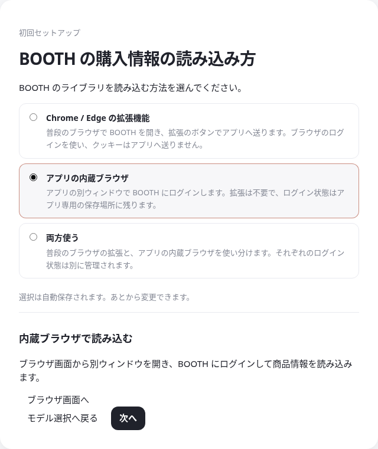

### 画面を操作しながら進める

読み込み方を選んだあとは、画面上のガイドに沿ってライブラリの全取得、未分類商品の分類、分類記録の見方と手動修正、ダウンロード済みファイルの登録を行います。操作は各画面で行い、ガイドで次の手順に進みます。ガイドには手順ごとに「未実施」「処理中」「完了」が出ます。終わった手順では「次へ」、まだの手順では「あとで行う」と出るので、押しただけで終わったことにはなりません。分類とファイルの照合には、事前に BOOTH の商品情報が必要です。ガイドは画面の下端の、左のサイドバーと右パネルの間に出ます。右パネルで開いた BOOTH のページを隠さないように、右パネルの手前で止まります。「折りたたむ」で小さくでき、折りたたんでも状態と進む操作は残ります。小さい窓ではガイドが最初から折りたたまれています。

手元のファイルは「インポート → 3. 手元のファイル」で取り込み元を選び、照合結果を確認して登録します。元の場所のまま登録するか、ライブラリへコピーするかを選べます。

### ダウンロードしたファイルの置き場所を選ぶ

続けて、BOOTH からダウンロードしたファイルを商品ごとにまとめる「ライブラリのフォルダ」と、ダウンロードの自動整理を選びます。

- 「フォルダを選ぶ」で、アセット用のフォルダを選びます。すでに zip や unitypackage を置いているフォルダでもかまいません。選んだフォルダは調べて、商品と結び付けます。
- 「ライブラリへ自動整理する」を選ぶと、自分でダウンロードしたファイルを、ダウンロードフォルダからライブラリのフォルダの商品 ID 別のフォルダへ移します。内蔵ブラウザで商品カードの「ダウンロード」を使うには、こちらを選びます。
- 「ダウンロード先に置いたままにする」を選ぶと、ファイルは移しません。

どちらかを選ぶと「次へ」を押せます。「あとで設定する」は何も変えずに進みます。あとから「設定 → ライブラリとダウンロード」で変更できます。

### 閉じたあとの動きを選ぶ

最後に、バックグラウンド動作とログイン時の起動を選び、「完了」を押します。「あとで設定する」を選ぶと、どちらもオフにしてセットアップを終えます。

- **バックグラウンドで動作**：ウィンドウを閉じても、商品情報の受信、自動整理、リモートへの自動同期を続けます。トレイまたはメニューバーから開き直したり終了したりできます。
- **ログイン時に起動**：バックグラウンド動作がオンの場合に使えます。PC へのログイン時、ウィンドウを出さずに起動します。

Linux でも AppIndicator 対応のトレイがあれば利用できます。トレイのメニューから「開く」「終了」を選びます（ダブルクリックは使いません）。GNOME では AppIndicator 対応の拡張が必要になる場合があります。ログイン直後にトレイが準備できていない場合や、デスクトップの再起動などで表示先がなくなった場合は、メインウィンドウを表示します。その間は窓を閉じると終了します。保存した常駐設定は残り、表示先が戻るとトレイを再表示します。AppImage の保存場所を変えた場合は、新しい場所で一度起動すると、ログイン時起動の登録先も更新されます。

「完了」か「あとで設定する」を押すと、ライブラリの状態に合わせた画面へ移ります。商品情報がまだ無ければ「インポート → 1. BOOTH から読み込む」、未分類の商品が残っていれば「インポート → 2. 分類」、そうでなければ「アバター」（アバター本体が無ければ「アセット」）です。

セットアップは「設定 → デバッグ → メンテナンス → セットアップを再表示」から開き直せます。

## 3. BOOTH から商品情報を読み込む

左メニューの「インポート」の「1. BOOTH から読み込む」で商品情報を読み込み、続けて同じ画面で分類・フォルダの調査を進めます。購入済みの商品が多い場合も、初回にまとめて情報を取り込めます。

### 内蔵ブラウザで読み込む

1. 「設定 → BOOTH → BOOTH の読み込み方」で「アプリの内蔵ブラウザ」または「両方使う」を選び、説明を確認します。
2. 左メニューの「インポート」を開き、「1. BOOTH から読み込む」の「ブラウザを開く」を押します。
3. 開いたブラウザで、BOOTH にログインします。Windows・macOS・Linux では右パネルのページタブに開きます。
4. インポート画面へ戻り、目的に合う操作を選びます。

| ボタン                         | 用途                                                 |
| ------------------------------ | ---------------------------------------------------- |
| ライブラリを開く | 内蔵ブラウザで購入ライブラリを開きます。 |
| ライブラリ全取得               | ライブラリ、ギフト、無料ダウンロードをページごとに読み込み、最後まで読めたら続けて未分類の商品を分類します。 |
| 中止                           | 全取得を途中で止めます。                             |

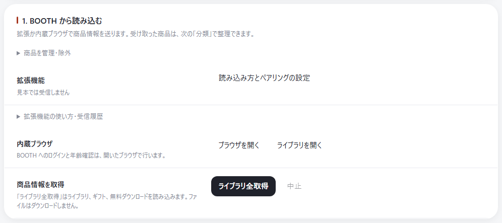

「ライブラリ全取得」は、ページを読み終えたあと、公開情報（カテゴリとタグ）をまだ読んでいない商品を 1 件ずつ約 3 秒おきに確認します。初回は 100 件でおよそ 5 分かかります。進み具合と残りの目安は画面上部に出ます。中止しても、公開情報は次回の全取得で続きから確認します。

最後まで読めたら、続けて未分類の商品を自動で分類します。分類の進み具合も画面上部に出て、「インポート → 2. 分類」の「中断」で止められます。中止したときや、ログイン切れ・年齢確認・BOOTH の応答待ちで途中停止したときは分類しません。そのときは、ログイン状態を確認してから読み込み直すか、「インポート → 2. 分類」の「未分類を分類」を押してください。

「設定 → BOOTH の読み込み方」の「BOOTHへのアクセス間隔」は初期値の **1.0秒（推奨）** を基本にします。公開の商品情報の確認には別途3秒以上の間隔が入ります。読み込みが制限された場合は表示された案内に従ってください。[利用上の注意](README.md#利用規約とアカウントへの注意)も確認してください。

選択中の BOOTH ライブラリページだけを読み込むときは、ブラウザ操作バーの「インポート」を使います。商品ページや一般サイトの内容は、この操作ではインポートできません。任意の商品ページを手動で送る必要がある場合は、代替手段の拡張を使います。購入・ダウンロード後の自動登録は、下の別の機能です。全取得やダウンロードの処理中は、タブ切り替えとページ移動を一時的に無効にします。

内蔵ブラウザのログイン状態は端末内に保存されます。選んだ 1 件のファイルを取得するときは、アプリ側が対象 URL の Cookie を読み出し、最初の HTTPS の BOOTH ダウンロード要求だけに使用します。リダイレクト先へは引き継ぎません。拡張機能は Cookie をアプリへ送らず、普段のブラウザ自身が取得します。

Cookie の保存と保護は OS・WebView の仕組みに依存し、VRCLibMan 独自の暗号化は行いません。同じ OS ユーザー権限で動く別のプログラムからのアクセスを防ぐ保証はありません。

共有 PC などでログイン状態を残したくない場合は、「内蔵ブラウザの閲覧データを削除」を使います。内蔵ブラウザで開いたすべてのサイトのログイン状態と閲覧データを削除し、商品情報・分類結果・ブックマークは残します。

### 内蔵ブラウザで取得した商品の自動登録

内蔵ブラウザでは、購入完了ページと、本人がクリックしたBOOTHのダウンロードの保存完了を検知して、商品をライブラリに登録します。初回に「取得した商品の分類」が開くので、アセットのジャンル・ワールド・アバター本体を選んで確定します。複数商品は順に確認します。既に確認・手動分類した商品や再ダウンロードでは繰り返し聞きません。購入やファイルの取得を自動で行う機能ではありません。

「後で分類する」や Esc を選んでも登録は残ります。今出ている分だけの後回しで、画面左下の「取得した商品の分類」から再開できます。新しい未分類の商品が届くと、確認を開き直します。再起動後も分類待ちは残ります。「設定 → BOOTH」の「取得したアセットの自動登録」でオフにできます。既定はオンで、オフにしても登録済みの商品・分類・ログインは消えません。セットアップで内蔵ブラウザを選んでいれば利用できます。

追跡対象のダウンロードは、ダウンロードフォルダ内の一意な `VRCLibMan-*` フォルダへ保存します。ファイルの自動整理がオンなら、保存成功後に指定したライブラリへ整理します。オフならダウンロード先に置いたまま登録します。商品を一意に特定できない場合や、未対応の支払い・ダウンロード画面では自動登録を見送り、従来のインポートやファイル登録を利用できます。

### 商品ページも内蔵ブラウザで開く

「設定 → BOOTH → 商品ページを開くブラウザ」を「内蔵ブラウザ」にすると、アバター詳細・アセット・プレビューの商品リンクも内蔵ブラウザで開けます。既定は「既定のブラウザ」です。取得中やエラーのときは OS の既定のブラウザで開きます。

### 内蔵ブラウザを暗くする

「設定 → BOOTH → BOOTH の読み込み方」で内蔵ブラウザを使っているとき、「強制ダークモード」をオンにできます。既定はオフです。

オンにすると、ライトテーマのページ（BOOTH など）も、内蔵ブラウザの中では背景が暗く、黒い文字は明るくなります。画像・動画・キャンバスは元の色のままです。色の付いた文字やボタンは、明るさも色相も反転します。右パネルのページタブと、別ウィンドウに切り出したページの両方に反映されます。再起動は要りません。開いているページにはすぐに変わります。設定を変えたあと別のページへ移ると、読み込みが終わるまで元の色が一瞬見えることがあります。そのときはそのページを再読み込みしてください。

ログインや入力はそのまま操作できます。ログイン状態は変わりません。画像に白い背景が含まれていると、その部分は明るく残ります。CSS で指定した背景画像は色が反転することがあります。

Windows の WebView2 での見た目は実機未確認です。macOS と Linux も未検証です。

内蔵ブラウザのタブ・ブックマーク・ショートカット

アドレスバーから一般のサイトも開けます。「＋」でページタブを追加し、各タブの「×」で閉じます。別ウィンドウは、最後のページタブを閉じるとその窓も閉じます。別ウィンドウでは、タブ列の空いている場所をドラッグしてウィンドウを移動できます。

「☆」でブックマークを保存し、ブックマークバーの「⋯」から編集・削除できます。Ctrl（macOS は Command）を押しながらクリックすると、新しいタブで開きます。ブックマークは再起動後も残りますが、タブは復元しません。

| ショートカット | 操作 |
| --- | --- |
| Ctrl / Command + T | 新しいタブ |
| Ctrl / Command + W | タブを閉じる |
| Ctrl / Command + L | アドレスバーへ移動 |
| Ctrl / Command + R | 再読み込み |
| Ctrl / Command + ＋ / − | ページを拡大・縮小 |
| Ctrl / Command + 0 | ページの表示倍率を100%に戻す |
| Windows: Alt + ← / →、macOS: Command + [ / ] | 戻る・進む |

右パネルでは、ショートカットはブラウザの操作バーにフォーカスがあるときだけ効きます。ほかの画面の操作とぶつからないようにするためです。

ブックマークバー右端の「−」「倍率」「＋」でも、ページを25%〜500%に拡大・縮小できます。倍率を押すと100%に戻ります。倍率はタブごとに保持し、別ウィンドウへ移しても引き継ぎます。

タブは 20 個、ブックマークは 200 件まで保存できます。

#### 右パネルのブラウザ（Windows・macOS・Linux）

Windows・macOS・Linux では、内蔵ブラウザを右パネルのページタブに表示します。右パネルの「＋ → ブラウザ」や、インポート画面の「ブラウザを開く」から開けます。サイドバーの「ログイン」や、内蔵ブラウザで開く BOOTH のリンクからも、このタブに開きます。タブの見た目は右パネルのほかのタブと同じです。

- ページタブをドラッグして並べ替えられます。アプリのウィンドウの外で離すと、そのページだけを別ウィンドウへ移します。操作バーの「別ウィンドウで開く」は、右パネルのページタブをまとめて別窓へ移します。
- 右パネルと複数の別ウィンドウを同時に使えます。各窓はそれぞれのタブを持ちます。「パネルに戻す」で、その窓のタブを右パネルへ戻せます。移動してもページの履歴とログインは引き継ぎます。
- ページはアプリの画面より手前に表示されるため、メニューやダイアログが重なるときや、幅・タブをドラッグしている間は一時的に隠れます。操作が終わると戻ります。
- 窓幅が狭いときは、右パネルが窓の中に浮かぶ小窓になり、ページもその中に表示します（[狭い窓の右パネル](#狭い窓の右パネル)）。小窓を動かしている間と大きさを変えている間は、ページが一時的に隠れます。
- 右パネルで別のタブに切り替えたりパネル全体を閉じたりしても、ページは閉じません。ページタブの「×」はそのページだけを閉じます。別窓の「×」はその窓のページだけを閉じます。
- ページタブの URL・タイトル・並びは再起動時に復元しません。ブックマークと、固定タブの「プレビュー」「ファイル」の並びは残ります。
- 内蔵ブラウザを使わない設定にすると、ページタブは利用できません。

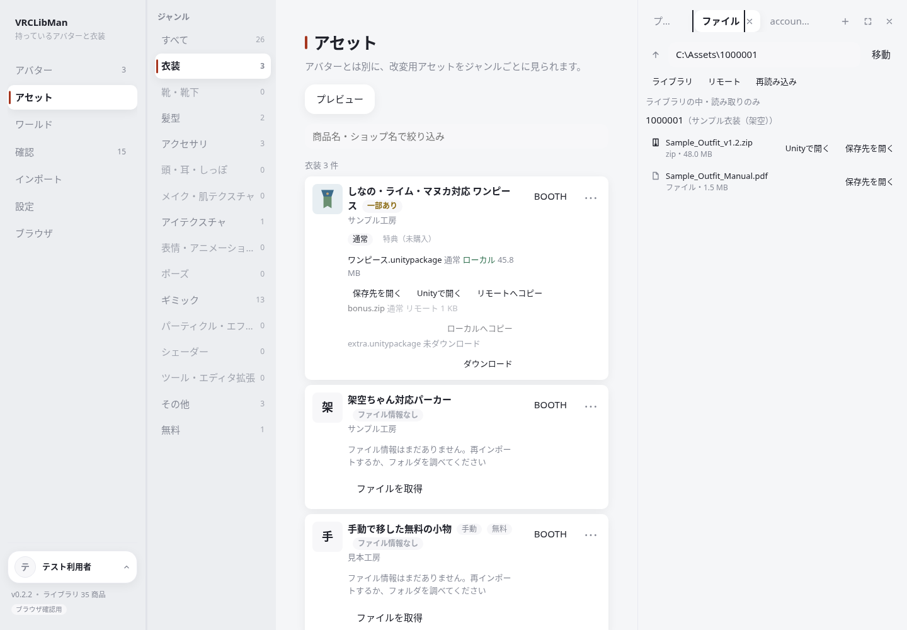

Linux 版も右パネルと別ウィンドウの両方に対応します。利用環境で表示が合わない場合は、別ウィンドウへ移して使用してください。

### 内蔵ブラウザを使わない場合

アプリ内で BOOTH にログインしたくない場合や、普段のブラウザで操作したい場合は拡張機能を使います。以下の導入・ペアリングは拡張を使う人だけに必要です。アプリ内の商品カードからのファイル取得は内蔵ブラウザ用です。拡張では、BOOTHで対象ページを開き、拡張ポップアップから1件ずつ取得できます。BOOTH上の所持・保存記録と対応アバター表示も使えます。[拡張の詳しい使い方](docs/browser-extension.md)

### 拡張をインストールしてつなぐ

1. Releases の拡張 zip を、残しておける場所に展開します。アプリのインストールとは別に行います。
2. Chrome では `chrome://extensions`、Edge では `edge://extensions` を開きます。
3. 「デベロッパーモード」または「開発者モード」をオンにします。
4. 「パッケージ化されていない拡張機能を読み込む」を選び、展開した **`manifest.json` が入っているフォルダ** を指定します。
5. アプリの「設定 → BOOTH → BOOTH の読み込み方」で「Chrome / Edge の拡張機能」または「両方使う」を選びます。
6. 表示された「ペアリングコード」をコピーし、ブラウザの拡張ポップアップへ貼り付けて「コードを保存して接続を確認」を押します。

アプリを起動した状態で使ってください。コードを作り直した場合は、拡張側にも新しいコードを保存します。

### 商品情報を送る

1. 拡張の「ライブラリを開く」から [BOOTH の購入ライブラリ](https://accounts.booth.pm/library) を開き、ログインします。
2. 拡張のポップアップで、目的に合うボタンを押します。

| ボタン                 | 用途                                                                                                 |
| ---------------------- | ---------------------------------------------------------------------------------------------------- |
| このページを送る       | 今開いている商品ページやライブラリページを読み込みます。特定商品の情報を更新したいときにも使います。 |
| ライブラリをすべて送る | 購入ライブラリ・ギフト・無料ダウンロードをページごとに読み込みます。初回の読み込みに使います。                           |
| 新しい購入だけ送る     | 各一覧で登録済みの商品に出会うまで、新しい商品を読み込みます。購入後の追加に使います。                           |

「新しい購入だけ送る」は、各一覧で登録済みの商品が現れると、その一覧の読み込みを止めます。古い未登録商品も含めて読み直す場合や、既存商品の説明・ファイル情報を更新する場合は、「ライブラリをすべて送る」または対象ページの「このページを送る」を使ってください。

送信後、アプリのインポート画面で「拡張機能の使い方・受信履歴」を開き、「最後の受信」の日時と件数を確認できます。受け取った商品に追加・更新があると、アプリは続けて未分類の商品を自動で分類します。

BOOTH へのアクセス間隔は初期値の **1.0秒** を基本にしてください。読み込みが制限された場合は表示された案内に従います。利用上の注意は [README](README.md#利用規約とアカウントへの注意) にあります。

### JSON ファイルから読み込む

拡張から直接送信できない場合は、保存された JSON を使えます。

1. 「インポート → その他 → JSON ファイルから読み込む」を開きます。
2. JSON をドロップするか、「ファイルを選ぶ」で指定します。
3. 表示された追加・更新・変化なしの件数を確認します。

追加・更新があった場合、初期状態では続けて自動分類します。あとで分類する場合は、JSON を読み込む前に、読み込み後に分類するチェックを外してください。

### ライブラリにない無料商品を追加する

無料商品のページを拡張で送ると、その商品を登録できます。URL を使う場合は「インポート → その他 → ライブラリにない無料商品を追加」を開き、無料であることを確認した商品の URL を入力して登録します。

URL の追加では、商品 ID を無料商品として登録します。価格の確認や商品情報の取得は行わないため、商品名・説明・ファイル情報は、その商品ページを拡張から送って補ってください。

### 商品画像を表示・保存する

読み込んだ商品情報に画像の URL が含まれると、商品カードや、アバター本体の商品に結び付いたアバターの一覧に画像が表示されます。商品ファイルをダウンロードする前でも表示できます。画像がない場合や取得できない場合は、名前の頭文字を表示します。

画像を端末にも保存したい場合は、「インポート → その他 → サムネイルを保存」を押します。取得できた画像はアプリデータの `thumbs` に保存され、保存済みの画像が優先して表示されます。画像の取得先との通信が必要です。

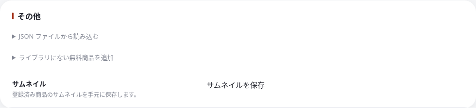

## 4. 商品を分類する

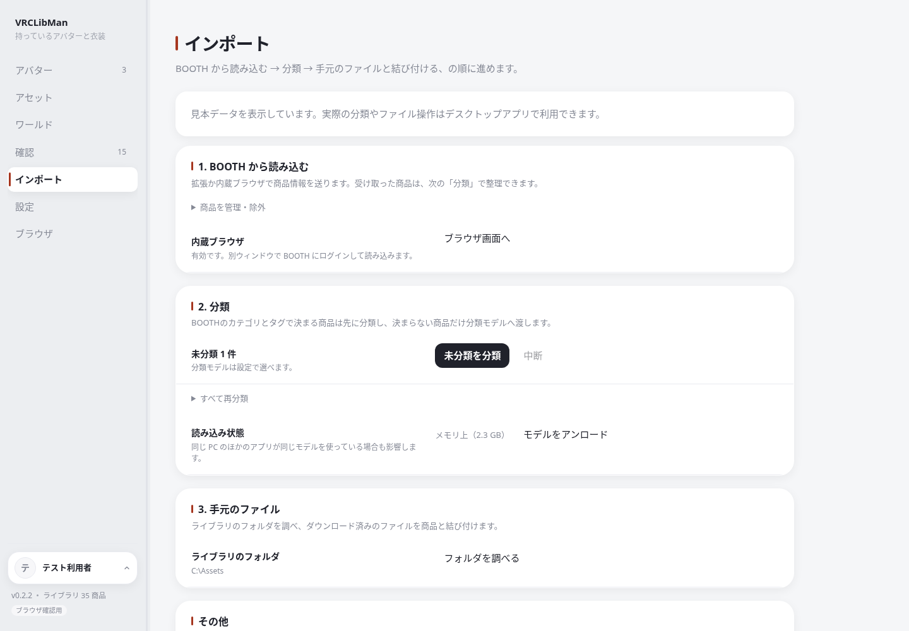

内蔵ブラウザの「ライブラリ全取得」が最後まで終わったときと、拡張から商品情報を受け取ったときは、続けて自動で分類します。そのときは次の操作は要りません。JSON から読み込んだときも、初期状態では続けて分類します。

自分で分類するときは、次のようにします。

1. 「インポート → 2. 分類」を開きます。
2. 「未分類を分類」を押します。
3. 進捗を確認し、終了したら「アバター」「アセット」「ワールド」を見ます。

BOOTH のカテゴリとタグで決まる商品は先に分類し、決まらない商品はタイトルと説明文から分類します。対応アバターは、説明文の「対応アバター」欄、タイトルの【◯◯対応】、ダウンロードファイルやバリエーションの名前から決めます。ファイル名は説明文に対応欄が無いときだけ使い、対応表で 1 体に決まる名前だけを結び付けます。分類はすべて端末内で行い、商品情報を外部へ送りません。止めたい場合は「中断」を押します。

以前の版で分類した商品は、更新後に「古い分類を再分類」で今の規則に合わせられます。以前の版で設定した Ollama・Apple・クラウド(APIキー) の分類設定は使わなくなり、更新後の初回起動で削除します。クラウドの APIキーを保存していた場合は、OS の資格情報からも削除します。Ollama 本体と取得したモデルは VRCLibMan からは消さないので、不要ならアンインストールしてください。

分類ルールが更新され、古い分類がある場合は「古い分類を再分類」が表示されます。古いルールで分類された商品だけを見直せます。

すでに分類済みの商品もまとめて見直す場合は、折りたたまれた「すべて再分類」を開き、同名のボタンを押します。既存の結果を上書きすることがあるため、確認画面が出ます。手動で固定したカテゴリや対応アバターは維持されます。

分類の結果は自動で反映されます。何がどこへ振り分けられたかは「分類記録」で見られます。違っていたときは[直す手順](#6-分類結果を見る直す)に進んでください。

## 5. アバター・アセット・ワールドを見る

左メニューの上にあるボタンでメニューを閉じると、アイコンだけの細い表示になります。アイコンにマウスを置くと項目名が出ます。同じボタンでもとに戻せ、開閉の状態は次回も引き継がれます。

### アバター一覧

左メニューの「アバター」には、次の2種類が分かれて表示されます。

- **持っているアバター**：アバター本体の商品に結び付いた項目です。
- **衣装の対応先**：衣装や小物の対応先として出てきた名前です。そのアバターを所持している意味ではありません。

名前の検索と、素体別／一覧の切り替えで探せます。「持っているアバターだけ表示」にチェックを入れると、「衣装の対応先」は一覧から外れます。

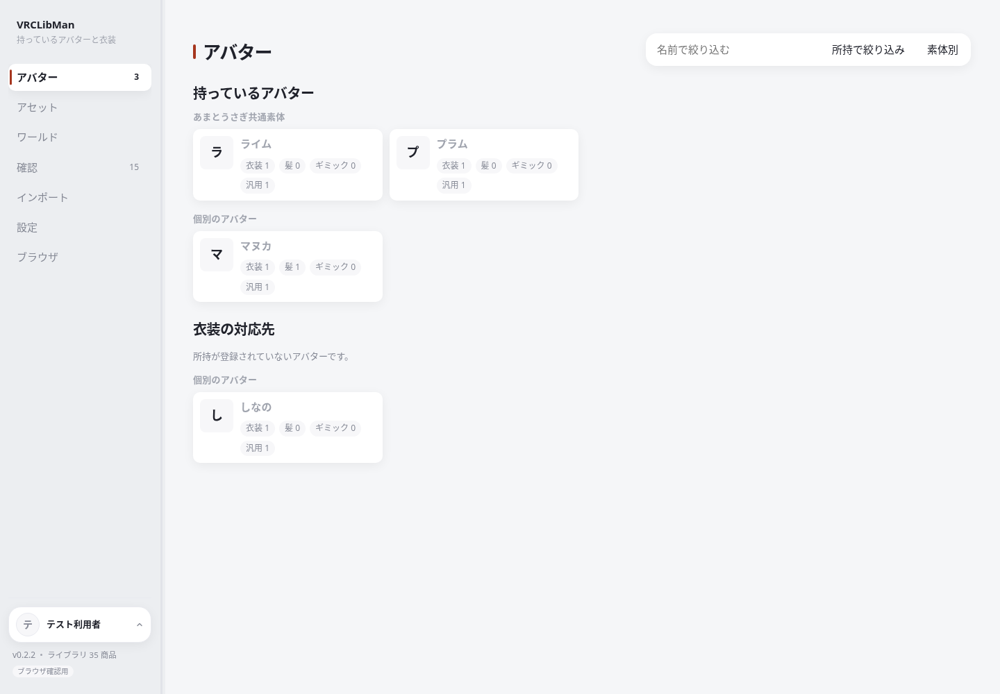

### アバター詳細

アバターのカードを押すと、衣装・髪・アクセサリなどをカテゴリ別に見られます。

別のアバターを見るには、左上の「アバター一覧へ」で一覧に戻り、見たいアバターを選びます。

- 同じ素体として対応表に登録されている場合は、共通素体経由の商品も表示します。髪は頭部の対応が必要なので、共通素体だけでは表示しません。そのアバターへの対応を登録すると髪の一覧に表示されます。
- 特定アバターに結び付かない汎用品は「汎用」を開くと見られます。
- 「BOOTH」から商品ページを開けます。
- ファイルが見つかっている場合は、「保存先を開く」などの操作が表示されます。
- 「アイテムを追加」で登録済みの商品を検索し、このアバターに手動で結び付けられます。

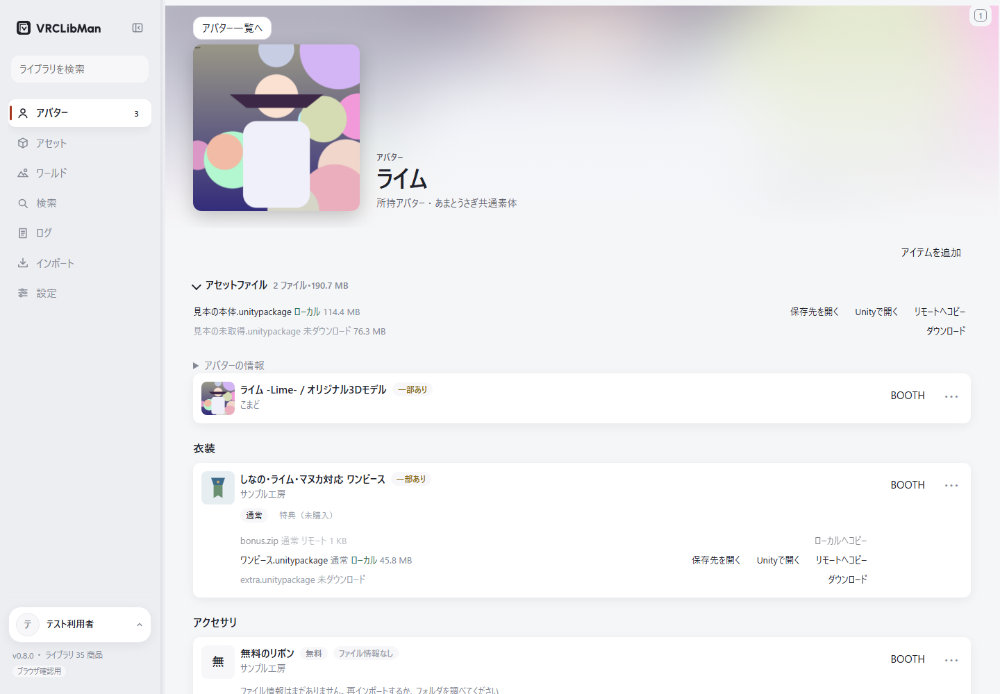

### ほかの衣装を探す

アバター詳細の「ほかの衣装」を開くと、そのアバターや共通素体への対応が登録されていない衣装を探せます。対応先が未登録の衣装も含みます。もちふぃった～などで調整する際の候補として使えます。

商品名・ショップ名・商品 ID で検索できます。商品は30件ずつ表示し、続きは「さらに表示」で開きます。通常の対応衣装と共通素体経由の衣装、汎用欄にある衣装は重ねて表示しません。

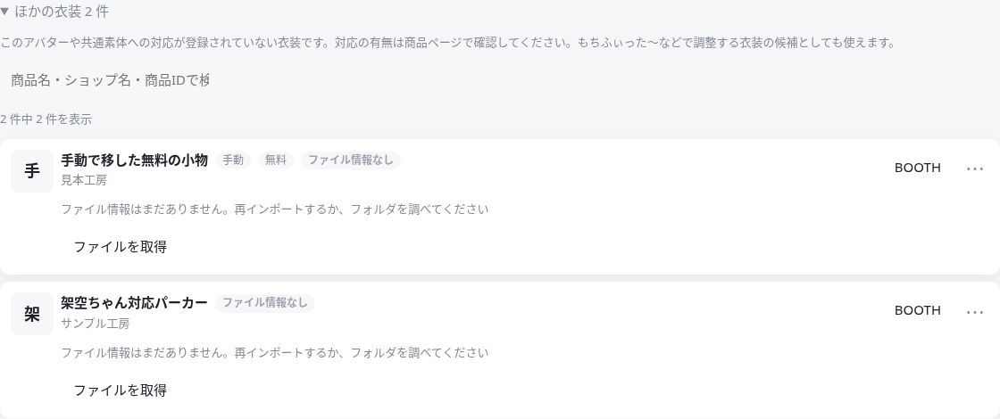

### ファイルの状態

ファイルの状態は次のように表示されます。

| 表示           | 意味                                                                             |
| -------------- | -------------------------------------------------------------------------------- |
| ローカル       | この PC でファイルが見つかっています。                                           |
| リモート       | 設定したリモートライブラリでファイルが見つかっています。                         |
| 一部あり       | 商品内のファイルで保存状態が分かれています。商品を開いて各行を確認します。       |
| 未ダウンロード | 登録されたファイルが保存先で見つかっていません。                                 |
| 不明           | ファイル情報や商品との関連付けが不足しています。再インポートやフォルダの調査で補います。 |
| 確認中         | リモート側の保存状態を調べています。                                             |

### ライブラリ全体から探す

左メニュー上の検索欄、または左メニューの「検索」からは、アバター・アセット・ワールドをまとめて探せます。アバターは名前・素体名・別名、商品は商品名・ショップ名・説明（保存した全文）・ジャンル名・商品 ID が対象です。読み込めない種類があるときはその種類を名前で示し、「もう一度読み込む」で読み直せます。読み込めた種類はそのまま探せます。空白で区切ると、すべての語を含むものだけが出ます。各画面の中の絞り込みとは別で、ジャンルをまたいで探したいときに使います。

### アセットとワールド

左メニューの「アセット」では、アバターとは別に衣装・髪・ギミックなどをジャンル別に探せます。「ワールド」ではワールド用の商品をジャンル別に見られます。どちらも商品名・ショップ名で絞り込めます。

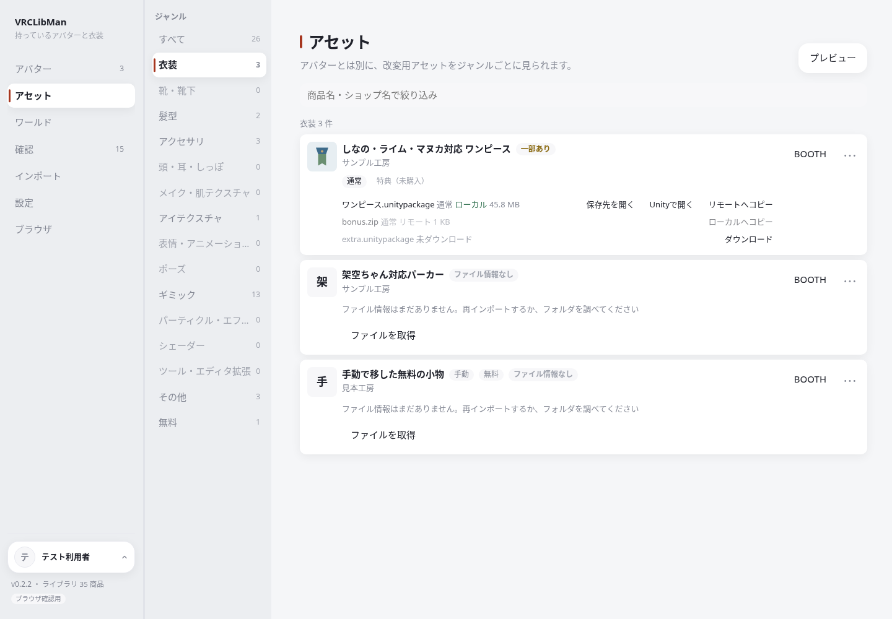

「無料」には、まだ手元にファイルがない無料商品が集まります。手元にファイルができると各ジャンルへ移ります。手動で移動した商品は移動先に残ります。「ジャンル未設定」は、ジャンルが決まっていない商品です。

商品カードの「⋯ → 移動」から、アセットやワールドのジャンルへ移動できます。商品カードをジャンル欄へドラッグして移すこともできます。移動した分類は固定され、「⋯ → 自動分類に戻す」で固定を解除できます。ワールドはアバター詳細やアバター一覧の件数には表示しません。

### アセットとワールドのプレビュー

「アセット」と「ワールド」の右上「プレビュー」を押すと、画面の右に右パネルが開き、「プレビュー」タブに大きい画像が出ます。はじめは閉じています。開いているかどうかは覚えておきます。どの画面でも Ctrl+Shift+B（Mac は ⌘⇧B）で右パネルを開閉できます。

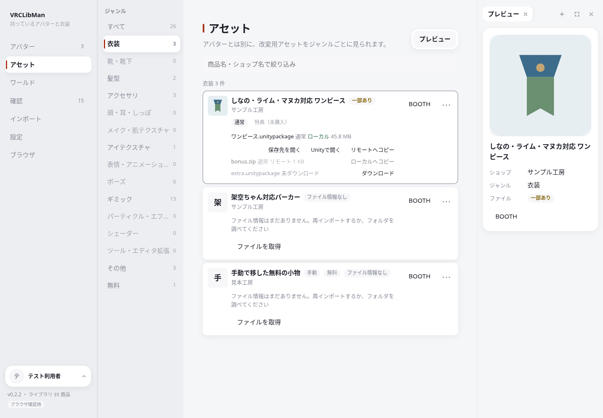

右パネルの上にはタブが並びます。「＋」でタブを足し、タブの「×」で閉じます。右上のボタンで、小窓として浮かせる、全面表示、右パネルを閉じる操作ができます。タブの並びは覚えておきます。固定のタブは「プレビュー」と「ファイル」です。内蔵ブラウザが有効なときは「＋ → ブラウザ」でページタブを複数追加できます（[右パネルのブラウザ](#右パネルのブラウザwindowsmacoslinux)）。

商品をクリックするか、商品にキーボードフォーカスがあるときに Space を押すと、その商品が選ばれます。矢印キーで一覧の中を移動します。欄には画像、ショップ名、ジャンル、ファイルの状態、商品ページを開く「BOOTH」があります。右パネルの左端をドラッグすると幅が変わり、ダブルクリックで元の幅に戻ります。ハンドルにフォーカスがあるときは左右の矢印でも幅が変わります。幅は覚えておきます。ドラッグでのジャンル移動や、右端のその他の操作はそのまま使えます。

年齢制限の商品は、大きい画像を自動では読みません。「表示する」を押したときだけ読みます。読み込めないときは、一覧と同じ小さい画像を出します。

### 狭い窓の右パネル

窓幅が 1000px 未満のときは、右パネルをアプリの窓の中に浮かぶ小窓として表示します。広い窓でも、右上の「ウィンドウとして浮かせる」で同じ表示にでき、「右側に戻す」で元の列に戻せます。

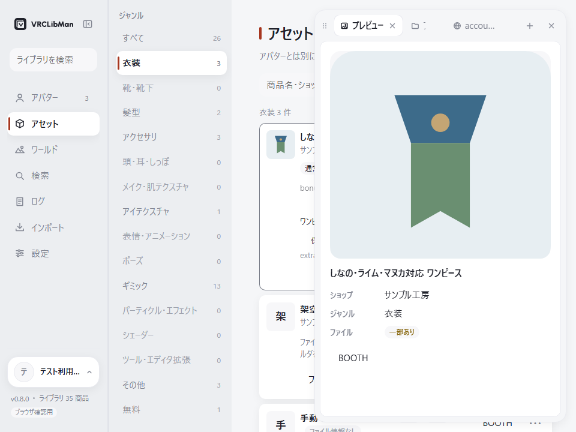

- 小窓を開いたままでも下の一覧を操作できます。一覧で選んだ商品は、そのままプレビューに出ます。
- タブ列の空いたところか左端のつまみをドラッグすると動かせます。左右の辺、下の辺、下の角をドラッグすると大きさが変わります。
- つまみかタブ列の空いたところをダブルクリックすると、右上に戻ります。つまみにフォーカスがあるときは、矢印キーで動かし、Shift + 矢印キーで大きさを変えられます。
- 小窓はいつも窓の内側に収まります。窓を縮めると詰めて表示し、広げると置いた位置に戻ります。置いた位置はアプリを閉じるまで覚えておきます。
- Esc や外側のクリックでは閉じません。閉じるときは「×」か Ctrl+Shift+B（Mac は ⌘⇧B）を使います。

### 右パネルのファイルタブ

右パネルの「＋」から「ファイル」を選ぶと、ファイルを見るタブが開きます。はじめはライブラリフォルダを表示します。このタブは見るだけで、ファイルの書き込み・削除・移動はしません。

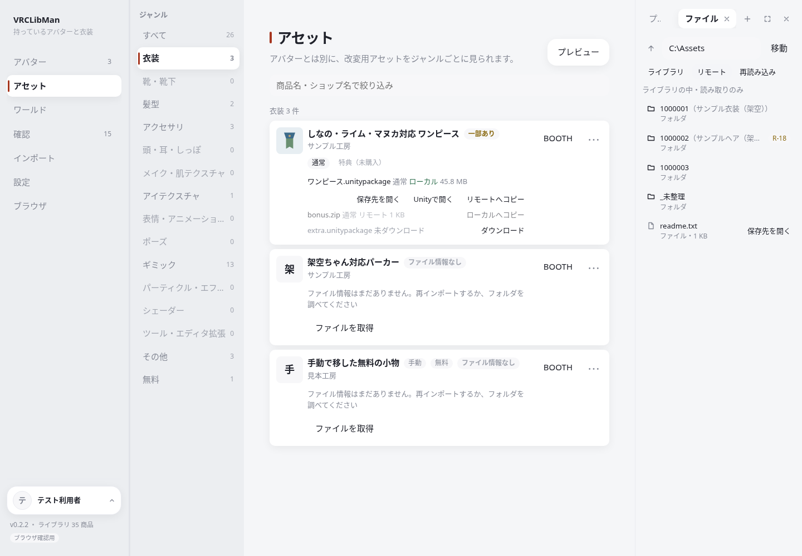

- 上の欄にいまの場所が出ます。パスを書き換えて「移動」か Enter を押すと、その場所へ移ります。見つからないパスはエラーになります。「..」を含むパスは開けないので、上の階層へは「↑」を使います。
- 「ライブラリ」でライブラリフォルダへ戻ります。リモートのライブラリが設定されていてつながるときは「リモート」も出ます。「再読み込み」で一覧を読み直します。
- ライブラリの外のフォルダも見られます。欄の下に「ライブラリの中」か「ライブラリの外」かが出ます。
- フォルダを押すと中に入ります。zip を押すと、展開せずに中身の一覧を出します。zip の中のフォルダにも入れます。
- ライブラリ（またはリモートライブラリ）の中では、商品IDだけのフォルダには `1234567（商品名）` のように商品名を添えます。フォルダ名は変えず、表示だけです。上のパスの欄も実際の名前のままです。アプリに登録されていない ID のフォルダは、名前だけを出します。長い商品名は省略し、マウスを重ねると全体が出ます。スキャンやダウンロードで商品と紐づいたファイルにも、別のフォルダにあるときは同じように添えます。年齢制限の商品には一覧と同じ「R-18」を付けます。
- ファイルの「保存先を開く」で、エクスプローラー（Mac は Finder）にそのファイルを選んだ状態で開きます。
- ショートカットやシンボリックリンクは「リンク」として出し、中へはたどりません。
- 1 つのフォルダに 2000 件、1 つの zip に 5000 件を超えると、先頭だけを出します。
- 開いている場所はアプリを閉じるまで覚えておきます。設定には保存しません。
- ライブラリ（またはリモートライブラリ）の中の `.unitypackage` と zip には「Unityで開く」が出ます。zip の中の `.unitypackage` にも出ます。下の「Unity で開く」を見てください。

### Unity で開く

`.unitypackage` を、設定で選んだ Unity に渡します。Unity の Import 画面が開くので、そこで中身を確かめてインポートします。プロジェクトへの書き込みは Unity の Import 画面で利用者が決めます。アプリはプロジェクトに書き込みません。

「Unityで開く」は次の場所に出ます。

- アバター詳細・アセットの商品カードで、「ローカル」の zip・`.unitypackage` の行
- 商品カードの「手元のファイル」の zip・`.unitypackage`
- 右パネルのファイルタブ（ライブラリかリモートライブラリの中だけ）

zip は展開しません。中の `.unitypackage` だけを一覧し、選んだものだけをアプリのキャッシュ（`unity-import/<商品ID>/`）に取り出して渡します。取り出したファイルは、次にアプリを起動したとき、1 日より古いものから消します。

- Unity パッケージが 1 つだけなら、確認なしでそのまま開きます。
- 2 つ以上あるときは、ファイル名とサイズの一覧から選びます。「選んだものをインポート」か「すべてインポート」を押すと、一覧の順に 1 件ずつ Unity に渡します。

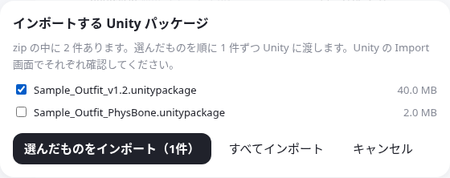

- Unity が起動していないときは、1 件目で Unity が起動します。起動を待つあいだ残りは渡さず、「続きを Unity に渡す」が出ます。Unity が開いてから押すと、残りを渡します。
- 既定の Unity を設定していないとき、または設定した Unity が見つからないときは、「設定を開く」で「設定 → Unity」へ移れます。今回だけ OS の関連付け（ダブルクリックと同じ）で開くこともできます。
- Unity の起動状態は 1 件だけのときも最大 20 秒確認します。異常終了したときはエラーを表示し、残りのパッケージを渡しません。
- 1 つの Unity パッケージは 8 GB まで取り出せます。

Windows で動作を確認しています。Mac と Linux の「Unityで開く」は、実機ではまだ確認していません。

### 購入履歴を見る

左メニューの「購入履歴」で、BOOTH で購入した注文を新しい順に見られます。使わなくても、ほかの機能はそのまま使えます。

1. 内蔵ブラウザで BOOTH にログインしておきます。
2. 「購入履歴を読み込む」を押します。内蔵ブラウザのタブが BOOTH の購入履歴を 1 ページずつ開き、そのあと注文の詳細を 1 件ずつ読みます。ギフトとして贈ったかどうかは詳細にしか出ないことがあるので、すべての注文の詳細を読みます。注文が多いと時間がかかります。途中で「中止」しても、次は続きから読みます。
3. 2 回目からは、新しい注文と、詳細をまだ読んでいない注文だけを読みます。

内蔵ブラウザで購入を終えたときは、購入完了ページから自動で記録します（「取得したアセットの自動登録」がオンのとき）。日時と金額は、すぐ後にその注文の詳細を読んで埋めます。読めなかった注文には「詳細は未取得」と出て、次に「購入履歴を読み込む」を押したときに埋まります。

| 操作 | 内容 |
| --- | --- |
| 金額を表示 | 商品代金、BOOST、お支払金額を出します。初期状態では出しません。 |
| 検索欄 | 購入履歴の中だけを探します。ページをまたいで、商品名・ショップ・注文番号・ラベル・アバター名で探せます。 |
| ラベル・アバター・年 | 絞り込みます。「ギフト（贈った）」も選べます。 |
| 商品の「ラベル」 | 自分で作ったラベルを付け外しします。新しいラベルもここで作れます。名前の変更と削除は、一覧の下の「ラベルを管理」で行います。 |
| アセットを見る | ライブラリにある商品を、アプリの「アセット」（ワールドなら「ワールド」、アバター本体なら「アバター」）で開きます。贈っただけの商品など、ライブラリに無い商品には出ません。 |
| 注文の右上の選択欄 | ギフトの判定を「贈ったギフト」か「自分用」に直します。「自動判定」で元に戻ります。 |

「アバター別」タブでは、対応アバターごとの件数と金額を、全期間か年ごとに見られます。行を押すと、その購入だけを「履歴」で表示します。数え方は次のとおりです。

- 対応アバターは今の分類から数えます。分類を直すと集計も変わります。
- 複数のアバターに対応する商品は、それぞれのアバターに全額で数えます。合計では 1 回だけ数えます。
- 同じ素体のほかのアバターには広げません。アバター本体の購入は、そのアバターに数えます。
- 贈ったギフトはアバター別に入れません。送料と手数料も数えません。

保存するのは、注文番号、注文日時、金額、商品名、ショップ名、ギフトかどうか、付けたラベルです。支払方法、住所、ギフト用 URL は保存しません。購入履歴はデータ移行の ZIP にも入ります。

## 6. 分類結果を見る・直す

分類は自動で反映され、確認の操作は要りません。結果が気になるときだけ、ここを使います。

### 分類記録を見る

左メニューの「ログ」から「分類記録」タブを開きます。実行ごとに、日時、きっかけ（BOOTH 取り込み、再分類など）、使った分類器、変更件数が並びます。行を開くと、商品ごとのカテゴリと対応アバターの変更前 → 変更後、信頼度、対応表に無かった名前が見られます。

1 つの商品の履歴を見たいときは「商品で絞り込む」に商品名か商品 ID を入れるか、商品カードの「⋯ → 分類記録を見る」を使います。

### 分類を元に戻す

記録を見て違っていた変更は、明細の「元に戻す」で実行前の状態に戻せます。

- その後の分類や手動の修正で状態が変わっている場合は戻せません。ボタンの横に理由が出ます。
- 対応アバターを手動で固定した商品は戻せません。
- 戻した商品も、次の取り込みや再分類で同じ分類が再び適用されることがあります。自動の分類から守りたいときは、次の手順で手動で修正してください。

### 商品を手動で修正する

1. 商品カードの「⋯ → 分類を編集」を開きます。商品カードが無い未分類の商品は、「インポート → 1. BOOTH から読み込む → 商品を管理・除外」で表示を「未分類」にし、「編集」を押します。
2. 「カテゴリ」を選び、必要に応じて「ジャンル」を選びます。「自動」を選ぶと、手で固定したジャンルを外し、カテゴリ・タグ・文面から選び直します。自動で決まっているジャンルは「自動（いまは〇〇）」と表示されます。
3. 特定アバターを対象としない商品では「汎用」を設定します。
4. 「対応アバター」の検索欄で名前を探し、正しいアバターを選びます。名前か別名に一致しない場合は「一致するアバターがありません」と出ます。文字の並びが似ているだけの候補は「名前が似ている候補」として分けて出るので、名前を確かめてから選んでください。不要な選択は名前の「×」で外せます。
5. 「保存」を押します。

変更した項目は手動の固定になり、自動の分類では変わらなくなります。商品修正の「保存」は、設定画面の自動保存とは別です。

アバター本体の商品に「所持アバターにする」が出る場合は、本体であることを確認してから使います。アバター以外に分類された本体商品も、商品カードの「⋯ → アバター本体として登録」から登録できます。

### 対応表に無い名前

対応表に無いアバター名は結び付けず、「分類記録」の「未収録の名前」にまとまります。「一覧をコピー」で一覧を取り出せるので、対応表の不足として GitHub の Issue に報告できます。

手元で足したいときは「設定 → 対応表を編集」を使います。表示名、別名、素体などを変更して「保存」を押してください。対応表の編集にも保存操作が必要です。

同じアバターの項目が重複した場合は、そのアバター詳細の「既存のアバターへ統合」で統合先を選べます。別名や対応する商品もまとめられるため、同じアバターか確認して実行してください。

## 7. 商品を除外・元に戻す

VRChat・Unity に関係のない商品など、管理対象から外したい商品には「除外」を使います。「その他」という分類は管理対象のカテゴリなので、除外とは役割が異なります。

1. 「インポート → 1. BOOTH から読み込む → 商品を管理・除外」を開きます。
2. 商品名・ショップ名・商品 ID で探します。
3. 対象商品の「除外」を押します。

商品カードでは「⋯ → 管理対象から除外」からも同じ操作ができます。

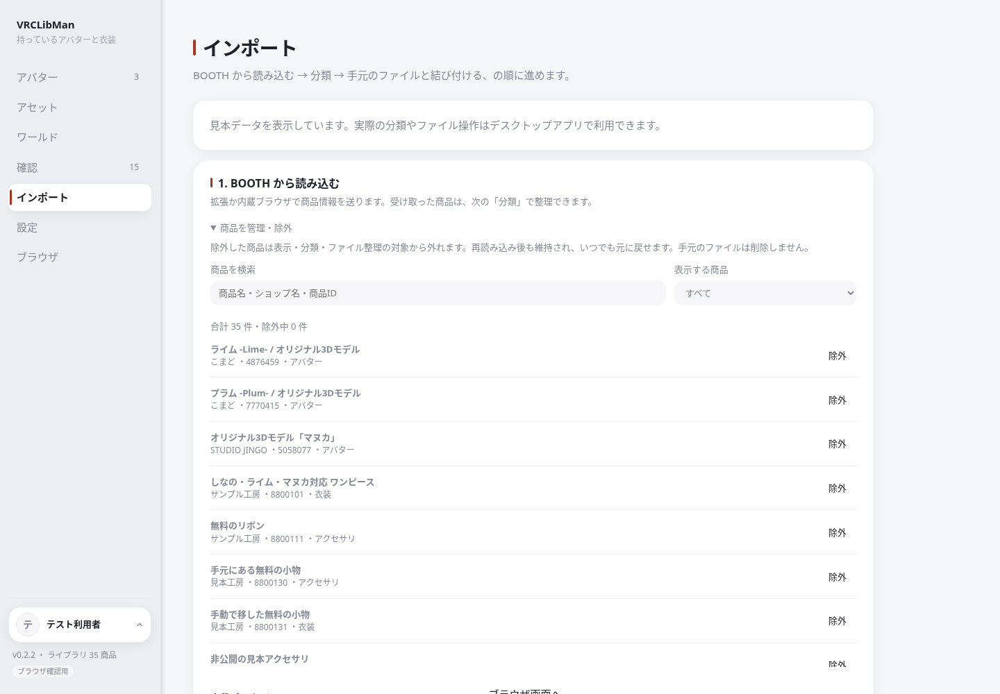

除外した商品は、通常の一覧・確認・分類・ファイルと商品の関連付け・ダウンロードの自動整理の対象から外れます。商品情報や手元のファイルは削除しません。再インポートしても除外は維持されます。

元に戻す場合は、同じ管理欄で「表示する商品」を「除外中」にし、対象商品の「元に戻す」を押します。

## 8. 手元のファイルを結び付ける

### ライブラリのフォルダを設定する

1. 「設定 → ライブラリとダウンロード → ライブラリのフォルダ」で「選ぶ」を押します。
2. ダウンロード済みの zip や unitypackage などを置いているフォルダを選びます。
3. 保存とフォルダの調査が終わったら、アバター詳細や「インポート → 3. 手元のファイル → 商品未設定のファイル」を見ます。

ホームフォルダ全体やドライブ・ボリュームの直下ではなく、アセット用のフォルダを指定してください。

あとでファイルを追加した場合は、「インポート → 3. 手元のファイル → フォルダを調べる」で調べ直せます。ここでも設定と同じライブラリフォルダを使います。

フォルダの調査では、ファイル名や商品 ID などから商品との対応を探します。既存ファイルを一括で移動する操作ではありません。

### ダウンロード済みファイルを登録する

取り込み対象は `.zip` と `.unitypackage` のみです（拡張子の大文字・小文字は区別しません）。それ以外のファイルやフォルダ自体は照合・登録しません。

「インポート → 3. 手元のファイル → 取り込み元を選ぶ」で Downloads や別のフォルダを選びます。事前に BOOTH の商品・ファイル情報を読み込んでください。完全一致したファイルは選択済みになります。同名の候補が複数ある場合や、ブラウザが ` (1)` などを付けたファイルは、商品を選択して確認します。サイズが異なる候補は選べません。バージョン表記は除去しません。

取り込み方法は「元の場所のまま登録」が既定です。「ライブラリへコピー」を選ぶと、設定したライブラリの商品IDフォルダへコピーして登録します。元のファイルは残し、同名ファイルは上書きしません。登録済みの保存先も置き換えません。同じ配布ファイルのコピーが複数ある場合は1件だけ選択してください。失敗した場合は件数と理由を表示し、コピー後に登録が失敗した場合もコピー済みのファイルは残します。

### 商品未設定のファイルを手動で結び付ける

1. 「インポート → 3. 手元のファイル → 商品未設定のファイル」を開きます。
2. 候補が正しい場合は「候補『商品名』に結び付ける」を押します。
3. 別の商品なら検索欄で探し、「商品を選ぶ」から選択して「選択した商品に結び付ける」を押します。

手動で結び付けた情報は、調べ直したときも維持されます。

## 9. ダウンロードを自動整理する

自分で開始した対象ファイルのダウンロードを、ライブラリフォルダへ商品別に移す機能です。既定はオフです。

1. 「設定 → ライブラリとダウンロード」でライブラリフォルダを選びます。
2. 「ダウンロードを自動整理」をオンにします。
3. 拡張を使う場合は、ポップアップの「ダウンロードしたファイルを自動整理する」の状態も確認します。
4. BOOTH で必要なファイルを自分でダウンロードします。

自動登録がオンの内蔵ブラウザでクリックした対象ダウンロードは、ダウンロードフォルダ内の `VRCLibMan-*` フォルダに保存されます。自動整理がオンなら、商品を特定できた対象ファイルをライブラリフォルダの商品 ID 別のフォルダへ移します。拡張経由では `Downloads/VRCLibMan/<商品ID>/` が整理前の保存先になります。自動整理オフの内蔵ブラウザでは、保存先に置いたまま商品へ登録します。

### 内蔵ブラウザのログインを使ってファイルを取得する

商品情報を読み込んだあと、購入済みファイルをアプリの商品カードから1件ずつ取得できます。

1. [内蔵ブラウザで BOOTH にログイン](#内蔵ブラウザで読み込む)し、ライブラリから商品情報とファイル情報を読み込みます。「ライブラリ全取得」ではファイル本体はダウンロードしません。
2. 「設定 → ライブラリとダウンロード」でライブラリフォルダを選び、「ダウンロードを自動整理」をオンにします。
3. 分類後、「アセット」「ワールド」またはアバター詳細で商品を探します。アバター本体の商品もアバター詳細に表示されます。
4. 商品カードの未ダウンロードのファイル行で「ダウンロード」を押します。未ダウンロードが4件以上ある場合は「未ダウンロード ○件」を開いて選びます。ライブラリのフォルダか自動整理の設定が足りないときは、ダウンロードを始めずに案内が出ます。案内の「設定を開く」で「設定 → ライブラリとダウンロード」へ移れます。
5. 「ライブラリに移しました」と表示されたら完了です。画面上部の通知とファイル行の「保存先を開く」で、移した先のフォルダを開けます。画面上部の通知は数秒から十数秒で自動的に消えます（マウスを重ねている間は消えません。「×」でもすぐ閉じられます）。リモートライブラリを設定している場合も、ダウンロードしたファイルの行は「ローカル」に切り替わります。複数ファイルは必要なものを1件ずつ選びます。

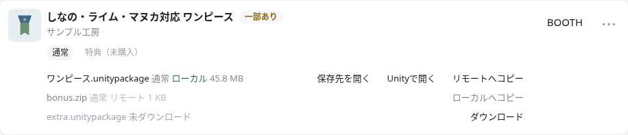

ログイン状態が有効なら、内蔵ブラウザのウィンドウを開いたままにする必要はありません。ログイン切れや年齢確認の案内が出たら内蔵ブラウザで確認し、もう一度押してください。ファイル情報やダウンロード番号がない場合は購入ライブラリの商品情報を読み込み直してください。内蔵ブラウザから取得・整理できる形式は `unitypackage`、`zip`、`rar`、`7z`、`vrm` です。

ファイルの「リモート」行は「ローカルへコピー」で取り込めます。商品情報の読み込みではファイルは取得されず、商品の購入や一括ダウンロードも行いません。

### ファイル情報がない無料商品

商品カードに「ファイル情報なし」と出ている商品は、内蔵ブラウザが有効なら「ファイルを取得」を押せます。BOOTH の公開情報から無料配布のファイルを探し、見つかったファイルを未ダウンロードの行として加えます。このボタンではファイル本体はダウンロードせず、購入や BOOTH のライブラリへの追加もしません。そのあと、上と同じように行の「ダウンロード」を1件ずつ押します（BOOTH へのログインが必要です）。有料の商品や、無料配布のファイルがない商品では「無料でダウンロードできるファイルはありません」と表示され、何も変わりません。有料の商品は購入後にライブラリから読み込んでください。

アプリ停止中などに残ったファイルは、「インポート → ダウンロードフォルダに残っているファイル」に理由とともに表示されます。設定を確認して「このファイルを移す」を押します。安全に特定できないファイルは、そのまま残ります。

## 10. リモートライブラリを使う

NAS や共有フォルダにもファイルを置く場合に使います。

1. OS から共有フォルダへアクセスできる状態にします。Mac では共有をマウントします。
2. 「設定 → ライブラリとダウンロード → リモートライブラリ」でパスを指定します。
3. アバター詳細を開き、ファイルの状態を確認します。保存先の設定を変更すると、それまでの確認結果を破棄し、新しい場所で確認し直します。

- 「リモート」の行では「ローカルへコピー」で手元へ取り込めます。
- 「ローカル」の行では、リモート先に接続できる場合に「リモートへコピー」が使えます。

手動コピーは押したファイル単位です。保存元と保存先が同じファイルを指している場合や、同じ中身のファイルがすでにある場合は、ファイルを変更せずに完了します。同じ名前の別のファイルがある場合は、大きさを示して置き換えてよいかを確認し、「OK」を選んだときだけ置き換えます。自動でコピーしたい場合は、リモートフォルダを指定して「リモートへ自動同期」をオンにします。既定はオフです。

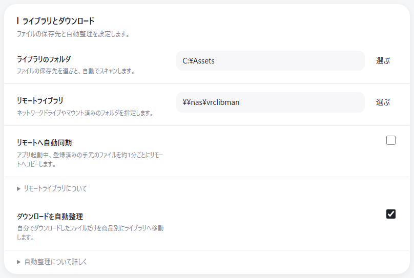

自動同期はアプリの起動中、登録済みの手元のファイルを約1分ごとにリモートの商品 ID フォルダへコピーします。除外商品と未登録ファイルは対象外です。同名ファイルは上書きせず、ファイルの削除やリモートからの自動取得は行いません。保存先を変更すると自動同期はオフになります。共有先に接続できないときは後で再試行します。

設定の「リモートへ自動同期」の下には、最後の確認の内訳が出ます。同じ名前の別のファイルがあってコピーしなかったもの（手元とリモートの大きさ付き）、コピーに失敗したもの（理由付き）、手元のファイルが見つからなかったもの、リモートの元の場所から消えたものを、それぞれ件数とファイルの一覧で確認できます。「今すぐ再試行」で、約1分を待たずに確認し直せます。

## 11. 設定を変更する

一般設定の項目は、変更すると自動で保存・適用されます。対応表の編集には「保存」が必要です。文字入力は少し待って保存されます。「保存中…」や保存エラーが出ている場合は、表示を確認してください。

### Unity

「設定 → Unity」で、unitypackage を開くときに使う Unity を選べます。Unity を複数入れている場合に、どのバージョンで開くかを決めておくための設定です。VRChat のプロジェクトで使っているバージョンを選んでください。

- 「既定の Unity」：見つかった Unity から選びます。「未設定」に戻すこともできます。選んだ Unity 本体のパスが下に表示されます。
- 「再検出」：Unity を入れ直したり追加したりしたあとに押します。
- 「参照…」：一覧に無い Unity を、本体のファイルで指定します。Windows は `Unity.exe`、Mac は `Unity.app`、Linux は `Unity` を選びます。

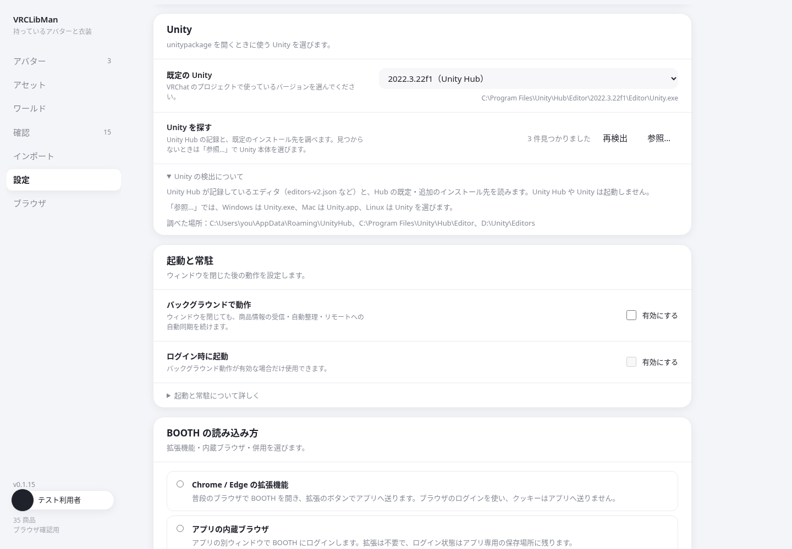

検出では、Unity Hub が記録しているエディタの一覧（`editors-v2.json` と旧形式の `editors.json`）と、Hub のインストール先を読みます。Unity Hub や Unity は起動しません。

| OS      | Unity Hub の記録                      | 既定のインストール先                                       |
| ------- | ------------------------------------- | ---------------------------------------------------------- |
| Windows | `%APPDATA%\UnityHub`                  | `C:\Program Files\Unity\Hub\Editor\<版>\Editor\Unity.exe`     |
| Mac     | `~/Library/Application Support/UnityHub` | `/Applications/Unity/Hub/Editor/<版>/Unity.app`           |
| Linux   | `~/.config/UnityHub`                  | `~/Unity/Hub/Editor/<版>/Editor/Unity`                     |

ここで選んだ Unity は「Unityで開く」で使います（「5. アバター・アセット・ワールドを見る → Unity で開く」）。

Hub で別のインストール先（`secondaryInstallPath.json`）を設定している場合は、その場所も調べます。Mac 版と Linux 版の検出は、実機ではまだ確認していません。

画面は標準デザインに統一されています。ライト／ダークはOSの設定に従います。設定の目次は「ライブラリ → Unity → 起動と常駐 → デザイン → 更新設定 → BOOTH → バージョン情報 → 対応表を編集 → デバッグ」の順です。

選択中の商品カードは、細いグレーの全周枠で表示します。

### 対応表とバージョン

| 場所・操作                                     | 用途                                                               |
| ---------------------------------------------- | ------------------------------------------------------------------ |
| バージョン情報 → バージョン                   | アプリ、推奨する拡張、最後に通信した拡張の版を確認します。         |
| バージョン情報 → アプリの更新                 | 公開された最新版を確認・ダウンロードし、再起動して適用します。     |
| バージョン情報 → 同梱の対応表 → 対応表を更新 | 対応表の更新を取得します。                                         |
| 対応表を編集                                   | アバターの別名や素体を追加・修正します。最後に「保存」を押します。 |
| デバッグ → メンテナンス → 初期データを追加   | 不足している初期データを追加します。                               |

初期データには、作者の商品説明で共通素体と確認できたアバターの組み合わせ（あまとうさぎ共通素体、まめふれんず共通素体、MARUBODY、YM Body など）が入っています。アプリを更新すると、新しく加わった素体の組み合わせと、既存の組み合わせに新しく加わったアバター（例: あまとうさぎ共通素体のソルト）だけが自動で追加されます。自分で消した素体は、自動では戻りません。戻したい場合は「初期データを追加」を押してください。

対応表を更新・編集すると、商品の対応アバターは自動で見直されます。通常は「対応表を再適用」を押す必要はありません。この操作はファイルと商品の関連付けには使いません。

拡張を更新するときは、新しい zip を展開し、ブラウザの拡張機能管理画面で読み込み直してください。アプリと拡張は別のバージョン番号です。

アプリの更新は「更新を確認 → 更新をダウンロード → 再起動して更新」の順です。サイドバー下部にも進捗が出ます。「起動時にアップデートを確認」をオンにしたときだけ、起動時に GitHub へ1回確認します（既定はオフ）。それ以外は手動の確認だけで、自動ダウンロード・再起動はしません。ライブラリと設定は引き継がれます。作業が終わってから再起動してください。署名を確認できない場合は適用せず停止します。「リリース一覧」から手動で更新することもできます。v0.1.7 以前からは、対応版を一度手動でインストールしてください。

### アセットの更新を確認する

設定の「アセットの更新設定」で「全商品をまとめて確認対象にする」をオンにすると、登録済みの商品と今後追加する商品をまとめて対象にできます。個別のチェックを外すとその商品だけ対象から外し、全体をオフにすると全商品の許可を解除します。件数制限はなく、除外した商品は対象に含めません。対象一覧は商品名・BOOTH ID・結果で絞り込み、50件ずつ表示します。

商品を個別に追加する場合は、登録済みの商品を選び「確認対象に追加」を押します。「今すぐ確認」を押すと、内蔵ブラウザが有効なら BOOTH ライブラリから最新のファイル情報も読み直して商品カードへ反映し、あわせて公開の商品説明と無料ファイル一覧の変化を確認します。新しく追加されたファイルは商品カードの上部に「新しいファイル」として表示され、BOOTH の一覧から外れた未ダウンロードの旧ファイルは「以前のファイル」に折りたたまれます。候補を見たら商品カードからダウンロードするか、「BOOTH で確認」で商品ページを開き、「確認済みにする」で今の情報を次の基準にします。確認対象が1件以上あるときは、サイドバーのアカウント欄の上にも「アセットの更新を確認」ボタンが出ます。押すと「今すぐ確認」と同じ確認を実行します。対象や全取得の有無はこの設定に従います。

「アプリ起動中、許可した商品を1日1回自動確認する」は初期状態でオフです。有効にすると、アプリが動いている間だけ定期確認し、候補があればアプリ内で通知します。全体設定、または商品ごとのチェックをオフにすると確認を止められます。実行中は「確認を停止」も使えます。既に始まった通信は完了する場合があります。

候補の通知や、未確認件数が出ている左メニューの「ログ」から「アセット更新」タブを開けます。検出した日時と変更前・変更後のファイルを確認できます。詳しくは [アセット更新記録](docs/asset-update-log.md) を参照してください。

有料ファイルの更新、同じ番号・名前のままの差し替え、商品説明の8000字以降は判定できません。「変更なし」は比較できる公開情報の範囲に限ります。商品説明だけの変更も「更新候補」として表示するので、実際のアセット更新かどうかは商品ページで確認してください。取得失敗は変更なしと区別し、前回の候補を残します。ログインや年齢確認を自動で通過することはありません。ダウンロードと適用は自動では行いません。

## 12. 困ったとき

| 症状                                   | 確認すること                                                                                                                         |
| -------------------------------------- | ------------------------------------------------------------------------------------------------------------------------------------ |
| 内蔵ブラウザが表示されない | 「設定 → BOOTH」で内蔵ブラウザが有効か確認します。Windows / macOS / Linux では右パネルのページタブも確認します。小窓を動かしている間はページが隠れ、置くと戻ります。 |
| 購入後の分類を後回しにした | 画面左下の「取得した商品の分類」から再開します。新しい商品が届くと確認を開き直します。再起動しても分類待ちは残ります。 |
| 拡張から商品が届かない                 | アプリが起動しているか、ペアリングコードが一致するかを確認します。送れずに JSON が保存された場合は、インポート画面から読み込めます。 |
| ペアリングコードが表示されない         | 「設定 → BOOTH → BOOTH の読み込み方」で「Chrome / Edge の拡張機能」か「両方使う」を選びます。                                                |
| 拡張のバージョンが「未確認」           | 新しい拡張を読み込み直し、アプリへ通信させてから設定画面を確認します。                                                               |
| 商品はあるのにファイルが出ない         | 商品情報の読み込みとファイル保存は別です。ファイルの保存先を確認し、ライブラリフォルダを調べ直します。                               |
| ファイル名が番号だけになっている | 内蔵ブラウザで購入ライブラリを読み込み直します。拡張を使う場合は最新版で「このページを送る」または「ライブラリをすべて送る」を使います。                             |
| 内蔵ブラウザからファイルを取得できない | 内蔵ブラウザのログイン、ライブラリフォルダ、自動整理を確認し、必要なら商品情報を読み込み直します。設定が足りないときに出る案内の「設定を開く」から設定へ移れます。年齢確認はブラウザで行ってください。 |
| ダウンロードの自動整理が動かない       | 自動整理とライブラリフォルダの設定を確認します。インポート画面に残ったファイルの理由も確認してください。                             |
| 全取得のあとに分類されない             | 中止したときや、ログイン切れ・BOOTH の応答待ちで途中停止したときは分類しません。「インポート → 2. 分類」の「未分類を分類」を押します。 |
| 分類や対応先が違う                     | 商品カードの「⋯ → 分類を編集」で修正して保存するか、「ログ → 分類記録」で元に戻します。                                                     |
| 読み込んだ商品が見当たらない           | 「商品を管理・除外」で除外中かを確認します。未分類の絞り込みやワールド側も確認してください。                                           |
| 設定に「未保存の設定があります」と出る | 同じ画面のエラーを確認し、フォルダや端末名などを直します。修正した内容は再び自動保存されます。                                |

公開終了や年齢確認が必要な商品などは、説明を取得できないことがあります。商品ページで確認できた情報をもとに手動で修正してください。

## 13. データの保存とバックアップ

商品情報・分類・対応表・設定は、次のアプリデータフォルダに保存されます。

| OS      | アプリデータフォルダ                                  |
| ------- | ----------------------------------------------------- |
| Windows | `%APPDATA%\app.vrclibman.desktop` |
| macOS | `~/Library/Application Support/app.vrclibman.desktop` |
| Linux | `$XDG_DATA_HOME/app.vrclibman.desktop`（未設定時は `~/.local/share/app.vrclibman.desktop`） |

バックアップするときは、バックグラウンド動作も含めてアプリを終了してから、アプリデータフォルダと、設定したライブラリフォルダをそれぞれコピーしてください。リモートにも独自のファイルがある場合は、そちらもバックアップします。

商品情報・分類・設定・ブックマークは `library.sqlite`、保存したサムネイルは `thumbs`、大きいプレビュー画像は `previews` に入っています。内蔵ブラウザのログイン状態は別の WebView データストアにあり、この DB のコピーだけでは引き継げません。商品ファイルの実体は、指定したライブラリフォルダなどにあります。アプリをアンインストールしても、アプリデータは自動では削除されません。

商品情報と分類は端末内で管理します。保存・通信・削除の案内は、アプリの「設定 → バージョン情報 → プライバシー」と、拡張ポップアップ最下部の「プライバシー」から確認できます。BOOTH へのアクセスなどの詳しい通信内容は、[README の「データと通信」](README.md#データと通信)を参照してください。
