# VRCLibMan の使い方

VRCLibMan は、BOOTH の商品情報と手元のファイルを結び付け、アバターごとに衣装・髪・小物などを探せるアプリです。ワールドもまとめて管理できます。

基本の流れは **「BOOTH から商品情報を読み込む → 分類する → 手元のファイルを結び付ける → 必要な箇所を確認・修正する」** です。商品情報の読み込みと、商品のファイルをダウンロードする操作は別々です。

このガイドはアプリ v0.1.13、拡張 v0.1.15 の画面と操作をもとにしています。

> 画面のデータは説明用のサンプルです。商品画像の代わりに名前の頭文字を表示しています。モデルの利用可否や接続状態は環境によって異なります。

## 目次

- [1. 準備する](#1-準備する)
- [2. 初回セットアップ](#2-初回セットアップ)
- [3. BOOTH から商品情報を読み込む](#3-booth-から商品情報を読み込む)
- [4. 商品を分類する](#4-商品を分類する)
- [5. アバター・アセット・ワールドを見る](#5-アバターアセットワールドを見る)
- [6. 分類結果を確認・修正する](#6-分類結果を確認修正する)
- [7. 商品を除外・元に戻す](#7-商品を除外元に戻す)
- [8. 手元のファイルを結び付ける](#8-手元のファイルを結び付ける)
- [9. ダウンロードを自動整理する](#9-ダウンロードを自動整理する)
- [10. リモートライブラリを使う](#10-リモートライブラリを使う)
- [11. 設定を変更する](#11-設定を変更する)
- [12. 困ったとき](#12-困ったとき)
- [13. データの保存とバックアップ](#13-データの保存とバックアップ)

## 1. 準備する

### アプリをインストールする

[GitHub Releases](https://github.com/KeisXR/VRCLibMan/releases) から、お使いの OS 向けの配布物をダウンロードします。

| 環境                             | 配布物                                 | 導入方法                                                                                            |
| -------------------------------- | -------------------------------------- | --------------------------------------------------------------------------------------------------- |
| Windows                          | `VRCLibMan_<version>_x64-setup.exe`    | インストーラを起動して案内に従います。Windows 10 では WebView2 が別途必要になる場合があります。     |
| Apple Silicon Mac・macOS 14 以降 | `VRCLibMan_<version>_aarch64.dmg`      | dmg を開き、アプリを「アプリケーション」へ移して起動します。                                        |
| Chrome / Edge の拡張             | `vrclibman-booth-export-<version>.zip` | 展開してブラウザに読み込みます。[拡張の導入手順](#拡張をインストールしてつなぐ)を参照してください。 |

配布物は未署名で、Mac 版は未公証です。OS の確認画面が出る場合は、取得元を確認してから OS の案内に従ってください。Intel Mac 向けの配布物はありません。

### 分類用モデルを用意する

通常は、同じ PC に [Ollama](https://ollama.com/) をインストールして起動します。VRCLibMan の画面から、使うモデルを選んで取得できます。

| モデル       | 選び方                 | ダウンロード容量の目安 | メモリの目安 |
| ------------ | ---------------------- | ---------------------- | ------------ |
| `qwen3.5:9b` | 推奨・新規設定の既定値 | 約 6.6〜7.6 GB         | 16 GB 以上   |
| `qwen3.5:4b` | 軽量な選択肢           | 約 3.3〜4.0 GB         | 8 GB 以上    |
| `gemma4:12b` | その他の選択肢         | 約 7.5 GB              | 16 GB 以上   |

容量とメモリは目安で、モデルの量子化や同時に動かすアプリによって変わります。更新前に保存したモデル選択は引き継がれます。

対応する Mac では、Apple Intelligence のオンデバイスモデルも選べます。アプリが macOS 27.2 以上で利用可能と判定した場合に使えます。この方法を選ぶ場合、Ollama のモデル取得は不要です。

## 2. 初回セットアップ

### 分類用のモデルを選ぶ

1. VRCLibMan を起動し、「分類用のモデル」でモデルを選びます。
2. 未導入の場合は「ダウンロードする」を押し、容量の目安を確認して取得します。
3. 導入済みになったら「次へ」を押します。取得をあとにする場合は「スキップして次へ」で進めます。

「その他のモデル」では、導入済みモデルを選ぶか、モデル名を入力できます。選択だけではダウンロードは始まりません。

Apple のモデルが使える環境では、「Apple のオンデバイスモデルを使う」から進めます。

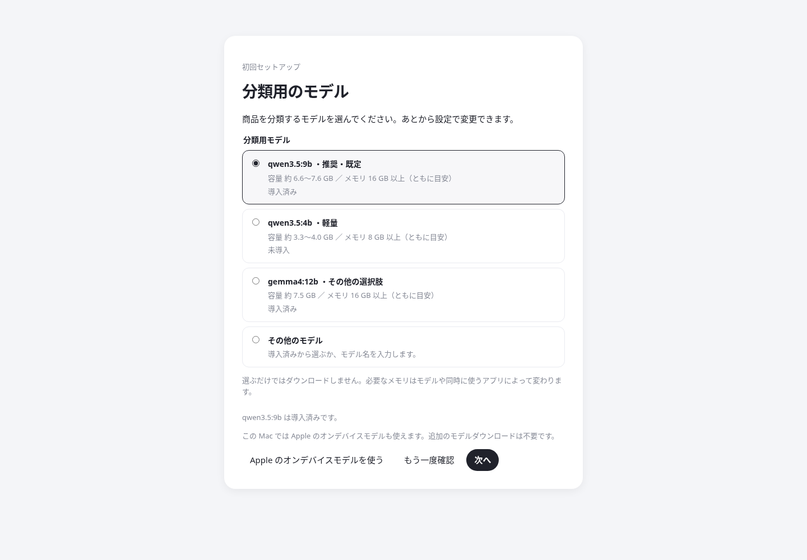

### BOOTH の読み込み方を選ぶ

| 選択肢                   | 使い方                                                                                    |
| ------------------------ | ----------------------------------------------------------------------------------------- |
| Chrome / Edge の拡張機能 | 普段のブラウザで BOOTH にログインし、拡張のボタンから商品情報を送ります。既定の方法です。 |
| アプリの内蔵ブラウザ     | アプリ専用の別ウィンドウで BOOTH にログインして読み込みます。                             |
| 両方使う                 | 拡張と内蔵ブラウザを使い分けます。それぞれのログイン状態は別です。                        |

選択はその場で保存されます。内蔵ブラウザを選ぶ場合は、画面に表示される説明を読んで有効にしてください。

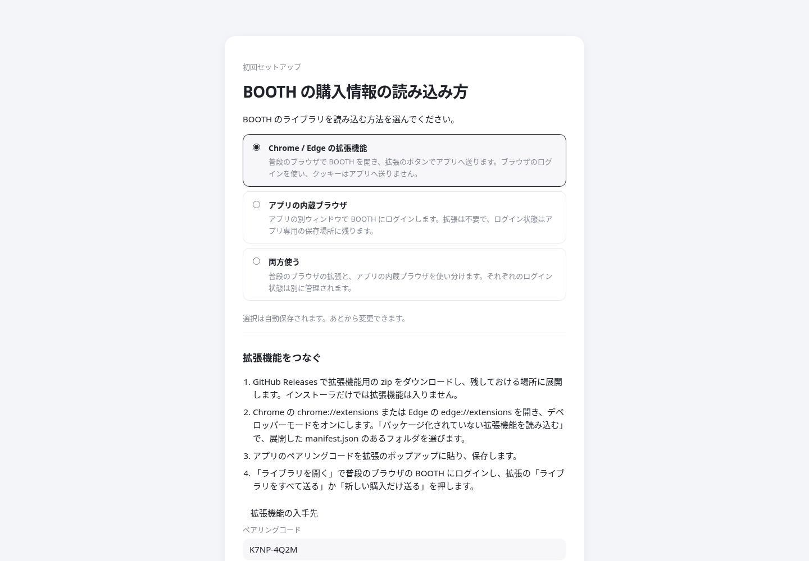

### 閉じたあとの動きを選ぶ

続く画面で、バックグラウンド動作とログイン時の起動を選びます。迷う場合は「あとで設定で選ぶ」で始められます。どちらも既定はオフです。

- **バックグラウンドで動作**：ウィンドウを閉じても、商品情報の受信、自動整理、リモートへの自動同期を続けます。トレイまたはメニューバーから開き直したり終了したりできます。
- **ログイン時に起動**：バックグラウンド動作がオンの場合に使えます。PC へのログイン時、ウィンドウを出さずに起動します。

セットアップは「設定 → データ → メンテナンス → セットアップを再表示」から開き直せます。

## 3. BOOTH から商品情報を読み込む

左メニューの「インポート」を開きます。読み込み、分類、フォルダの調査を上から順に進められます。

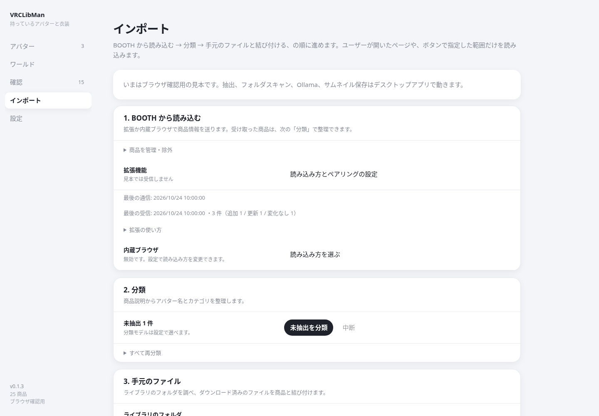

### 拡張をインストールしてつなぐ

1. Releases の拡張 zip を、残しておける場所に展開します。アプリのインストールとは別に行います。
2. Chrome では `chrome://extensions`、Edge では `edge://extensions` を開きます。
3. 「デベロッパーモード」または「開発者モード」をオンにします。
4. 「パッケージ化されていない拡張機能を読み込む」を選び、展開した **`manifest.json` が入っているフォルダ** を指定します。
5. アプリの「設定 → BOOTH の読み込み方」で「Chrome / Edge の拡張機能」または「両方使う」を選びます。
6. 表示された「ペアリングコード」をコピーし、ブラウザの拡張ポップアップへ貼り付けて「コードを保存して接続を確認」を押します。

アプリを起動した状態で使ってください。コードを作り直した場合は、拡張側にも新しいコードを保存します。

### 商品情報を送る

1. 拡張の「ライブラリを開く」から [BOOTH の購入ライブラリ](https://accounts.booth.pm/library) を開き、ログインします。
2. 拡張のポップアップで、目的に合うボタンを押します。

| ボタン                 | 用途                                                                                                 |
| ---------------------- | ---------------------------------------------------------------------------------------------------- |
| このページを送る       | 今開いている商品ページやライブラリページを読み込みます。特定商品の情報を更新したいときにも使います。 |
| ライブラリをすべて送る | 購入ライブラリ・ギフト・無料ダウンロードをページごとに読み込みます。初回の読み込みに使います。                           |
| 新しい購入だけ送る     | 各一覧で登録済みの商品に出会うまで、新しい商品を読み込みます。購入後の追加に使います。                           |

「新しい購入だけ送る」は、各一覧で登録済みの商品が現れると、その一覧の読み込みを止めます。古い未登録商品も含めて読み直す場合や、既存商品の説明・ファイル情報を更新する場合は、「ライブラリをすべて送る」または対象ページの「このページを送る」を使ってください。

送信後、アプリのインポート画面で「拡張機能の使い方・受信履歴」を開き、「最後の受信」の日時と件数を確認できます。

BOOTH へのアクセス間隔は初期値の **1.0秒** を基本にしてください。読み込みが制限された場合は表示された案内に従います。利用上の注意は [README](README.md#利用規約とアカウントへの注意) にあります。

### 内蔵ブラウザで読み込む

1. 「設定 → BOOTH の読み込み方」で「アプリの内蔵ブラウザ」または「両方使う」を選び、説明を確認します。
2. 左メニューの「ブラウザ」を開き、「ブラウザを開く」を押します。
3. 開いた別ウィンドウで、BOOTH にログインします。
4. アプリのブラウザ画面へ戻り、目的に合う操作を選びます。

| ボタン                         | 用途                                                 |
| ------------------------------ | ---------------------------------------------------- |
| ライブラリを開く               | 別ウィンドウを購入ライブラリへ移動します。           |
| 今開いているページをインポート | 別ウィンドウで表示中の BOOTH ライブラリのページを読み込みます。         |
| ライブラリ全取得               | ライブラリ、ギフト、無料ダウンロードをページごとに読み込みます。 |
| 中止                           | 全取得を途中で止めます。                             |

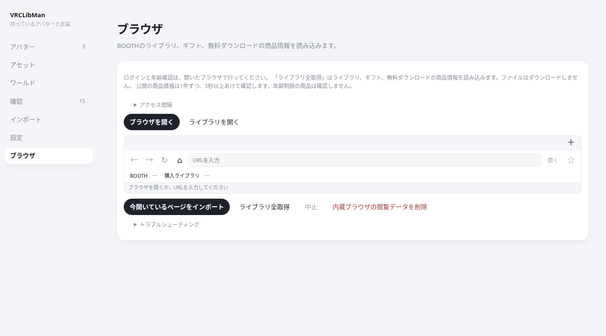

読み込みが終わったら、アプリに商品が追加されたことを確認します。ログイン切れなどで途中停止した場合は、ログイン状態を確認してから読み込み直してください。

別ウィンドウの「インポート」も、選択中の BOOTH ライブラリページを読み込めます。商品ページや一般サイトの内容は、この操作ではインポートできません。商品ページを送りたい場合は拡張を使います。全取得やダウンロードの処理中は、タブ切り替えとページ移動を一時的に無効にします。

共有 PC などでログイン状態を残したくない場合は、「内蔵ブラウザの閲覧データを削除」を使います。内蔵ブラウザで開いたすべてのサイトのログイン状態と閲覧データを削除し、商品情報・分類結果・ブックマークは残します。

内蔵ブラウザのタブ・ブックマーク・ショートカット

アドレスバーから一般のサイトも開けます。「＋」でタブを追加し、各タブの「×」で閉じます。最後のタブを閉じるとブラウザウィンドウも閉じます。タブ列の空いている場所をドラッグして、ウィンドウを移動できます。

「☆」でブックマークを保存し、ブックマークバーの「⋯」から編集・削除できます。Ctrl（macOS は Command）を押しながらクリックすると、新しいタブで開きます。ブックマークは再起動後も残りますが、タブは復元しません。

| ショートカット | 操作 |
| --- | --- |
| Ctrl / Command + T | 新しいタブ |
| Ctrl / Command + W | タブを閉じる |
| Ctrl / Command + L | アドレスバーへ移動 |
| Ctrl / Command + R | 再読み込み |
| Windows: Alt + ← / →、macOS: Command + [ / ] | 戻る・進む |

タブは 20 個、ブックマークは 200 件まで保存できます。

### JSON ファイルから読み込む

拡張から直接送信できない場合は、保存された JSON を使えます。

1. 「インポート → その他 → JSON ファイルから読み込む」を開きます。
2. JSON をドロップするか、「ファイルを選ぶ」で指定します。
3. 表示された追加・更新・変化なしの件数を確認します。

追加・更新があった場合、初期状態では続けて自動分類します。あとで分類する場合は、JSON を読み込む前に、読み込み後に分類するチェックを外してください。

### ライブラリにない無料商品を追加する

無料商品のページを拡張で送ると、その商品を登録できます。URL を使う場合は「インポート → その他 → ライブラリにない無料商品を追加」を開き、無料であることを確認した商品の URL を入力して登録します。

URL の追加では、商品 ID を無料商品として登録します。価格の確認や商品情報の取得は行わないため、商品名・説明・ファイル情報は、その商品ページを拡張から送って補ってください。

### 商品画像を表示・保存する

読み込んだ商品情報に画像の URL が含まれると、商品カードや、アバター本体の商品に結び付いたアバターの一覧に画像が表示されます。商品ファイルをダウンロードする前でも表示できます。画像がない場合や取得できない場合は、名前の頭文字を表示します。

画像を端末にも保存したい場合は、「インポート → その他 → サムネイルを保存」を押します。取得できた画像はアプリデータの `thumbs` に保存され、保存済みの画像が優先して表示されます。画像の取得先との通信が必要です。

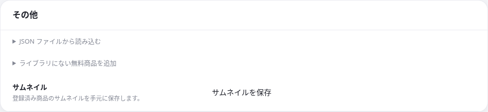

## 4. 商品を分類する

1. 「インポート → 2. 分類」を開きます。
2. 「未分類を分類」を押します。
3. 進捗を確認し、終了したら「アバター」「アセット」「ワールド」「確認」を見ます。

BOOTH のカテゴリとタグで決まる商品は先に分類し、決まらない商品を設定した端末内のモデルで分類します。止めたい場合は「中断」を押します。

分類ルールが更新され、古い分類がある場合は「古い分類を再分類」が表示されます。古いルールで分類された商品だけを見直せます。

すでに分類済みの商品もまとめて見直す場合は、折りたたまれた「すべて再分類」を開き、同名のボタンを押します。既存の結果を上書きすることがあるため、確認画面が出ます。手動で固定したカテゴリや対応アバターは維持されます。

分類が終わっても、対応表にない名前などは「確認」に残ります。[確認・修正の手順](#6-分類結果を確認修正する)に進んでください。

## 5. アバター・アセット・ワールドを見る

### アバター一覧

左メニューの「アバター」には、次の2種類が分かれて表示されます。

- **持っているアバター**：アバター本体の商品に結び付いた項目です。
- **衣装の対応先**：衣装や小物の対応先として出てきた名前です。そのアバターを所持している意味ではありません。

名前の検索、「所持で絞り込み」、素体別／一覧の切り替えで探せます。

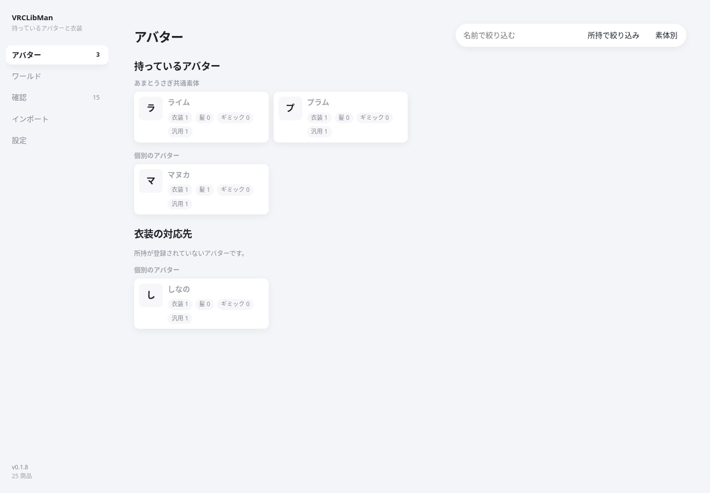

### アバター詳細

アバターのカードを押すと、衣装・髪・アクセサリなどをカテゴリ別に見られます。

- 同じ素体として対応表に登録されている場合は、共通素体経由の商品も表示します。
- 特定アバターに結び付かない汎用品は「汎用」を開くと見られます。
- 「BOOTH」から商品ページを開けます。
- ファイルが見つかっている場合は、「保存先を開く」などの操作が表示されます。
- 「アイテムを追加」で登録済みの商品を検索し、このアバターに手動で結び付けられます。

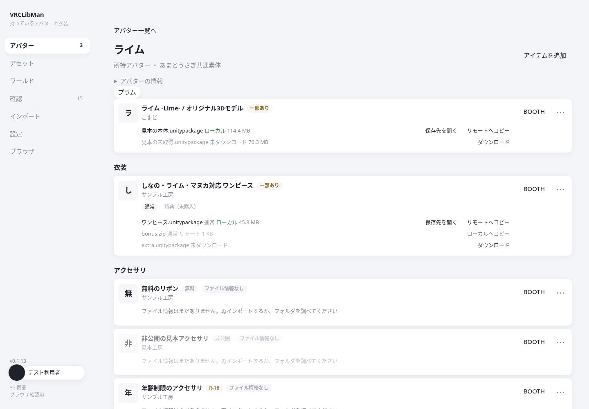

### ほかの衣装を探す

アバター詳細の「ほかの衣装」を開くと、そのアバターや共通素体への対応が登録されていない衣装を探せます。対応先が未登録の衣装も含みます。もちふぃった～などで調整する際の候補として使えます。

商品名・ショップ名・商品 ID で検索できます。商品は30件ずつ表示し、続きは「さらに表示」で開きます。通常の対応衣装と共通素体経由の衣装、汎用欄にある衣装は重ねて表示しません。

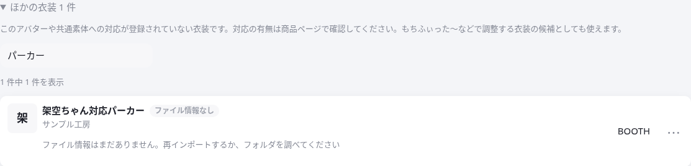

### ファイルの状態

ファイルの状態は次のように表示されます。

| 表示           | 意味                                                                             |
| -------------- | -------------------------------------------------------------------------------- |
| ローカル       | この PC でファイルが見つかっています。                                           |
| リモート       | 設定したリモートライブラリでファイルが見つかっています。                         |
| 一部あり       | 商品内のファイルで保存状態が分かれています。商品を開いて各行を確認します。       |
| 未ダウンロード | 登録されたファイルが保存先で見つかっていません。                                 |
| 不明           | ファイル情報や商品との関連付けが不足しています。再インポートやフォルダの調査で補います。 |
| 確認中         | リモート側の保存状態を調べています。                                             |

### アセットとワールド

左メニューの「アセット」では、アバターとは別に衣装・髪・ギミックなどをジャンル別に探せます。「ワールド」ではワールド用の商品をジャンル別に見られます。どちらも商品名・ショップ名で絞り込めます。

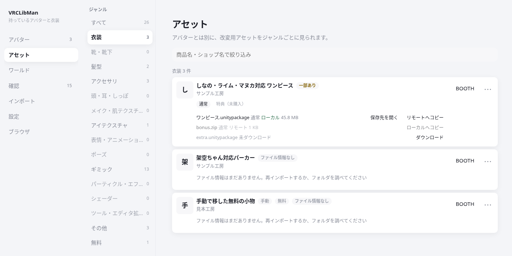

「無料」には、まだ手元にファイルがない無料商品が集まります。手元にファイルができると各ジャンルへ移ります。手動で移動した商品は移動先に残ります。「ジャンル未設定」は、ジャンルが決まっていない商品です。

商品カードの「⋯ → 移動」から、アセットやワールドのジャンルへ移動できます。商品カードをジャンル欄へドラッグして移すこともできます。移動した分類は固定され、「⋯ → 自動分類に戻す」で固定を解除できます。ワールドはアバター詳細やアバター一覧の件数には表示しません。

### アセットとワールドのプレビュー

「アセット」と「ワールド」の右上「プレビュー」を押すと、一覧の右に大きい画像が出ます。はじめはオフです。オンかオフかは覚えておきます。

商品をクリックするか、商品にキーボードフォーカスがあるときに Space を押すと、その商品が選ばれます。矢印キーで一覧の中を移動します。欄には画像、ショップ名、ジャンル、ファイルの状態、商品ページを開く「BOOTH」があります。欄の左端をドラッグすると幅が変わり、ダブルクリックで元の幅に戻ります。ハンドルにフォーカスがあるときは左右の矢印でも幅が変わります。幅は覚えておきます。ドラッグでのジャンル移動や、右端のその他の操作はそのまま使えます。

窓が狭いときは右の欄ではなく、画面の上に重なって表示されます。「閉じる」か Esc で重なりを消せます。プレビュー自体はオンのままです。

年齢制限の商品は、大きい画像を自動では読みません。「表示する」を押したときだけ読みます。読み込めないときは、一覧と同じ小さい画像を出します。

## 6. 分類結果を確認・修正する

左メニューの「確認」を開きます。

| タブ   | 対象                                             | 主な操作                                                 |
| ------ | ------------------------------------------------ | -------------------------------------------------------- |
| 未分類 | まだカテゴリが付いていない商品                   | モデルで分類するか、手動でカテゴリと対応先を設定します。 |
| 要確認 | 名前や対応先などの確認が必要な商品               | 説明を確認し、カテゴリや対応アバターを修正します。       |
| 商品未設定のファイル | フォルダ内にあるが商品と結び付いていないファイル | 正しい商品を選んで結び付けます。                         |

### 商品を手動で修正する

1. 対象商品のタイトル・説明を確認します。必要なら「BOOTH を開く」で商品ページを見ます。
2. 「カテゴリ」を選び、必要に応じて「ジャンル」を選びます。
3. 特定アバターを対象としない商品では「汎用」を設定します。
4. 「対応アバター」の検索欄で名前を探し、正しいアバターを選びます。不要な選択は名前の「×」で外せます。
5. 内容を残す場合は「保存」、確認を終えた場合は「確認済みにする」を押します。

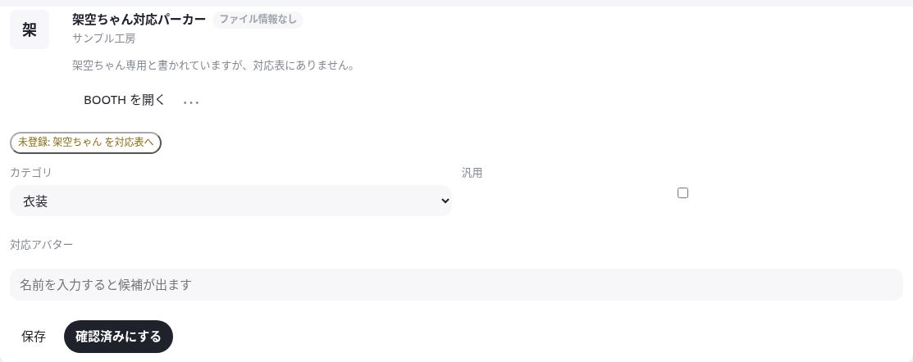

商品修正の「保存」と「確認済みにする」は、設定画面の自動保存とは別です。**商品を編集したあとは、どちらかのボタンを押してください。**

アバター本体の商品に「所持アバターにする」が出る場合は、本体であることを確認してから使います。アバター以外に分類された本体商品も、商品カードの「⋯ → アバター本体として登録」から登録できます。

### 名前を対応表に登録する

「新しいアバター候補」では、「アバターとして登録」または「既存の別名にする」を選べます。新しいアバター名なのか、登録済みアバターの別表記なのかを確認して使い分けます。

別名や素体の関係を詳しく編集する場合は、「設定 → 対応表を編集」を使います。表示名、別名、素体などを変更して「保存」を押してください。対応表の編集にも保存操作が必要です。

同じアバターの項目が重複した場合は、そのアバター詳細の「既存のアバターへ統合」で統合先を選べます。別名や対応する商品もまとめられるため、同じアバターか確認して実行してください。

## 7. 商品を除外・元に戻す

VRChat・Unity に関係のない商品など、管理対象から外したい商品には「除外」を使います。「その他」という分類は管理対象のカテゴリなので、除外とは役割が異なります。

1. 「インポート → 1. BOOTH から読み込む → 商品を管理・除外」を開きます。
2. 商品名・ショップ名・商品 ID で探します。
3. 対象商品の「除外」を押します。

確認画面や商品カードでは「⋯ → 管理対象から除外」からも同じ操作ができます。

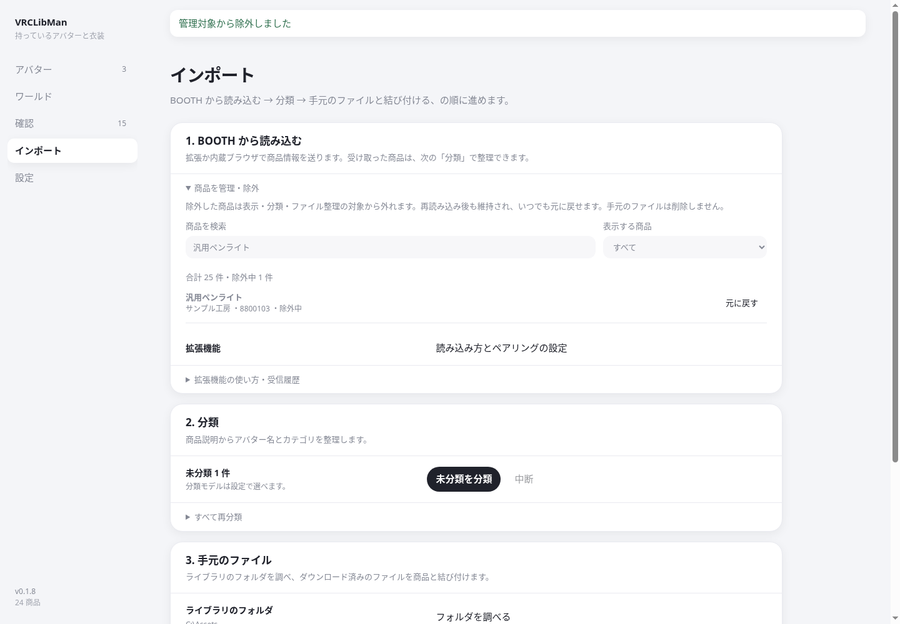

除外した商品は、通常の一覧・確認・分類・ファイルと商品の関連付け・ダウンロードの自動整理の対象から外れます。商品情報や手元のファイルは削除しません。再インポートしても除外は維持されます。

元に戻す場合は、同じ管理欄で「表示する商品」を「除外中」にし、対象商品の「元に戻す」を押します。

## 8. 手元のファイルを結び付ける

### ライブラリのフォルダを設定する

1. 「設定 → ライブラリとダウンロード → ライブラリのフォルダ」で「選ぶ」を押します。
2. ダウンロード済みの zip や unitypackage などを置いているフォルダを選びます。
3. 保存とフォルダの調査が終わったら、アバター詳細や「確認 → 商品未設定のファイル」を見ます。

ホームフォルダ全体やドライブ・ボリュームの直下ではなく、アセット用のフォルダを指定してください。

あとでファイルを追加した場合は、「インポート → 3. 手元のファイル → フォルダを調べる」で調べ直せます。ここでも設定と同じライブラリフォルダを使います。

フォルダの調査では、ファイル名や商品 ID などから商品との対応を探します。既存ファイルを一括で移動する操作ではありません。

### 商品未設定のファイルを手動で結び付ける

1. 「確認 → 商品未設定のファイル」を開きます。
2. 候補が正しい場合は「候補『商品名』に結び付ける」を押します。
3. 別の商品なら検索欄で探し、「商品を選ぶ」から選択して「選択した商品に結び付ける」を押します。

手動で結び付けた情報は、調べ直したときも維持されます。

## 9. ダウンロードを自動整理する

自分で開始した対象ファイルのダウンロードを、ライブラリフォルダへ商品別に移す機能です。既定はオフです。

1. 「設定 → ライブラリとダウンロード」でライブラリフォルダを選びます。
2. 「ダウンロードを自動整理」をオンにします。
3. 拡張を使う場合は、ポップアップの「ダウンロードしたファイルを自動整理する」の状態も確認します。
4. BOOTH で必要なファイルを自分でダウンロードします。

対象ファイルはいったん `Downloads/VRCLibMan/<商品ID>/` に置かれ、アプリが指定したライブラリフォルダへ移します。

### 内蔵ブラウザのログインを使ってファイルを取得する

商品情報を読み込んだあと、購入済みファイルをアプリの商品カードから1件ずつ取得できます。

1. [内蔵ブラウザで BOOTH にログイン](#内蔵ブラウザで読み込む)し、ライブラリから商品情報とファイル情報を読み込みます。「ライブラリ全取得」ではファイル本体はダウンロードしません。
2. 「設定 → ライブラリとダウンロード」でライブラリフォルダを選び、「ダウンロードを自動整理」をオンにします。
3. 分類後、「アセット」「ワールド」またはアバター詳細で商品を探します。アバター本体の商品もアバター詳細に表示されます。
4. 商品カードの未ダウンロードのファイル行で「ダウンロード」を押します。未ダウンロードが4件以上ある場合は「未ダウンロード ○件」を開いて選びます。
5. 「ライブラリに移しました」と表示されたら完了です。「保存先を開く」で確認できます。複数ファイルは必要なものを1件ずつ選びます。

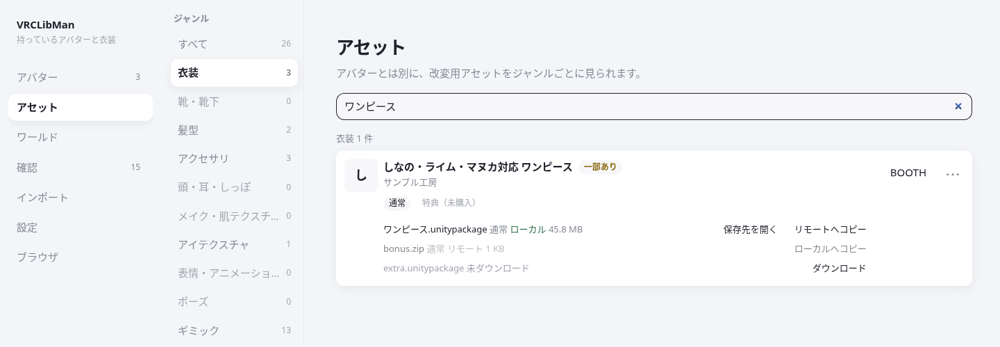

ログイン状態が有効なら、内蔵ブラウザのウィンドウを開いたままにする必要はありません。ログイン切れや年齢確認の案内が出たら内蔵ブラウザで確認し、もう一度押してください。ファイル情報やダウンロード番号がない場合は購入ライブラリの商品情報を読み込み直してください。内蔵ブラウザから取得・整理できる形式は `unitypackage`、`zip`、`rar`、`7z`、`vrm` です。

ファイルの「リモート」行は「ローカルへコピー」で取り込めます。商品情報の読み込みではファイルは取得されず、商品の購入や一括ダウンロードも行いません。

アプリ停止中などに残ったファイルは、「インポート → ダウンロードフォルダに残っているファイル」に理由とともに表示されます。設定を確認して「このファイルを移す」を押します。安全に特定できないファイルは、そのまま残ります。

## 10. リモートライブラリを使う

NAS や共有フォルダにもファイルを置く場合に使います。

1. OS から共有フォルダへアクセスできる状態にします。Mac では共有をマウントします。
2. 「設定 → ライブラリとダウンロード → リモートライブラリ」でパスを指定します。
3. アバター詳細を開き、ファイルの状態を確認します。

- 「リモート」の行では「ローカルへコピー」で手元へ取り込めます。
- 「ローカル」の行では、リモート先に接続できる場合に「リモートへコピー」が使えます。

手動コピーは押したファイル単位です。自動でコピーしたい場合は、リモートフォルダを指定して「リモートへ自動同期」をオンにします。既定はオフです。

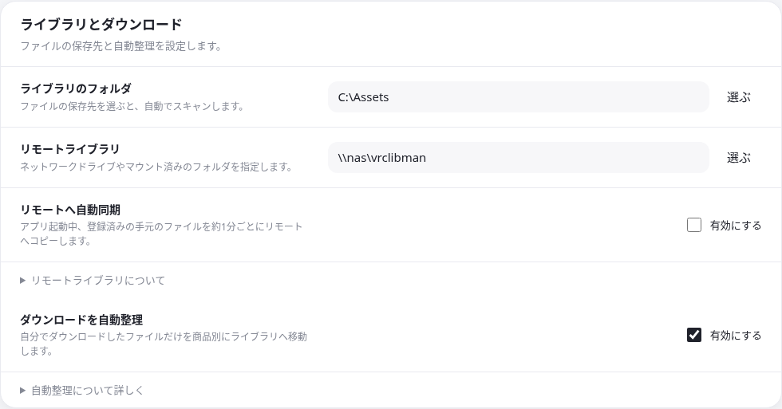

自動同期はアプリの起動中、登録済みの手元のファイルを約1分ごとにリモートの商品 ID フォルダへコピーします。除外商品と未登録ファイルは対象外です。同名ファイルは上書きせず、ファイルの削除やリモートからの自動取得は行いません。保存先を変更すると自動同期はオフになります。共有先に接続できないときは後で再試行します。

## 11. 設定を変更する

一般設定の項目は、変更すると自動で保存・適用されます。対応表の編集には「保存」が必要です。文字入力は少し待って保存されます。「保存中…」や保存エラーが出ている場合は、表示を確認してください。

### 分類方法とモデル

「設定 → 分類モデル」で分類方法を選べます。Ollama では URL、モデル、モデル取得、接続確認が表示されます。通常の URL は `http://127.0.0.1:11434` です。

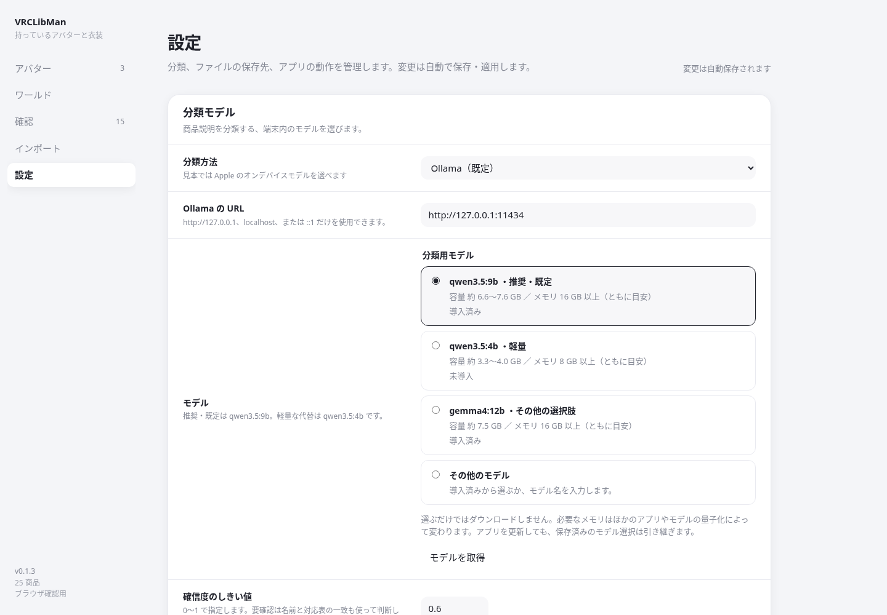

Ollama を使う場合、「分類後にモデルをアンロード」をオンにすると、分類の終了・中断・失敗後に選択中のモデルをメモリから外せます。Ollama 自体は停止しません。「モデルをアンロード」で手動でも外せます。

Apple のオンデバイスモデルを選ぶと、Ollama 関連の欄は非表示になります。Ollama へ戻すと、それまでのモデル設定が表示されます。Apple で処理できない商品は、導入済みの Ollama モデルで再試行する場合があります。

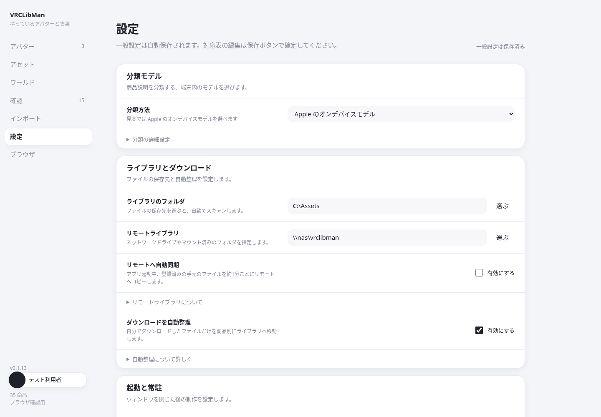

#### クラウド(APIキー)で分類する

手元でモデルを動かせない場合は、「分類方法」で「クラウド(APIキー)」を選ぶと、OpenAI 互換の API で分類できます。既定はオフで、選んだときだけ使います。利用料金は、キーを発行したサービスの規約に従います。

1. 「接続先」に API の URL を入力します。既定は `https://api.openai.com/v1` です。xAI なら `https://api.x.ai/v1` のように、`/chat/completions` の手前までを入力します。https だけを使えます。
2. 「モデル名」に、接続先で使えるモデル名をそのまま入力します。
3. 「APIキー」にキーを入力し、「保存」を押します。キーは OS の資格情報（Windows の資格情報マネージャー、macOS のキーチェーン）に保存され、画面には「保存済み」とだけ表示されます。消すときは「削除」を押します。
4. 「接続テスト」を押します。接続先のモデル一覧を取得して、キーと接続先を確認します。商品の情報は送りません。失敗したときは「認証失敗」「権限なし」「回数制限」「サーバーエラー」「タイムアウト」「接続失敗」などの種別が表示されます。

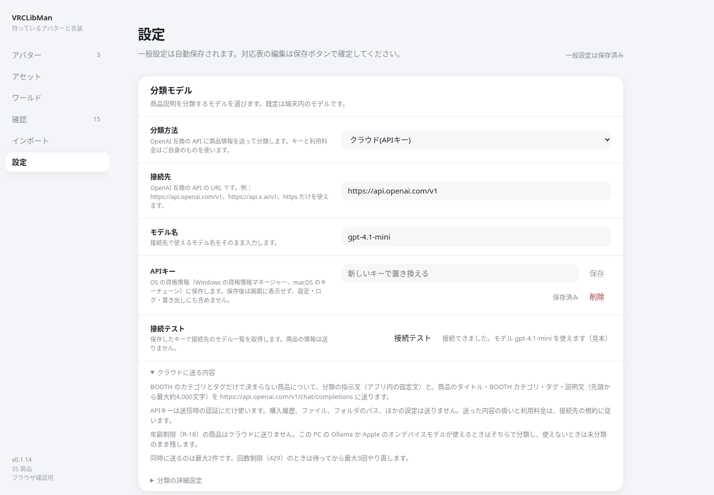

クラウドで分類するときは、BOOTH のカテゴリとタグだけで決まらない商品について、分類の指示文と、商品のタイトル・BOOTH カテゴリ・タグ・説明文（先頭から最大約4,000文字）を `接続先/chat/completions` に送ります。購入履歴、ファイル、フォルダのパスは送りません。

年齢制限（R-18）の商品はクラウドに送りません。この PC の Ollama か Apple のオンデバイスモデルが使えるときはそちらで分類し、使えないときは未分類のまま残します。分類の完了表示に、その件数が出ます。

同時に送るのは最大2件です。回数制限（429）のときは待ってから最大3回やり直し、それでも続くときはその商品を失敗にします。失敗の種別は `booth-browser.log` に、商品 ID の末尾4桁と一緒に残ります。キーや商品名は残りません。

### 対応表とバージョン

| 場所・操作                               | 用途                                                               |
| ---------------------------------------- | ------------------------------------------------------------------ |
| データ → バージョン                      | アプリ、推奨する拡張、最後に通信した拡張の版を確認します。         |
| データ → アプリの更新                    | 公開された最新版を確認・ダウンロードし、再起動して適用します。   |
| データ → 同梱の対応表 → 対応表を更新     | 対応表の更新を取得します。                                         |
| データ → メンテナンス → 初期データを追加 | 不足している初期データを追加します。                               |
| 対応表を編集                             | アバターの別名や素体を追加・修正します。最後に「保存」を押します。 |

対応表を更新・編集すると、商品の対応アバターは自動で見直されます。通常は「対応表を再適用」を押す必要はありません。この操作はファイルと商品の関連付けには使いません。

拡張を更新するときは、新しい zip を展開し、ブラウザの拡張機能管理画面で読み込み直してください。アプリと拡張は別のバージョン番号です。

アプリの更新は「更新を確認 → 更新をダウンロード → 再起動して更新」の順です。サイドバー下部にも進捗が出ます。「起動時にアップデートを確認」をオンにしたときだけ、起動時に GitHub へ1回確認します（既定はオフ）。それ以外は手動の確認だけで、自動ダウンロード・再起動はしません。ライブラリと設定は引き継がれます。作業が終わってから再起動してください。署名を確認できない場合は適用せず停止します。「リリース一覧」から手動で更新することもできます。v0.1.7 以前からは、対応版を一度手動でインストールしてください。

## 12. 困ったとき

| 症状                                   | 確認すること                                                                                                                         |
| -------------------------------------- | ------------------------------------------------------------------------------------------------------------------------------------ |
| 拡張から商品が届かない                 | アプリが起動しているか、ペアリングコードが一致するかを確認します。送れずに JSON が保存された場合は、インポート画面から読み込めます。 |
| ペアリングコードが表示されない         | 「設定 → BOOTH の読み込み方」で「Chrome / Edge の拡張機能」か「両方使う」を選びます。                                                |
| 拡張のバージョンが「未確認」           | 新しい拡張を読み込み直し、アプリへ通信させてから設定画面を確認します。                                                               |
| Ollama に接続できない                  | Ollama が起動しているか、設定の URL が同じ PC の接続先かを確認し、「接続を確認」を押します。                                         |
| モデルが未導入                         | 設定でモデルを選び、「モデルを取得」から取得します。モデル名と空き容量を確認してください。                                           |
| Apple のモデルを選べない               | 対応する Mac・OS・利用可能状態が必要です。分類方法欄の案内を確認します。                                                             |
| 商品はあるのにファイルが出ない         | 商品情報の読み込みとファイル保存は別です。ファイルの保存先を確認し、ライブラリフォルダを調べ直します。                               |
| ファイル名が番号だけになっている       | 拡張を更新し、購入ライブラリを「このページを送る」または「ライブラリをすべて送る」で再インポートします。                             |
| 内蔵ブラウザからファイルを取得できない | 内蔵ブラウザのログイン、ライブラリフォルダ、自動整理を確認し、必要なら商品情報を読み込み直します。年齢確認はブラウザで行ってください。 |
| ダウンロードの自動整理が動かない       | 自動整理とライブラリフォルダの設定を確認します。インポート画面に残ったファイルの理由も確認してください。                             |
| 分類や対応先が違う                     | 「確認」でカテゴリと対応アバターを修正し、「保存」または「確認済みにする」を押します。                                               |
| 読み込んだ商品が見当たらない           | 「商品を管理・除外」で除外中かを確認します。未分類・要確認やワールド側も確認してください。                                           |
| 設定に「未保存の設定があります」と出る | 同じ画面のエラーを確認し、モデル名・URL・フォルダなどを直します。修正した内容は再び自動保存されます。                                |

公開終了や年齢確認が必要な商品などは、説明を取得できないことがあります。商品ページで確認できた情報をもとに手動で修正してください。

## 13. データの保存とバックアップ

商品情報・分類・対応表・設定は、次のアプリデータフォルダに保存されます。

| OS      | アプリデータフォルダ                                  |
| ------- | ----------------------------------------------------- |
| Windows | `%APPDATA%\app.vrclibman.desktop`                     |
| macOS   | `~/Library/Application Support/app.vrclibman.desktop` |

バックアップするときは、バックグラウンド動作も含めてアプリを終了してから、アプリデータフォルダと、設定したライブラリフォルダをそれぞれコピーしてください。リモートにも独自のファイルがある場合は、そちらもバックアップします。

商品情報などは `library.sqlite`、保存したサムネイルは `thumbs` に入っています。商品ファイルの実体は、指定したライブラリフォルダなどにあります。アプリをアンインストールしても、アプリデータは自動では削除されません。

商品情報と分類は端末内で管理します。保存・通信・削除の案内は、アプリの「設定 → データ → プライバシー」と、拡張ポップアップ最下部の「プライバシー」から確認できます。BOOTH へのアクセスやモデル取得などの詳しい通信内容は、[README の「データと通信」](README.md#データと通信)を参照してください。
